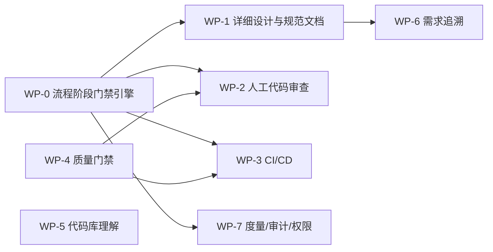

# Vernal 标准化研发流水线能力补齐工程任务书（供 Codex 直接执行）

> **前置必读（Phase 0）**：动工新增以下 WP-0 ~ WP-7 能力前，**请务必先执行 [CODEX_AUDIT_AND_REFACTOR_SPEC.md](CODEX_AUDIT_AND_REFACTOR_SPEC.md) 中的 Fix-1 ~ Fix-6**（修复现存字段错配、LoopForge `task_runs` 断链、转向并发 Bug、安全漏洞、双壳概念分裂与 `app.py` 路由拆分），避免在存量缺陷和巨石文件上继续堆代码。
>
> **背景**：实验室要求建设「架构驱动、规范约束、人机协同、质量可控」的流水线式 AI 辅助研发平台，覆盖 需求分析 → 架构设计 → 详细设计 → AI 辅助编码 → 人工代码审查 → 自动化测试 → 持续集成与交付。
> Vernal 已具备：需求摄入与 PM 规格、架构圆桌与 ADR、蓝图 DAG、多 Harness 编码、AI 独立审查、`verify_cmd` 确定性门禁、私有化部署。
> **本任务书补齐的能力**：显式流程阶段门禁（WP-0）、详细设计与规范文档（WP-1）、人工代码审查（WP-2）、CI/CD（WP-3）、质量门禁（WP-4）、代码库理解（WP-5）、需求追溯（WP-6）、度量审计权限（WP-7）。
> 远景与 UI/架构演进见 [ROADMAP_V2.md](ROADMAP_V2.md)。

---

## 0. 全局工程红线（动工前必读）

1. **不魔改、不重编译 LoopForge 上游 Go 源码**（`ghcr.io/tencent/loopforge:0.4.0`），只通过其 REST API（workflow / agent / skill / issue / run / approval）扩展。
2. **SQLite 迁移 100% 幂等向后兼容**：新表 `CREATE TABLE IF NOT EXISTS`；已有表加列在 `Database._init_schema()` 中先查 `PRAGMA table_info` 再 `ALTER TABLE`。旧工作区 `.autodev/state.db` 启动不得报错。
3. **前端严守 LoopForge CSP**：禁止内联事件（`onclick=` 等）与 `eval`；修改 `styles.css` 后执行 `.venv/bin/python scripts/build_vernal_stage_css.py`，并递增 `autodev/server/proxy.py` 与 `vernal-overlay.css` 中的 `OVERLAY_VERSION`。第三方前端库只能以**本地 vendored ESM / UMD 文件**放入 `autodev/server/static/vendor/`，禁止 CDN。
4. **离线优先**：任何新增运行时依赖（Python 包、二进制、Docker 镜像）必须能被 `./vernal.sh --pack` 打进离线包；运行期不得访问公网。工具缺失时门禁显示 `SKIPPED（工具缺失）`，**禁止静默通过**。
5. **新 API 一律写进新的路由模块**：新建 `autodev/server/routers/`，每个领域一个 `APIRouter`（`process.py`、`docs.py`、`reviews.py`、`ci.py`、`quality.py`、`trace.py`、`metrics.py`、`audit.py`），在 `create_app()` 中 `include_router`。**不得继续往 `app.py` 里堆路由**。共享依赖（取当前 engine、当前用户、角色校验）放 `autodev/server/deps.py`。
6. **默认行为向后兼容**：所有新能力由配置开关控制，代码层默认值保持现有行为（保证现有 108 项 pytest 全绿）；「标准流程模板」中再开启新门禁。
7. **`files` 与 `git` 两种协作模式、`local` 与 `loopforge` 两种运行后端都必须工作**。
8. 每个 WP 完成后补对应测试文件，全量 `.venv/bin/pytest -q` 通过后再进入下一个 WP。

## 1. 依赖关系与落地顺序



推荐顺序：**WP-0 → WP-4 → WP-2 → WP-3 → WP-1 → WP-5 → WP-6 → WP-7**（P0 = WP-0~4，P1 = WP-5~7）。

---

## WP-0（P0）：流程阶段门禁引擎（Process-as-Code）

**目标**：把「七阶段流水线」从隐含在代码里的状态，变成**可配置、可视化、可审计**的显式模型。它是后续所有门禁的挂载点。

**原则**：不重写 scheduler/engine。ProcessRunner 是「现有状态的投影 + 门禁检查器」，scheduler 只在少数钩子点调用它。

### 0.1 新增包 `autodev/process/`

- `model.py`（Pydantic）：
  ```python
  GateKind = Literal["human_approval", "ai_review", "command", "quality", "ci", "trace_coverage"]
  class GateDef(BaseModel):
      id: str; name: str; kind: GateKind
      scope: Literal["project", "milestone", "task"]
      blocking: bool = True
      approver_roles: list[str] = []      # WP-7 RBAC 生效前忽略
      config: dict[str, Any] = {}
  class StageDef(BaseModel):
      id: Literal["requirements", "architecture", "detailed_design", "implementation",
                  "code_review", "testing", "integration_delivery"]
      name: str
      enabled: bool = True
      required_artifacts: list[str] = []  # 文档 kind，如 "SRS", "ADD", "DETAILED_DESIGN"
      gates: list[GateDef] = []
  class ProcessTemplate(BaseModel):
      id: str; name: str; description: str
      stages: list[StageDef]
      review_policy: Literal["off", "milestone", "risk", "all"] = "off"
      review_checklist: list[str] = []
      quality: dict[str, float] = {}      # WP-4 阈值
  ```
- `templates/` 内置 YAML（打包为 package data）：
  - `legacy.yaml`：只映射现有行为（蓝图审批 = `require_plan_approval`，合入审批 = `require_merge_approval`），**代码默认值**。
  - `standard.yaml`：七阶段全开；SRS/架构/详设三道人工评审门、`review_policy: risk`、CI 必过、质量阈值。
  - `feature.yaml`（新增功能：跳过架构圆桌，保留详设）、`bugfix.yaml`（需求→复现→补丁→审查→回归）、`doc_reverse.yaml`（存量代码逆向补文档，供 WP-5 使用）。
- `runner.py`：
  - `load_template(ws) -> ProcessTemplate`：优先级 `workspaces/<id>/.autodev/process.yaml` > `config.toml` 中的 `process_template = "<id>"` > `legacy`。
  - `stage_status(db, template) -> list[StageView]`：从现有事实推导每个阶段的状态 `NOT_STARTED | IN_PROGRESS | WAITING_GATE | PASSED | FAILED | SKIPPED`，推导规则写成表格，放在模块 docstring（如：`ProjectStatus >= SPECIFIED` 且 SRS 门通过 → requirements PASSED）。
  - `require(db, gate_id, scope_type, scope_id) -> GateRecord`：幂等地创建或返回 PENDING 门禁记录。
  - `is_passed(db, stage_or_gate, scope) -> bool`：给 scheduler 钩子用。
  - `decide(db, record_id, decision, actor, comment, evidence)`：`pass | fail | waive`。`waive` 必须填写理由（WP-7 后限管理员）。

### 0.2 数据库（`autodev/db.py`）

```sql
CREATE TABLE IF NOT EXISTS gate_records (
  record_id INTEGER PRIMARY KEY AUTOINCREMENT,
  stage_id TEXT NOT NULL, gate_id TEXT NOT NULL, kind TEXT NOT NULL,
  scope_type TEXT NOT NULL, scope_id TEXT NOT NULL,
  status TEXT NOT NULL DEFAULT 'PENDING',        -- PENDING|PASSED|FAILED|WAIVED|SKIPPED
  round INTEGER NOT NULL DEFAULT 1,
  actor TEXT, summary TEXT, evidence_json TEXT NOT NULL DEFAULT '{}',
  created_at TEXT NOT NULL, decided_at TEXT
);
CREATE UNIQUE INDEX IF NOT EXISTS idx_gate_scope_round
  ON gate_records(gate_id, scope_type, scope_id, round);
```

每次门禁决策同时写 `events`（`gate.requested` / `gate.passed` / `gate.failed` / `gate.waived`）。

### 0.3 钩子点（只改这几处）

| 钩子 | 位置 | 行为 |
|---|---|---|
| H1 规格批准 | `engine.run_pm_spec` 完成后 | 模板含 SRS 门时创建 PENDING；`approve_plan` 前必须已通过 |
| H2 蓝图批准 | `engine.approve_plan` | 改为同时写入架构门的 `gate_records`，旧接口保持可用 |
| H3 派单前 | `Scheduler._dispatch_ready` | 模板启用 `detailed_design` 时，该里程碑的详设门未通过则不派 coder 任务（WP-1） |
| H4 AI 审查通过后 | 原先把任务置为 `APPROVED` 的两处（本地路径 + `_execute_remote` 末尾），统一收敛到新方法 `Scheduler._on_ai_approved(task, msg)` | 交给 WP-2 判定是否进入人工审查 |
| H5 里程碑合入前 | `_integrate_milestone` / `_integrate_files` 进入 `AWAITING_MERGE` 前，以及 `engine._merge_milestone` | 检查 CI 门（WP-3）、质量门（WP-4）、追溯门（WP-6） |

### 0.4 API（`routers/process.py`）

- `GET /vernal-api/process`：返回 `{template, stages:[{id,name,status,gates:[...],artifacts:[...]}], needs_you: n}`
- `GET /vernal-api/gates?status=PENDING`
- `POST /vernal-api/gates/{record_id}/decide`：`{decision, comment, expected_round}`；`round` 不匹配时返回 409
- `PUT /vernal-api/process/template`：`{template_id}` 或上传 YAML（校验后写入 `.autodev/process.yaml`）

### 0.5 前端：总控顶部「流水线步进条」

在 `view-overview` 顶部新增横向 stepper：7 个节点（需求 → 架构 → 详设 → 编码 → 审查 → 测试 → 集成交付）。每个节点显示状态色和待办数字徽标，点击跳转到对应视图。WAITING_GATE 节点显示脉冲描边，并带一个主按钮（如「去评审详细设计」）。新建 `static/js/pipeline.js`，监听 SSE 中的 `gate.*` 事件刷新。

### 0.6 测试 `tests/test_process_gates.py`

模板加载优先级；legacy 模板下现有流程行为不变；H3 在详设门未通过时阻止派单；`decide` 幂等且 round 冲突返回 409；`waive` 无理由时拒绝；阶段状态推导表逐行覆盖。

---

## WP-4（P0）：质量门禁增强（先于 WP-2/WP-3 落地，供二者复用）

**目标**：在现有 `verify_cmd` 之外，补上 lint、密钥扫描、SAST、**变更行覆盖率**、假测试检测，结果统一成一种格式，同时喂给修复提示词、审查页和 CI。

### 4.1 新增包 `autodev/quality/`

- `model.py`：
  ```python
  class Finding(BaseModel):
      tool: str; rule: str; severity: Literal["blocker","high","medium","low","info"]
      file: str; line: int = 0; message: str
  class QualityResult(BaseModel):
      gate: str; status: Literal["PASSED","FAILED","SKIPPED"]
      metrics: dict[str, float] = {}; findings: list[Finding] = []
      skipped_reason: str = ""; duration_sec: float = 0
  ```
- `gates/` 插件，每个实现 `async def run(cwd, changed_files, base_ref, cfg) -> QualityResult`：
  | 插件 | 工具 | 说明 |
  |---|---|---|
  | `lint` | `ruff`（py）、`eslint`（js/ts，项目自带配置时才跑） | **只检查变更文件** |
  | `secrets` | `gitleaks detect --no-git --source` | 工具缺失时回退到 `verifier._SECRET_PATTERNS` 正则 |
  | `sast` | `semgrep --config autodev/assets/semgrep/ --sarif` | 规则集**自己维护**（覆盖注入、命令执行、路径穿越、硬编码凭据、不安全反序列化）；不要直接打包 Semgrep 官方 Registry 规则（许可证限制） |
  | `diff_coverage` | `coverage.py` xml / lcov + `diff-cover` | 变更行覆盖率，阈值取 `template.quality.changed_line_coverage` |
  | `test_integrity` | 自研 AST 扫描 | 检测无断言测试、`assert True`、整文件 skip、测试中吞异常；这是治 AI「假测试」的关键 |
- `runner.py`：`run_quality(stage: "task"|"milestone", ...)`。task 级只跑 lint + secrets + test_integrity + diff_coverage（要快）；milestone 级在 CI 中额外跑 sast。
- `sarif.py`：把 SARIF 转成 `Finding`，以兼容外部工具。

### 4.2 接入点

- `Scheduler._execute_task` 本地路径中 `verify_cmd` 通过后、AI 审查前，调用 task 级质量门；`_execute_remote` 在 `_check_files` 之后调用。FAILED 时与 verify 失败同等处理：走 `_fail_attempt`，`last_feedback` 中附上前 30 条 findings（`file:line [rule] message`）。
- 结果落库：`quality_results(id, task_id, milestone_id, attempt, gate, status, metrics_json, findings_json, created_at)`。
- 镜像：`Dockerfile`（Vernal）与 `deploy/loopforge/Dockerfile.sandbox` 安装 `ruff`、`semgrep`、`diff-cover`、`coverage`，以及 `gitleaks` 二进制（按 amd64/arm64 分别下载并校验 sha256，构建期完成）。

### 4.3 API 与测试

- `GET /vernal-api/tasks/{task_id}/quality`、`GET /vernal-api/milestones/{id}/quality`
- `tests/test_quality_gates.py`：每个插件的 PASSED / FAILED / SKIPPED（monkeypatch `shutil.which` 模拟工具缺失）；test_integrity 识别 5 类假测试样例；diff_coverage 低于阈值时触发 `_fail_attempt`，且反馈中包含 findings。

---

## WP-2（P0）：人工代码审查（Human-in-the-Loop Code Review）

**目标**：领导明确要求「人工代码审查」。在 AI 审查通过之后、任务计为完成之前，按策略插入**人工 Diff 审查 → 行内评论 → 通过 / 要求修改**的闭环。要求修改时自动打回给编码智能体返工。

**设计决定**：门禁放在 **Vernal 侧**，不放在 LoopForge workflow 的 approval 节点。原因：人要看的是 Vernal 落地并验证后的最终 diff（`candidate_commit_sha` / `artifact_digest`），而且这样 local 和 loopforge 两种后端可以共用一套实现。

### 2.1 状态与策略

- `TaskStatus` 新增 `AWAITING_HUMAN_REVIEW`。它**不**属于 `ACTIVE_TASK_STATUSES`（`_recover_stale` 不会重置它），`_unlock_ready` 不把它当作已完成，里程碑集成会等待它。
- 配置 `review_policy`（来自流程模板，`config.toml` 可覆盖）：
  - `off`：现状。
  - `milestone`：任务不拦，里程碑进入 `AWAITING_MERGE` 时生成**里程碑级**审查（聚合 diff）。合入接口要求审查已通过。
  - `risk`：满足任一条件的任务进入人工审查——改动了 `protected_paths` / `contracts/`；role 为 `contract` / `integrator`；变更行数 > `review_risk_lines`（默认 400）；命中 `review_required_paths` glob；diff 命中敏感模式（`subprocess`、`eval`、SQL 拼接、`crypto`、`auth`、`password`）；AI 审查经过 ≥ 2 轮返工才通过；质量门有 medium 及以上的 SAST findings。
  - `all`：所有任务都要人工审查。
- `Scheduler._on_ai_approved(task, msg)`（WP-0 的 H4）：调用 `review.policy.evaluate(task, diff_stats, quality)`，返回 `(need, reasons)`。需要审查时置为 `AWAITING_HUMAN_REVIEW`，创建 review，并发出 `review.requested` 事件；否则维持原逻辑置 `APPROVED`。

### 2.2 新增包 `autodev/review/`

- `diffs.py`：统一产出结构化 diff。
  ```python
  def task_diff(engine, task) -> DiffView   # git: gitops.commit_diff(base_sha, candidate_commit_sha)
                                            # files: FileExchange 前后快照 + difflib.unified_diff
  def milestone_diff(engine, ms) -> DiffView
  # DiffView = {files:[{path,status,additions,deletions,binary,too_large,
  #             hunks:[{header,lines:[{type:"ctx|add|del",old_no,new_no,text}]}]}], stat}
  ```
  单文件超过 3000 行时标记 `too_large`，并提供「下载原始 patch」。现有 `/vernal-api/tasks/{id}/diff` 改为复用这个模块。
- `policy.py`：上节的策略判定，纯函数，便于测试。
- `service.py`：`open_review`、`add_comment`、`resolve_comment`、`decide`。

### 2.3 数据库

```sql
CREATE TABLE IF NOT EXISTS code_reviews (
  review_id INTEGER PRIMARY KEY AUTOINCREMENT,
  scope_type TEXT NOT NULL,              -- task | milestone
  scope_id TEXT NOT NULL, milestone_id TEXT, round INTEGER NOT NULL DEFAULT 1,
  status TEXT NOT NULL DEFAULT 'OPEN',   -- OPEN|APPROVED|CHANGES_REQUESTED|SUPERSEDED
  head_ref TEXT NOT NULL,                -- candidate_commit_sha 或 artifact_digest
  base_ref TEXT, risk_reasons_json TEXT NOT NULL DEFAULT '[]',
  ai_summary_md TEXT, checklist_json TEXT NOT NULL DEFAULT '{}',
  reviewer TEXT, decision_note TEXT, created_at TEXT NOT NULL, decided_at TEXT
);
CREATE UNIQUE INDEX IF NOT EXISTS idx_review_scope_round ON code_reviews(scope_type, scope_id, round);
CREATE TABLE IF NOT EXISTS review_comments (
  comment_id INTEGER PRIMARY KEY AUTOINCREMENT,
  review_id INTEGER NOT NULL, file TEXT NOT NULL, line INTEGER NOT NULL DEFAULT 0,
  side TEXT NOT NULL DEFAULT 'new', severity TEXT NOT NULL DEFAULT 'major', -- blocker|major|minor|nit
  body TEXT NOT NULL, author TEXT NOT NULL, source TEXT NOT NULL DEFAULT 'human', -- human|ai|quality
  resolved INTEGER NOT NULL DEFAULT 0, created_at TEXT NOT NULL
);
```

### 2.4 AI 预审摘要（借鉴 PR-Agent 的 describe/review）

打开 review 时自动生成 `ai_summary_md`，**不额外调用模型**，复用已有产物：AI 审查官的 `ReviewVerdict`（summary、criteria_check）+ diff stat + 质量结果。内容包括：变更摘要、验收标准逐条对照（met / evidence）、风险原因、**建议人工重点看的文件**（按 风险命中 > 变更行数 > 是否契约 排序）。AI 审查官的 `blocking_issues` 和质量 findings 预填为行内评论（`source=ai|quality`），人工可以采纳或驳回。

### 2.5 决策闭环

- `approve`：要求请求中的 `expected_head == head_ref`，否则返回 409（防止批准过期 diff）；存在未解决的 blocker 时拒绝，除非 `override_reason` 非空。任务 → `APPROVED`，写 gate_record PASSED，然后调用 `_unlock_ready`。
- `request_changes`：把未解决的评论编译成结构化返工单：
  ```
  【人工审查意见 · 第 N 轮 · 审查人 xxx】
  - [blocker] src/a.py:42 问题…（建议…）
  - [major]   src/b.py:10 …
  总体意见：…
  ```
  调用现有 `engine.steer(task_id, note, actor)` 重开任务（复用续跑与返工链路），当前 review 置为 `CHANGES_REQUESTED`。任务再次通过 AI 审查后会以 `round + 1` 开新 review，界面上可以对比上一轮评论是否已解决。
- 里程碑级审查的 `approve` 等价于调用 `engine.merge_milestone`；`request_changes` 需要人工按文件指定要打回的任务（按 `allowed_paths` 自动建议归属任务）。

### 2.6 API（`routers/reviews.py`）

`GET /vernal-api/reviews?status=OPEN` · `GET /vernal-api/reviews/{id}`（meta + DiffView + comments + quality）· `POST /reviews/{id}/comments` · `PATCH /reviews/comments/{cid}`（resolve / 修改）· `POST /reviews/{id}/decision` `{decision, note, expected_head, override_reason?, checklist}` · `GET /reviews/{id}/patch`（原始 patch 下载）

### 2.7 前端：独立的「代码审查」页（`static/js/review.js` + `review.css`）

- 布局：左栏为文件树（+/- 行数、风险标签、评论数，「重点看」文件置顶）；中栏为 diff，支持并排 / 统一切换。可以 vendored `diff2html`（MIT）渲染，也可以自研轻量 renderer；语法高亮用 vendored `highlight.js` 精简包。右栏依次是 AI 摘要、验收标准对照、质量门结果、审查清单（来自 `template.review_checklist`，如「符合详细设计」「契约未被破坏」「有对应测试且非空壳」「无敏感信息」「错误处理完备」）。
- 行内评论：点击行号弹出评论框（severity 下拉框），评论以线程形式内嵌在 diff 中。
- 底部固定决策栏：「通过」/「要求修改」；有未解决的 blocker 时「通过」置灰，悬浮提示原因。
- 快捷键：`j/k` 切换文件，`n/p` 跳到上一条 / 下一条评论，`c` 添加评论。
- 「收件箱」视图把待审查条目合并进统一的 Needs-You 列表，顶栏显示红色计数徽标。

### 2.8（可选）Gitea PR 镜像

开关 `review_mirror_gitea = true` 且项目处于 Gitea 镜像的 git 模式时：开 review 同时在 `vernal-local/<project>` 创建 PR（任务分支 → 里程碑集成分支），并把评论同步为 PR review comments。Vernal 仍是唯一的决策来源；Gitea 侧的批准不反向生效（避免出现双主）。

### 2.9 测试 `tests/test_human_review.py`

策略判定的每个分支；`AWAITING_HUMAN_REVIEW` 阻塞依赖解锁和里程碑集成；scheduler 重启后状态保持；`request_changes` 生成的 steer_note 包含全部未解决评论，任务回到 READY，下一轮 round + 1；`expected_head` 过期返回 409；有 blocker 时拒绝 approve，带 override 时放行并记录；files 模式 diff 正确；`policy=milestone` 时合入接口要求审查已通过。

---

## WP-3（P0）：持续集成与交付（CI/CD）

**目标**：里程碑集成候选版本自动触发 CI（构建、全量测试、SAST），**CI 不通过不能合入**；CI 失败时自动生成缺陷修复任务进入返工闭环。在此基础上提供最小可用的交付（版本标签、制品、可选部署钩子）。

**选型**：默认使用栈内已有的 **Gitea 1.22 自带的 Gitea Actions + act_runner**（兼容 GitHub Actions 语法，MIT 许可）。外部 Jenkins / GitLab CI 通过适配器接入。

### 3.1 部署（`deploy/loopforge/`）

- `compose.yaml` 中 gitea 服务追加：
  ```yaml
  GITEA__actions__ENABLED: "true"
  GITEA__actions__DEFAULT_ACTIONS_URL: self   # 不去 github.com 拉 action
  ```
- 新增服务 `gitea-runner`（`gitea/act_runner`，**锁定具体版本号**）：
  - `GITEA_INSTANCE_URL=http://gitea:3000`；`GITEA_RUNNER_REGISTRATION_TOKEN` 由 `ensure-gitea.sh` 调用 `gitea actions generate-runner-token` 生成，写入 `.runner/pool/act-runner-token`（权限 600）。
  - `GITEA_RUNNER_LABELS=vernal-sandbox:docker://${VERNAL_SANDBOX_IMAGE:-autodev-runtime-sandbox:latest}`：CI job 直接复用已有的沙箱镜像，离线可用。
  - 挂载 `/var/run/docker.sock`。**在 USAGE_GUIDE 中写明安全提示**：runner 可以控制宿主 Docker，仅限内网可信主机；在 runner `config.yaml` 中设置 `container.valid_volumes: []`，并把 job 容器放在独立 network。
  - 放在 compose profile `ci` 中，`./vernal.sh --ci` 或 `.env` 的 `VERNAL_ENABLE_CI=1` 时启用。`offline.sh` 通过 `docker compose --profile full --profile ci config --images` 自动把 runner 镜像打进离线包（需要确认 profile 参数已加上）。
- `doctor.sh` 增加 CI 自检：runner 是否在线（`GET /api/v1/admin/runners` 或 `gitea actions` CLI）。

### 3.2 CI 模板（`autodev/assets/ci/`）

- 提供 `python.yml`、`node.yml`、`generic.yml` 三个模板，**只使用 `run:` 步骤，不使用任何 `uses:`**（避免依赖外网 action 仓库）：
  ```yaml
  name: vernal-ci
  on: { push: { branches: ["vernal/ci/**"] } }
  jobs:
    verify:
      runs-on: vernal-sandbox
      steps:
        - name: checkout
          run: |
            git clone --depth 1 --branch "${GITHUB_REF_NAME}" \
              "http://x-access-token:${{ secrets.GITHUB_TOKEN }}@gitea:3000/${GITHUB_REPOSITORY}.git" src
        - name: setup        # 依赖安装命令可配置，支持内网 PyPI/npm 镜像或 wheelhouse
          run: cd src && ${VERNAL_CI_SETUP:-true}
        - name: test
          run: cd src && {{ test_cmds }}
        - name: quality
          run: cd src && python -m autodev.quality.cli --stage milestone --out ../vernal-ci-result.json || true
        - name: report
          if: always()
          run: |
            curl -fsS -X POST -H "Content-Type: application/json" \
              --data @vernal-ci-result.json "{{ callback_url }}"
  ```
  执行 checkout 前，Codex 需要用一个真实的 Gitea 1.22 实例确认 job 内可用的 token 变量名与 clone 地址（`gitea.server_url` 在容器网络内是否可达）。若不可达，改用 `ensure-gitea.sh` 预置的 CI 机器账号 token，写入仓库 secret。
- `autodev/ci/detect.py`：按仓库文件选择模板（`pyproject.toml` / `requirements*.txt` → python；`package.json` → node；否则 generic），`test_cmds` 取「里程碑 `integration_cmd` ∪ 该里程碑所有任务 `verify_cmds`」去重后的结果。
- 如果项目自带 `.gitea/workflows/` 或 `.github/workflows/`，**尊重已有配置**，不覆盖，只额外追加 `vernal-ci.yml`，并且只监听 `vernal/ci/**` 分支。
- `autodev/quality/cli.py`：WP-4 的命令行入口，让 CI 中也能跑同一套质量门，输出 JSON。

### 3.3 触发与结果回收

- 触发点（WP-0 的 H5）：里程碑集成验证通过、即将进入 `AWAITING_MERGE` 时，若模板含 `ci` 门：
  - **git 模式**：把集成候选 commit 推到 Gitea 镜像 `vernal-local/<project>` 的 `refs/heads/vernal/ci/<milestone>-r<round>`（复用 `local_git_bridge` 的推送与仓库确保逻辑）。
  - **files 模式**：把交付快照物化到临时 git 仓库并提交，再推到同一分支（复用 `local_git_bridge.export_release` 的实现思路）。
  - 推送前写入（或更新）`.gitea/workflows/vernal-ci.yml`；该文件只存在于 CI 分支，不进入交付物。
  - 里程碑新增状态 `CI_RUNNING`（`MilestoneStatus` 增加枚举值，处理好前端展示和 `_recover_stale`：重启后恢复轮询，不重置状态）。
- 数据库：
  ```sql
  CREATE TABLE IF NOT EXISTS ci_runs (
    ci_run_id INTEGER PRIMARY KEY AUTOINCREMENT,
    milestone_id TEXT NOT NULL, round INTEGER NOT NULL DEFAULT 1,
    provider TEXT NOT NULL, ref TEXT NOT NULL, commit_sha TEXT NOT NULL,
    status TEXT NOT NULL DEFAULT 'QUEUED',  -- QUEUED|RUNNING|SUCCESS|FAILURE|CANCELLED|TIMEOUT
    url TEXT, summary_json TEXT NOT NULL DEFAULT '{}', log_tail TEXT,
    started_at TEXT, finished_at TEXT, created_at TEXT NOT NULL
  );
  ```
- 结果回收用**双通道**：
  1. **轮询**（必选，无需入站网络）：scheduler 主循环中非阻塞地每 10 秒查询 Gitea `GET /api/v1/repos/{owner}/{repo}/commits/{sha}/status`。超过 `ci_timeout_sec`（默认 1800）判为 TIMEOUT。
  2. **回调**（增强）：`POST /vernal-api/ci/callback/{project}/{milestone}/{round}/{sig}`，签名复用 `sign_context_sig(settings.project_signing_key(), ...)`，接收测试总数、失败数、覆盖率、findings 摘要。签名错误返回 403；同一 round 只接受一次结果（幂等）。
- 状态处理：
  - SUCCESS → 写 gate_record PASSED，进入 `AWAITING_MERGE`（或在 `require_merge_approval=false` 时自动合入）。
  - FAILURE / TIMEOUT → 写 gate_record FAILED，抓取失败 job 日志尾部（Gitea Actions 日志 API；拿不到时用回调中的 summary），调用 `engine.insert_single_task` 生成 `bugfix` 泳道任务：标题「修复 CI 失败：<失败用例/步骤>」，描述附日志尾部 150 行，`allowed_paths` 取该里程碑全部任务 `allowed_paths` 的并集。修复完成后自动以 `round + 1` 重新跑 CI。连续失败 `ci_max_fix_rounds`（默认 3）次后熔断并通知人工。

### 3.4 CI Provider 抽象（`autodev/ci/providers/`）

```python
class CIProvider(Protocol):
    name: str
    async def trigger(self, project, ref, sha, ctx) -> CIHandle: ...
    async def poll(self, handle) -> CIStatus: ...
    async def fetch_log_tail(self, handle, lines=150) -> str: ...
```

实现 `gitea.py`（完整）和 `webhook.py`（通用：POST 到配置的 URL，只靠回调回收结果）。`jenkins.py`（`buildWithParameters` + `/api/json` 轮询）与 `gitlab.py`（Pipelines API）给出实现，用 httpx `MockTransport` 测试，标注「待真实环境验证」。配置项为 `ci_provider`、`ci_url`、`ci_token_ref`（指向凭据存储，**禁止明文写入 config.toml**）。

### 3.5 交付（CD，最小可用）

- 里程碑合入后：在交付仓库打标签 `vernal-<milestone>-v<version_no>`（与 `milestone_deliveries` 的版本号对齐），自动生成 Release Notes：里程碑目标、完成任务清单、审查记录摘要、CI 结果、需求覆盖（WP-6 落地后补上）。
- 可选制品：模板含 `deliver.docker_image` 时，CI 增加 `docker build`，推送到 Gitea 自带的容器 Registry（`gitea:3000/vernal-local/<project>:<tag>`）。
- 可选部署钩子：`deliver.deploy_cmd`（例如 ssh 到测试机执行 `docker compose pull && up -d`），**只能由人工点击「部署到测试环境」触发**，记录到 `deployments(id, milestone_id, version_no, target, status, actor, log_tail, created_at)`；支持「回滚到上一版本」，即用上一个标签重新部署。

### 3.6 API 与前端

- `GET /vernal-api/ci/runs?milestone=` · `POST /vernal-api/ci/runs/{id}/retry` · `POST /vernal-api/ci/callback/...` · `GET/POST /vernal-api/deployments`
- 前端：里程碑卡片显示 CI 状态胶囊（排队、运行、成功、失败），可跳转到 Gitea 的运行详情；新增「交付记录」页，按时间线展示 版本 → 标签 → CI → 部署。

### 3.7 测试 `tests/test_ci_pipeline.py`

模板检测与 `test_cmds` 合成；已有 workflows 时不覆盖；用 MockTransport 模拟 Gitea status：SUCCESS 放行合入，FAILURE 生成 bugfix 任务并在修复后 round + 1，TIMEOUT 判定，连续失败熔断；回调签名错误返回 403，重复回调保持幂等；重启后 `CI_RUNNING` 恢复轮询；`ci` 门未通过时 `merge_milestone` 拒绝。

---

## WP-1（P0）：详细设计阶段与规范化研发文档体系

**目标**：补上「详细设计」这一环，让平台产出**成体系、可评审、可导出**的研发文档（需求规格、架构设计、详细设计、接口设计、测试计划和测试报告），形成「文档先行 → 按设计编码 → 按设计审查」的约束链。

### 1.1 文档模板库（`autodev/assets/doc_templates/<profile>/`）

| kind | 文件 | 内容要点 | 产出时机 |
|---|---|---|---|
| `SRS` | `docs/SRS.md` | 功能需求（**每条带 `REQ-xxx` 编号，用 EARS 句式**：「当 <触发> 时，系统应 <响应>」）、非功能需求（`NFR-xxx`）、约束、验收标准 | PM 规格阶段（升级现有 `PRD_SPEC.md`） |
| `ADD` | `docs/ARCHITECTURE.md` | arc42 精简结构 + C4 Mermaid 图（上下文、容器、组件）、部署视图、横切关注点、ADR 索引 | 圆桌 / 蓝图阶段 |
| `ADR` | `docs/adr/ADR-xxx.md` | MADR 格式（背景、决策、备选方案、后果） | 圆桌（拆分现有 ADR 纪要） |
| `DETAILED_DESIGN` | `docs/design/<squad>.md` | 模块职责、对外接口（签名、入参出参、错误码，关联 REQ）、数据结构、关键流程时序图（Mermaid）、异常处理、**测试用例设计**（`TC-xxx`，关联 REQ） | **新增**的详设阶段 |
| `ICD` | `docs/INTERFACES.md` | 契约汇总（由 `contracts/` 自动生成索引） | 契约任务完成后 |
| `TEST_PLAN` / `TEST_REPORT` | `docs/test/` | 测试计划来自详设中的 TC；测试报告**自动生成**（verify / 质量 / CI 结果 + REQ 覆盖） | 里程碑合入时 |

- profile 分三种：`default`（arc42 / MADR / EARS）、`gbt8567`（按 GB/T 8567 计算机软件文档编制规范组织章节骨架）、`custom`（实验室自己的模板目录，通过设置页上传）。模板使用 Markdown + `{{占位}}`，并附「填写指引」注释，供智能体遵循。
- 新增 Skill `autodev/assets/skills/spec-writing/SKILL.md`：教智能体写 EARS 需求、C4 图和可测试的接口定义，由规划类 agent 挂载。

### 1.2 模型（`autodev/models.py`，新字段一律给默认值以兼容旧数据）

```python
class RequirementItem(_Strict):
    req_id: str; title: str; statement: str      # EARS 句式
    priority: Literal["P0","P1","P2"]; acceptance: list[str]
class ProductSpec(_Strict):  # 追加
    requirements: list[RequirementItem] = []
    nfrs: list[RequirementItem] = []
class DesignInterface(_Strict):
    name: str; signature: str; inputs: str; outputs: str; errors: list[str]; req_ids: list[str]
class DesignTestCase(_Strict):
    tc_id: str; req_ids: list[str]; kind: Literal["unit","integration","e2e"]; description: str
class DetailedDesign(_Strict):
    squad_id: str; milestone_id: str; responsibilities: list[str]
    interfaces: list[DesignInterface]; data_models: list[str]
    sequences_mermaid: list[str]; error_handling: list[str]
    test_cases: list[DesignTestCase]; design_markdown: str
class PlanTask(_Strict):  # 追加
    requirement_ids: list[str] = []
    design_refs: list[str] = []                  # 如 "design/backend.md#接口-createOrder"
```

在 `SCHEMA_MODELS` 中注册 `detailed_design`。确认 `codex --output-schema` 的严格模式能处理带默认值的字段（参照现有 `PlanTask.squad: str = ""` 的处理方式）。

### 1.3 流程

1. 蓝图批准后，对每个里程碑、每个目标研发组派出一个**详设任务**：本地模式用 `run_structured_readonly`；LoopForge 模式新增 workflow `vernal-design-sop`，结构参照 `build_plan_workflow`，节点为 agent → 校验脚本 → 可选的 approval。agent 复用架构师角色。输入：SRS、ADD、该组 `owned_paths`、现有契约，以及 WP-5 落地后的 Repo Map。
2. 校验脚本（确定性检查）：引用的 REQ 必须存在；每个 P0 REQ 至少被一个接口和一个 TC 覆盖；每个接口至少有一个 TC；Mermaid 代码块能被基础语法检查通过。不通过时 `rejectTo` agent，最多返工 2 次。
3. 落盘为 `docs/design/<squad>.md` + `.autodev/design/<milestone>/<squad>.json`，并创建「详细设计评审」门（WP-0 的 H3），通过后才派发该组的 coder 任务。
4. 滚动拆单（`build_wave_prompt` / `build_blueprint_prompt`）要求总监为每张任务卡填写 `requirement_ids` 与 `design_refs`。`build_coder_prompt` 注入对应的设计片段，`build_review_prompt` 在验收清单中追加「实现符合详细设计 <design_refs>」「新增测试覆盖 TC-xxx」。
5. 里程碑合入时自动生成 `docs/test/TEST_REPORT-<milestone>.md`。

### 1.4 文档中心（API `routers/docs.py` + 前端 `static/js/docs-center.js`）

- `GET /vernal-api/docs`：文档树（kind、路径、状态 草稿 / 评审中 / 已批准、版本号、关联门禁）
- `GET /vernal-api/docs/{path}`、`GET /vernal-api/docs/{path}/versions`、`GET /vernal-api/docs/{path}/diff?from=&to=`
- `PUT /vernal-api/docs/{path}`：人工在线编辑并保存为新版本。表 `doc_versions(path, version, content_sha, author, note, created_at)`，内容存入内容寻址存储（复用 `FileExchange`）
- `POST /vernal-api/docs/{path}/comments`：段落级评论
- `GET /vernal-api/docs/export?kinds=SRS,ADD&format=md|docx|zip`：docx 由 `python-docx` 实现一个轻量 Markdown → docx 转换（标题、列表、表格、代码块，Mermaid 以代码块保留并附注），模板页眉页脚可配置（实验室名称、密级字段、版本号）
- 前端：左侧文档树，中间 Markdown 渲染（vendored `marked` + `mermaid` 离线渲染），右侧版本、评论与门禁决策按钮；支持版本对比

### 1.5 测试 `tests/test_detailed_design.py`

模板渲染；旧版 `prd_spec.json` 加载兼容；详设校验脚本的每条规则（未覆盖的 P0 REQ、悬空 REQ、接口无 TC）；H3 阻止派单，批准后放行；coder / reviewer 提示词包含 design_refs 片段；docx 导出可被 `python-docx` 重新打开且标题层级正确；文档版本 diff。

---

## WP-5（P1）：代码库理解（Repo Map + Code Wiki + 符号导航）

**目标**：接手几万行的存量代码时，智能体能「看懂再动手」：规划阶段有全局地图，编码阶段有精准上下文，审查阶段能看到影响面；同时为缺文档的老系统**逆向生成架构文档**。

### 5.1 `autodev/codeintel/repomap.py`（借鉴 Aider repo-map，Apache-2.0）

- 用 `tree-sitter` + `tree-sitter-language-pack` 抽取定义（类、函数、方法签名）和引用。wheel 打进离线包。依赖缺失时退回到正则抽取（覆盖 py / js / ts / go / java / c / cpp）。
- 构建「文件 → 符号」引用图，用 **Personalized PageRank** 排序：个性化种子为任务的 `allowed_paths`、描述中提到的标识符、`design_refs` 中的接口名。在 token 预算内输出精简地图（文件路径 + 关键签名）。
- 按文件内容哈希缓存到 `.autodev/codeintel/`，增量更新。
- 注入点：PM / 圆桌 / 蓝图提示词（全局地图，预算约 4k token，仅在存量项目时启用）；`build_coder_prompt`（个性化地图，约 2k）；`build_review_prompt`（被修改符号的调用方列表，作为「影响面」）。

### 5.2 Code Wiki（借鉴 DeepWiki-Open / OpenDeepWiki 的思路）

- 项目接管（`project/import-folder` 或远端 Git）完成后，可以一键「生成代码百科」：只读 agent 基于 Repo Map 和抽样文件，产出 `docs/wiki/`，包括总览、各模块页、关键流程时序图，以及**逆向推导出的 `ARCHITECTURE.md` 初稿**。使用流程模板 `doc_reverse`。
- 前端「代码百科」页与文档中心共用渲染器。

### 5.3 符号级导航（Serena MCP，MIT）

在 `ensure_builtin_assets` 中像 Playwright / Context7 一样注册 Serena MCP，默认不绑定角色；沙箱镜像预装，语言服务器按需安装，并在文档中说明。

### 5.4 「问代码库」

`POST /vernal-api/ask`：通过 LoopForge 只读的 plan SOP（或本地 `run_structured_readonly`）回答关于代码的问题，上下文为 Repo Map + ripgrep 检索结果。前端提供右侧抽屉式对话面板（见 ROADMAP_V2 入口设计）。

**测试** `tests/test_codeintel.py`：多语言 fixture 的符号抽取；PageRank 种子生效（相关文件排在前面）；预算截断；缓存命中与增量更新；tree-sitter 缺失时走降级路径。

---

## WP-6（P1）：需求追溯矩阵

- 表 `requirements(req_id, kind, title, statement, priority, status, source, updated_at)`，由 SRS（WP-1）同步而来；人工在文档中心修改 SRS 后重新解析。
- 追溯链：REQ → 详设接口 / TC（`design.json`）→ 任务（`PlanTask.requirement_ids`）→ 变更文件（任务 diff）→ 测试。测试侧的约定写入 coder 规则：pytest 用 `@pytest.mark.req("REQ-001")`，其他语言在测试名或注释中写 `REQ-001`；`autodev/trace/scan.py` 负责扫描。→ 测试结果来自 CI 回调中的 junit。
- `GET /vernal-api/trace/matrix`、`GET /vernal-api/trace/export?format=csv|docx`
- 前端「追溯矩阵」页：行是 REQ，列是 设计 / 任务 / 代码 / 测试 / 结果；断链的格子标红；顶部显示 P0 需求覆盖率。
- 门禁 `trace_coverage`：交付前要求「全部 P0 需求都有通过的测试」，阈值在模板中可配。
- **测试** `tests/test_traceability.py`：解析、扫描、断链检测、门禁阻断合入。

---

## WP-7（P1）：效能度量、审计日志与角色权限

### 7.1 效能度量（`autodev/metrics/`，借鉴 Apache DevLake / DORA 指标口径）

- 指标从现有表（tasks、task_runs、events、code_reviews、ci_runs、quality_results）计算，**不新增埋点**：任务和里程碑的交付周期、**一次通过率**（无返工即 AI 审查通过）、平均返工轮数、熔断率、人工介入次数（steer、审查打回、门禁豁免）、AI 审查与人工审查各自发现的问题数、CI 通过率、变更行覆盖率趋势、Token 消耗与折算成本（`model_prices` 价格表可配置）。
- 跨项目汇总：读取 `workspaces/.vernal-projects.json` 遍历各工作区，生成「领导驾驶舱」视图。
- `GET /vernal-api/metrics?project=&from=&to=`、`GET /vernal-api/metrics/portfolio`；前端用 vendored 轻量图表库（如 uPlot）或手写 SVG。

### 7.2 审计日志

- 新建平台级数据库 `workspaces/.vernal-platform.db`，表 `audit_log(id, ts, actor, actor_ip, project, action, target, detail_json, prev_hash, hash)`。用**哈希链**防篡改：`hash = sha256(prev_hash + 本行规范化 JSON)`。
- 在 `deps.py` 提供 `audit(action)` 依赖或装饰器，覆盖所有变更类操作：门禁决策和豁免、审查决策、合入、部署、批准蓝图、配置与凭据修改、公用池配置、项目创建和删除。actor 取自 LoopForge 登录态（`auth_current_with_cookie`）。
- `GET /vernal-api/audit`（筛选、导出 CSV）、`GET /vernal-api/audit/verify`（校验哈希链）。

### 7.3 角色权限（RBAC）

- 表 `members(user_id, project, role)`，角色为 `admin | architect | developer | reviewer | viewer`；首个登录用户为 admin。
- `deps.require_role(*roles)` 保护的操作：豁免门禁、改流程模板、凭据与公用池配置（admin）；架构 / 详设门决策（architect、admin）；代码审查决策（reviewer、architect、admin，且**禁止审查自己发起的人工接管任务**）；合入与部署（architect、admin）；viewer 只读。
- 门禁的 `approver_roles`（WP-0）在这里生效。设置页增加「成员与角色」管理。

### 7.4 模型调用治理（数据安全）

- 把现有的 `/vernal-api/pool-model/{provider}/v1/...` 代理升级为**模型网关**：按项目设置 `data_classification`（`public` | `internal`），`internal` 项目只允许调用白名单中的内网端点（如 vLLM / Ollama / 私有化 DeepSeek）；记录每次调用的元数据（项目、角色、模型、token、耗时，**不记录正文**）；支持按项目设置 Token 预算上限，超限时暂停调度并通知。
- 可选：在发送给外部模型前对上下文做密钥 / IP 脱敏（复用 gitleaks 规则）。
- 备选方案：部署 LiteLLM Proxy（MIT）作为网关，Vernal 只做策略配置。由实施时评估后二选一，在 PR 中说明理由。

**测试** `tests/test_metrics_audit_rbac.py`：指标计算 fixture；审计哈希链篡改检测；越权返回 403；`internal` 项目调用外网模型被拒；预算超限暂停调度。

---

## 附录 A：验收清单（Definition of Done）

- [ ] 全量 pytest 全绿（原 108 项 + 新增各 WP 测试）；`legacy` 模板下现有端到端流程行为不变
- [ ] 用 `standard` 模板跑通一个示例项目（建议 `examples/order-hub`），总控步进条依次经过 7 个阶段，每道人工门可在 UI 上完成决策
- [ ] 人为制造一个风险改动（修改 `contracts/`），任务进入人工审查；「要求修改」后智能体按评论返工，第二轮可以对比前后差异
- [ ] 人为制造一个 CI 失败（在测试里放一个必挂用例），平台自动生成 bugfix 任务，修复后 CI 转绿并允许合入
- [ ] 植入一个空壳测试（`assert True`），被 test_integrity 拦截；植入一个硬编码密钥，被 secrets 门拦截
- [ ] 导出 SRS、ARCHITECTURE、DETAILED_DESIGN、TEST_REPORT 的 docx，打开后结构正确
- [ ] `./vernal.sh --pack` 生成的离线包在断网机器上可以启动，CI runner 和质量工具可用（或明确显示 SKIPPED 及原因）
- [ ] README、USAGE_GUIDE 更新：流程模板、审查、CI、文档中心的使用说明与安全提示
