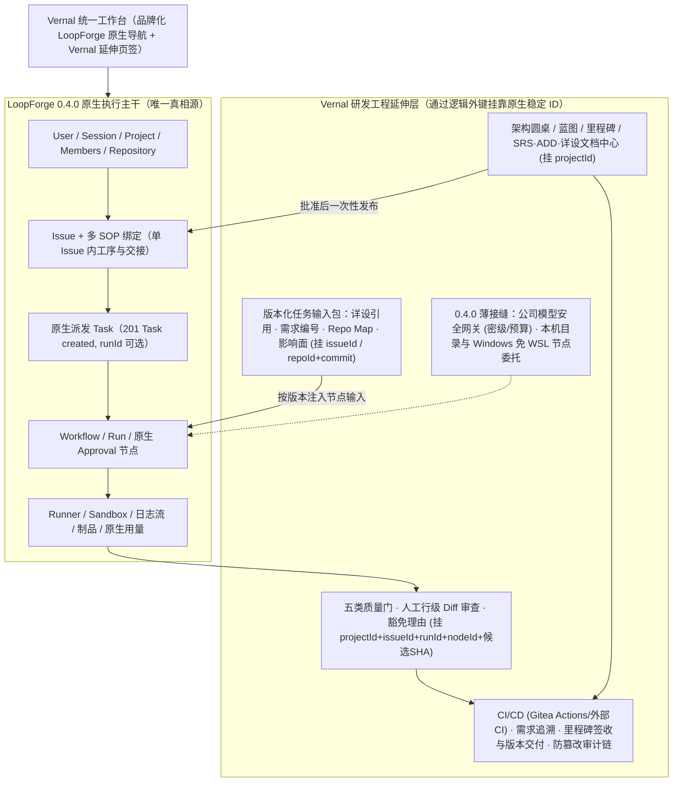

# Vernal × LoopForge 一体化架构收敛与合并工程任务书（供 Codex 执行）

> **文档定位**：本任务书汇总两轮独立代码审计及对本机 LoopForge `0.4.0`（镜像 `ghcr.io/tencent/loopforge:0.4.0`、OpenAPI 116 项公开能力与原生前端源码）的实证核查结果，指导将当前「Vernal 与 LoopForge 两套并行」的拼装形态，收敛为 **“一个 Vernal（套 LoopForge 原生工作台之皮，吃透原生执行主干）+ 清晰的研发工程延伸层”** 的统一平台。
>
> **核心保证（不删核心能力，只退役平行重复底座）**：
> - 此前已落地的 **全部七阶段研发平台能力 100% 保留并强化**，包括：**WP-0 流程阶段门禁**、**WP-1 详细设计与文档中心**、**WP-2 人工行级 Diff 代码审查**、**WP-3 CI/CD（Gitea Actions + `act_runner` 离线 6 镜像 + 隔离 CI 分支 + 质量阻断 + 受控部署/回滚）**、**WP-4 五类质量门与 `vernal-quality` 沙箱 CLI**、**WP-5 Repo Map / Code Wiki / 问代码库**、**WP-6 需求追溯矩阵**、**WP-7 防篡改哈希链审计 / 效能度量 / 模型安全网关**。
> - 本次做减法退役的，**仅限与 LoopForge `0.4.0` 重复造轮子的平行底座**（第二套项目目录、第二套通用成员目录、第二套运行详情与任务主表、线上 `worker_slots` 槽位权威写、第二套原生审批队列、双模式前端壳层切换）。

---

## 0. 全局工程红线（动工前必读）

1. **绝不修改上游 LoopForge `0.4.0` 源码与 MySQL 结构**：只通过其公开 REST API（含已核实的原生 `Task`、Project `members`、Issue Run 历史等端点）、资产配置与版本锁定壳层扩展。
2. **SQLite 迁移 100% 幂等向后兼容**：新增表用 `CREATE TABLE IF NOT EXISTS`，新增列先查 `PRAGMA table_info` 再 `ALTER TABLE`；旧工作区 `.autodev/state.db` 与 `.vernal-platform.db` 启动零报错。
3. **前端严守 LoopForge CSP 与离线优先**：禁止内联事件与 `eval`，禁止公网 CDN；修改样式后运行 `.venv/bin/python scripts/build_vernal_stage_css.py` 并递增 `OVERLAY_VERSION`；所有运行期依赖必须可随 `./vernal.sh --pack` 离线打包交付。
4. **`local` 与 `mock` 仅收缩为离线调试与单元测试兼容路径**：产品默认主路径（`runtime_backend="loopforge"`）必须端到端走通原生主干与全部延伸能力，不能只在 `local` 下有效。
5. **严守分批验收与测试基线**：每一批完成后全量 `.venv/bin/pytest -q`（当前基线 146 项）必须通过，且必须补齐**针对 LoopForge `0.4.0` 真实契约的新增回归测试**，再进入下一批；全程先保留工作区改动，不擅自 `git commit` / `git push`。

---

## 1. 统一目标架构与单一事实源归属

### 1.1 整体分层图

### 1.2 单一事实源与“减法 vs 延伸”总表

| 领域 | 唯一真源（主控） | 退役的平行实现（减法） | 保留/升级的 Vernal 延伸能力 |
|---|---|---|---|
| **身份、登录与项目准入** | **LoopForge**（`User`、Cookie、Project `ownerId` & `members`） | 退役 Vernal 通用成员目录、项目创建拷贝个人临时令牌、可编辑 `loopforge_url` 参与认证 | 保留 `(projectId, userId, 研发研发权限)` 细粒度收紧扩展表（仅可收紧审批/合入/部署权限，不能授予项目访问权）；独立管理 `project_signing_key()` |
| **项目与仓库** | **LoopForge Project ID + Repository** | 退役 `.vernal-projects.json` 作为项目主目录；不再打开纯原生项目时盲建空 `files` 目录 | 保留 `projectId` 对应的本机目录映射、设备绑定、交付目标、可恢复分步初始化草稿 |
| **研发任务与工单** | **LoopForge Issue**（已发布工作） | 退役多入口重复建单与本地可编辑任务主表 | 蓝图草案留 Vernal；批准展开后一次性发布原生 Issue；`tasks` 收缩为 Issue 扩展（保留旧 `T-xxx`、里程碑、需求关联、允许路径、跨工单依赖） |
| **派发、排队与运行历史** | **LoopForge Task & Run** | 退役线上 `worker_slots` 槽位权威写与 `task_runs` 对原生执行的重复拷贝 | Vernal 只控跨工单依赖与发单门禁；发单先落持久派单记录、认原生 `Task.id` 再追 `Run.id`；质量验证结果单独保留为候选质量证据 |
| **流程模板、角色与资产** | **原生 Agent / Workflow / Skill / Rule / MCP 目录** | 退役无条件全量覆盖原生 Agent；不再把 12~16 套未版本化 SOP 盲灌项目 | Vernal 提供带版本标记的可安装研发模板（升级不毁手工定制）；跨 Issue 七阶段流程、详设校验与里程碑签收留在 Vernal |
| **审批、审查与待办** | **执行节点审批归原生；行评与签收证据归 Vernal** | 退役自建平行原生审批队列、双口径前端红点 | SOP 人工门复用原生审批入口；人工行级 Diff 评论、阻塞项、豁免理由与候选 SHA 绑定留在 Vernal |
| **执行器与 Windows 接入** | **LoopForge Runner（macOS/Linux）** | 退役产品主流程按 OS 分叉独立调度；`local`/`mock` 仅留离线调试与回归 | 保留 Windows 免 Docker/WSL 的 `vernal link`，收敛为“原生 Script 节点委托本机 CLI 并收回产物” |
| **公用池与模型治理** | **算力调度归原生；公司额度、密级与预算归 Vernal 网关** | 退役每次派单并发覆盖同一共享账号全局 URL；禁止公用账号抢走人类审批 | 强化模型网关项目强绑定、`internal` 密级外网硬阻断、真实模型名审计与 `create_async_http_client` 代理契约 |
| **代码交付与 CI/CD** | **统一候选版本模型 + Gitea/远端 Git/目录回执** | 退役普通远端 Git 跳过验证与质量门的分叉；回收每任务 Gitea 临时仓 | **完整保留并加固 WP-3 CI/CD（Gitea Actions + `act_runner` + 离线 6 镜像 + 部署/回滚）**、短事务交付与候选实测追溯 |
| **统计、事件与审计** | **执行次数/原生用量/日志归原生；治理指标与审计链归 Vernal** | 退役 `task_runs` 重复重算原生执行统计的权威地位 | 保留返工率、审查阻塞、需求覆盖率、原仓库交付周期、SHA-256 防篡改审计链 |
| **前端工作台** | **品牌化 LoopForge 原生工作台** | 退役 CSS 隐藏原生业务导航、双模式切换、第二任务详情与第二运行详情 | 在原生工作台内以薄适配层挂载项目级（蓝图/文档/里程碑/交付）、工单级（详设/审查）、Run 级（质量证据）页签 |

> [!WARNING]
> **Batch 2 动工前唯一必做的前置核实（5 分钟）**：
> `autodev/loopforge/client.py:449` 注明上游按 `issue.responsibleUserId` 选择 `agentCliCredentials`，而原生 `app/approvals.js:341` 也按 `responsibleUserId` 过滤待审项。实施 Batch 2.3 前，**必须先查阅本机 `0.4.0` 镜像源码及 `openapi.yaml:660, 767`**，确认模型凭据解析优先级（平台共享配置 / 沙箱或节点环境变量 / 账号级凭据）以及审批节点是否支持独立审批人或项目 `maintainer` 跨责任人审批，以此确定「公司付费 + 张三执行 + 李四审批」的唯一安全实现路径，**严禁猜测上游字段**。

---

## 2. 三批次施工蓝图

### 第一批（Batch 1）：收编原生主干 + 封死跨项目安全边界

**目标**：让默认 `loopforge` 路径真正运行在原生 `Project -> Members -> Issue -> Task -> Run -> Approval` 主干上，并把跨项目越权、认证劫持与令牌串号一次性封死。

#### 1.1 固定认证地址、分离凭据与后台 `ContextVar` 隔离
- **固定认证上游（修 P0 认证信任链漏洞）**：
  - `autodev/server/app.py:173`、`autodev/server/deps.py:188, 206`：Cookie 核验与项目成员查询**强制使用部署级固定的 `public_pool.server_url()`（`VERNAL_LOOPFORGE_URL`）**，禁止读取可被项目配置改写的 `target_slot.engine.settings.loopforge_url`。
  - `autodev/server/routers/runtime.py:220-258`：远程或非管理员禁止修改 `loopforge_url`；修改 `loopforge_project_id` 前必须校验该 ID 归属当前用户且未绑定到其他工作区，**严禁直接覆写 `ctx.slots[pid]`**。
- **彻底分离三类凭据（修 A-1）**：
  - 浏览器交互操作（建项、审批、驳回、重试、Runner 绑定）：统一使用当前请求用户的个人身份（Cookie 或当前用户短期会话令牌），严禁继续用硬编码路径白名单 `uses_personal_identity`（`app.py:230-242`）遗漏审批/重试接口。
  - 禁止 `autodev/server/routers/projects.py:114-116` 与 `autodev/server/deps.py:168-170` 将 `effective_loopforge_token()`（可能为 1 天临时个人令牌）拷贝并永久写入新项目 `credentials.json`。
  - 后台调度与轮询任务（`planning.py:199`、`deps.py:290`、`projects.py:244`）：在调用 `asyncio.create_task` 前使用 `contextvars.Context()` 剥离请求级 `EXECUTION_IDENTITY` / `LINK_USER` / `current_user_var`，后台任务必须绑定显式记录的执行主体与凭据引用，不继承发起人 1 天临时上下文。
  - **独立签名密钥**：`autodev/security.py:194-211` 与 `autodev/config.py:341-347` 解耦——`project_signing_key()` 不再直接拿 `loopforge_token` 做 HMAC 签名材料，改为优先使用项目独立的 256-bit `signing_secret`（写入 `0600` `.autodev/credentials.json`），验签阶段提供向后兼容窗口以平滑过渡已发出的短期下载链接与在途 CI 回调。

#### 1.2 全路由 Fail-Closed 鉴权、配对设备撤销与细粒度研发角色收紧
- **统一中间件保护所有读写接口（修 A-2）**：
  - `autodev/server/app.py:210-228`：非本机或开启 `VERNAL_REQUIRE_AUTH=1` 时，对**全部 `/vernal-api/*` GET 与写路由**（除明确自带签名的 `git-bridge` / `baseline.json` / `plan-context` / `ci/callback` / `pool-model` / `link/*` 与健康检查外）统一执行 `verify_cookie_user` + `verify_project_access(..., strict=True)`。
  - `autodev/server/deps.py:206-224`：`verify_project_access` 遇上游异常或返回空项目列表时默认 **fail-closed（返回 503/403）**，不再静默放行。
  - **跨项目资源作用域隔离**：`GET /vernal-api/audit`（`governance.py:63-82`）与 `GET /vernal-api/metrics/portfolio`（`governance.py:56-60`）必须按当前登录用户有权访问的 LoopForge 项目集合过滤；查看全平台无过滤审计限平台管理员（LoopForge `isAdmin`）。
- **配对设备随成员移除撤销（修 Codex 增补 P0）**：
  - `autodev/server/link.py:162-171`、`autodev/db.py:188`：为 `host_links` 增加 `revoked_at`、`expires_at` 字段及 `DELETE /vernal-api/link/{link_id}` 撤销接口；设备鉴权时校验未撤销、未过期，并按缓存 TTL（如 60s）复验 `owner` 仍具有该项目访问权（成员被移除后自动拒绝读取后续交付）。
- **收紧研发动作 RBAC（修 A-3，暂不搬表避免高风险迁库）**：
  - 保留现有 `members` 表结构，但定位明确收窄为「项目内研发高危动作收紧表」，项目准入仍以 LoopForge 原生成员为准；
  - 消除空表提权漏洞：`POST /vernal-api/rbac/members` 首次初始化仅允许 LoopForge 平台管理员或项目 `ownerId`/`maintainer` 执行；
  - 在 `deps.py` 提供统一辅助校验，补齐 `/vernal-api/runtime/config`、`/vernal-api/agent/config`、`/vernal-api/plan/approve`、`/vernal-api/scheduler/start`、`/vernal-api/milestones/{id}/merge`、以及 `autodev/ci/service.py:605`（补齐按项目条件匹配角色）的权限检查。

#### 1.3 原生项目为目录真源与可恢复分步绑定
- **不再以 `.vernal-projects.json` 为项目主目录（修 A-4）**：
  - 项目列表直接以 LoopForge 原生 `Project` 为准；Vernal 侧仅保存 `projectId -> {workspace_root, source_mode, delivery_target, bind_state, last_error}`。
  - `autodev/server/routers/projects.py:181-267`：项目创建改为**可恢复的分步登记**——先建/验证上游 LoopForge Project 与 Repository，任何上游失败**显式返回错误并记录 `bind_state="PENDING_UPSTREAM"` 与失败原因**（绝不吞掉仓库注册错误还返回 `loopforge_synced=true`）；对用户接入的已有本机目录不粗暴删除原目录，允许重试绑定。
  - `autodev/server/deps.py:156-177`：冷启动打开已有工作区时，**严禁使用 `seed_engine.settings.execution_pool` 覆盖该项目已保存的 `execution_pool`**（修 Codex 增补 P1）；首次选中仅存在于 LoopForge 的原生项目时，允许只读浏览与进入引导页，**不再自动凭空创建空 `files` 工作区**。

#### 1.4 承认原生 `Task`（`201 Task created`）与持久派单对账状态机
- **补齐 LoopForge `0.4.0` 原生 `Task` 与 Issue Run 历史客户端方法**：
  - `autodev/loopforge/client.py`：新增 `get_task(task_id)`、`list_issue_tasks(issue_id)`、`list_issue_runs(issue_id)`（对照本机 `openapi.yaml:1289, 1421, 1484` 精确路径与字段）；改造 `dispatch_issue()` 完整返回原生 `Task` 对象（接受 `task.id` 已创建但 `runId` 暂为空的排队状态，不再把无 `runId` 当派发失败！）。
- **建立持久派单记录消除空窗（修 B-1、B-2 及 Codex 增补 P1）**：
  - 在 `autodev/db.py` 新增幂等表 `dispatch_records(dispatch_id, task_id, exec_seq, attempt_no, pool, actor, issue_id, lf_task_id, lf_run_id, state, created_at, updated_at)`：
    1. 派单前先落库 `DISPATCHING`；
    2. 上游建 Issue / 派发返回后条件更新 `issue_id` / `lf_task_id` / `lf_run_id`（若仅拿到 `lf_task_id`，状态置为 `QUEUED` 并轮询 `get_task` 等待 `runId` 就绪）；
    3. 网络中断或网关重启时，`_recover_stale` 先按 `lf_task_id` / `lf_run_id` / `list_issue_runs` 查证远端真实状态再决定续查、收割还是标记待人工确认，绝不盲目重派；
    4. 修复 `scheduler.py:355` 异常回收写 `FUSED` 时未校验 `exec_seq` 代次的竞态。
  - 停止调度明确区分「暂停本地观察」与「向远端发 `pause_run`」；仅在收到远端暂停确认后才允许进入可重派态，防止旧 Run 与新派单并发重叠。
- **收口审批与重试的资源归属校验（修 C-2、B-2）**：
  - `autodev/loopforge/client.py:483-512`：`list_pending_approvals(project_id=...)` 严格按当前 `project_id` 过滤。
  - `autodev/server/routers/runtime.py:529-588`：`/runs/{run_id}/approve`、`/reject`、`/retry` 执行前必须先 `get_run(run_id)` 校验其 `projectId == 当前项目`（否则 403/404）；`/retry` 保留旧 URL 兼容但内部转交 Vernal 统一重派命令（登记新 `dispatch_record` 与 `exec_seq`），不再裸透传导致状态脱节。

#### 1.5 品牌化 LoopForge 单一工作台（退役双模式壳层与重复详情）
- **停止隐藏原生业务导航与双模式切换**：
  - `autodev/server/static/vernal-overlay.css:96-100` & `vernal-overlay.js:162-213`：移除默认隐藏原生菜单的规则与 `body.vernal-mode` 双壳互切逻辑；原生项目切换器、工单列表、运行列表、原生「待我确认」、Runner 与资产导航直接作为 Vernal 唯一日常操作主界面。
  - 在原生工作台内通过**极薄的版本锁定挂载槽**（压至 2~3 个明确锚点）注册 Vernal 延伸页签：
    - 项目级：**蓝图与圆桌**、**文档与详设**、**里程碑与交付（含 CI/追溯/治理）**；
    - 工单级（Issue 抽屉/页签）：**详设与验收约束**、**人工 Diff 审查**；
    - 运行级（Run 详情）：**五类质量证据**。
  - 统一后端待办汇总接口 `GET /vernal-api/inbox`（聚合项目级未决门禁、人工 Diff 审查、里程碑签收、熔断任务，不再重复拷贝原生「待我确认」列表），修复 `main.js:284-290` 与 `runtime.js:88-97` 两处角标互相覆盖。
  - 新增针对 `0.4.0` 原生 HTML/JS 挂载锚点的前端契约烟测。

---

### 第二批（Batch 2）：把全部七阶段研发能力（含 CI/CD）焊死到原生主干

**目标**：让圆桌、详设、Repo Map、五类质量门、人工审查、CI/CD、追溯与模型安全网关在**默认 `loopforge` 模式下 100% 端到端闭环生效**，消灭本地/远端两张皮。

#### 2.1 版本化远端任务输入包（修 C-1 与 B-4）
- 抽取统一上下文构造器 `autodev/context_bundle.py:build_task_input_bundle(ws, db, task)`，供 `prompts.py` 与 `loopforge/bridge.py` 共同消费，按执行时序分两步注入：
  1. **派发前（喂给原生编码节点）**：组装带版本号的固定输入包，包含 `requirement_ids`（附 `@pytest.mark.req("REQ-xxx")` / 注释标注约定）、已批详设引用片段（`resolve_design_refs_snippet`）、带预算上限的个性化 Repo Map（`build_repo_map`）、允许路径白名单、验收标准与生效项目规矩；
  2. **产出候选后（喂给审查节点）**：基于候选真实 Diff 计算变更影响面（`find_impact_callers`）并附带详设对照清单。
- `autodev/loopforge/bootstrap.py:527-585`：为规划角色绑定 `spec-writing` Skill；`loopforge_harness.py:33-43, 414-420` 补齐 `detailed_design` 阶段元数据并接入 `stop_event` 中止信号。
- `autodev/loopforge/bridge.py:513-527`：`update_issue` 失败不再静默 `pass` 强派旧描述；统一延迟建单（`steering.py:488-499` 不再提前手建简化 Issue，改为发布工作统一建单）。

#### 2.2 统一三类远端交付验收契约（修 Codex 增补 P0 & B-3）
- **修补普通远端 Git 跳验证的 P0 漏洞（`autodev/scheduler.py:1144-1215`）**：
  - 将 `files`、`managed_git` 与普通远端 Git 三条分支收敛为统一的候选验收契约 `verify_and_record_candidate(...)`：
    - 无论走哪种传输方式，远端 Run 结束后均必须完成：① 候选代码还原/检出（锁定唯一 SHA 或 `artifact_digest`）；② 确定性路径白名单与敏感文件守卫（`guard_worktree` / `FileExchange.patch`）；③ 独立复跑任务 `verify_cmds`；④ 运行任务级质量门（`lint / secrets / test_integrity / diff_coverage`）并记录结构化质量证据。只有全部通过才登记 `VERIFY PASS`。
- **统一 Run 产物客户端与 `verify_only` 边界（修 B-3）**：
  - `LoopForgeBridge` 提供 `client_for_run(run_id)`，按 `dispatch_records` 记录的池与主体选择客户端，供 `scheduler.py` 与 `tasks.py` 统一拉取 Run 详情、日志、Diff 与制品。
  - `_execute_remote` 开头显式处理 `pending_action == "verify_only"`：仅当本地存在可还原候选（worktree / snapshot / 已落地 `artifact_digest`）时直接跳过编码节点复跑验证与质量门；候选不可还原时返回明确 `409/OpsError` 提示，不再误派昂贵编码 Run。

#### 2.3 公用池付费主体、审批人与模型安全网关解耦（修 D-1、D-2、D-3）
- **执行前置 0.4.0 实证结论**：依据对本机 `0.4.0` 凭据解析与审批过滤机制的核实结果，彻底拆开「发起人 / 审批责任人 / 公司模型付费主体」——**严禁再通过把共享公用账号写成 `responsibleUserId` 来抢走人类审批，严禁并发派单时互相覆盖同一共享账号的全局 `agentCliCredentials` URL**（若 `0.4.0` 不支持执行级/平台共享凭据，则采用每项目隔离的公用执行身份 + 原生审批节点显式分配或项目 `maintainer` 审批路径）。
- **模型安全网关强绑定项目与密级（修 D-1、D-2）**：
  - 公用池路由升级为 `/vernal-api/pool-model/{project_id}/{provider}/v1/{operation:path}`，票据 `model_ticket(project_id, provider, expiry)` 强绑定 `project_id` 与 `provider`（保留对本机单项目旧无项目票据的过渡兼容开关）；
  - 网关验签后从票据确定归属项目，严格执行 `enforce_model_gateway_policy`（`internal` 密级禁公网）、累计与并发预算检查、脱敏与真实 `payload["model"]` 审计落库；
  - `public_pool.model_request`（`public_pool.py:305`）改用 `create_async_http_client(base)` 遵循内外网代理契约；
  - `agent/config` 保存前校验角色模型与公用池允许模型白名单的兼容性；
  - 对 `data_classification="internal"` 项目：下发源码前若目标 Runner 无法证明出口受控（未经受控内网网关或未被管理员显式标记为内网可信节点），直接拒绝接单。
- **消除公用账号成员开通死胡同（修 D-3）**：创建项目或启用公用池时，若 `0.4.0` 提供成员接口则自动把公用执行身份以普通成员加入项目；否则在设置页提供一键复制账号名与直达项目成员页引导。

#### 2.4 CI/CD、人工审查、追溯与里程碑交付短事务加固（保留并加固昨晚全部能力）
- **CI/CD 并发与回调 Bug 修复（完整保留 WP-3 全部功能与离线 6 镜像）**：
  - `autodev/db.py:281`：为 `ci_runs` 增加 `UNIQUE(milestone_id, round)` 唯一索引（迁移前幂等检测去重）；
  - `autodev/ci/service.py:227-275`：改为**先在短事务内原子预留 `ci_runs`（`status='QUEUED'`）拿到唯一 `round`** → 再执行隔离分支准备与外部 CI 触发 → 最后条件更新 `external_id / ref / commit_sha / status='RUNNING'`，彻底消除双重触发竞态与快回调早于入库的 404；
  - `autodev/ci/service.py:533`：修复 `bool(payload.get("passed", ...))` 将字符串 `"false"`/`"0"` 误判为 `True` 的确定性 Bug，改为严格布尔解析函数 `_parse_strict_bool(...)`。
- **里程碑交付短事务与审批-审计原子协同（修 Codex 增补 P1）**：
  - `autodev/engine.py:1050, 1251-1284`：`merge_milestone` 改为**三段式短事务**——① 短事务校验门禁并预留 `version_no`（状态置 `PUBLISHING`）；② **释放 SQLite 写锁后**执行外部 Git/Gitea/远端推送与 tag 发布；③ 短事务条件落账 `milestone_deliveries` 与 `MERGED`，消除慢远端锁死项目库及部分推送失败状态错乱。
  - `autodev/process/runner.py:261-276` & `autodev/review/service.py:420-474`：审批决定改为单事务条件更新 `WHERE record_id=? AND status='PENDING'` / `WHERE review_id=? AND status='OPEN'`，并将同库的任务放行、门禁状态更新与待投递 `audit_outbox` 写入同一项目事务，再幂等刷入 `.vernal-platform.db` 防篡改哈希链。
- **需求追溯实测口径升级**：
  - `autodev/trace/service.py:76-129`：保留现有 `linked_coverage_rate`（向后兼容），新增 `verified_candidate_pass_rate`——要求对应需求标记实际出现在该候选版本的测试扫描与已通过的测试/CI 报告中，避免仅凭“任务已批准+目录里有标记”误判 `PASSED`。
- **Windows 免 WSL 节点委托验证**：验证 `vernal link` 作为原生 Script 节点委托回执通道（覆盖断线恢复、取消、超时与补丁校验）。

#### 2.5 托管资产版本化、临时仓回收与一键备份
- **资产版本化（修 C-3、C-4）**：给 Vernal 安装的 Agent / Workflow 写入 `vernal-managed-vN` 标记——未手工改动时随版本平滑升级，已手工定制则保留用户改动（尤其是手工勾选的 `mcpServers` / 提示词）不再暴力覆盖；按角色配置显式挂载内置 MCP（如 `frontend` 可选挂 Playwright、`coder`/`planner` 按需挂 Serena）。
- **Gitea 临时仓与引用回收（修 D-4）**：任务合入或取消后自动清理过期的 `vernal-task-*` 基线引用/仓库，或改用项目唯一镜像仓的隔离命名空间引用（前提：保持同等任务隔离与租约保护）。
- **长期运行运维与备份（修 E-3）**：
  - 修正 `proxy.py:150` 与 `runtime.js:320` 的故障指引，统一指向根目录 `./vernal.sh`；
  - 在 `vernal.sh` 新增 `./vernal.sh --backup [输出目录]` 与 `./vernal.sh --restore <归档>`，原子覆盖全部真实持久化数据：**`workspaces/` + 4 个 Docker 卷（`mysql-data`、`platform-data`、`gitea-data`、`gitea-runner-data`）+ `deploy/loopforge/.runner/` + `deploy/loopforge/.env`**（并明确提示 `LOOPFORGE_DATA_DIR` 仅含部分宿主目录，不可单备 `.data/`）。

---

### 第三批（Batch 3）：历史数据幂等迁移与正式退役平行旧实现

**目标**：在不破坏历史项目与既有测试兼容的前提下，完成数据迁移并清退已废弃的平行代码与表写入，实现净代码瘦身。

1. **幂等迁移工具（`vernal migrate-unified`）**：
   - 已有原生 `loopforge_project_id` / `loopforge_issue_id` / `loopforge_run_id` 的项目与任务直接绑定到新扩展模型；
   - 仅有历史本地 `T-xxx` 编号与本地执行记录的旧工作区保留只读历史说明，**严禁按标题模糊硬配、严禁自动批量重派**；
   - 迁移脚本可重复执行（执行两次结果完全一致，提供 `--dry-run` 报告）。
2. **兼容过渡与正式退役**：
   - 旧 CLI 命令与兼容性查询端点（如测试仍消费的 `/vernal-api/runtime/analytics`）在过渡期改为从原生对象与新扩展表聚合输出，不突然 404；
   - 停止新路径对旧表权威写入后，正式退役：Vernal 通用成员目录逻辑、线上 `worker_slots` 权威状态写入、`task_runs` 对原生执行的重复复刻、平行原生审批队列、`.vernal-projects.json` 目录权威职责与双模式前端切换代码。

---

## 3. 测试基线、兼容性策略与硬验收清单（Definition of Done）

### 3.1 既有 146 项测试的兼容性策略
- **全部保留有效业务断言**：本机首次引导、既有路由、`local`/`mock` 离线回归、历史 SQLite 升级、CI 三个工作流模板空壳测试阻断（`python`/`node`/`generic`）、离线冷启动含空格目录探测（`test_offline_install.py`）与标准七阶段回归均须保持 100% 全绿。
- **两处写死旧行为的测试采用明确兼容边界**：
  1. 本机单项目无项目票据的模型代理测试（`tests/test_execution_pools_and_dsh.py:94, 107`）：仅在本机单项目可唯一确定项目时保留过渡兼容，多项目或冲突归属严格拒绝；
  2. 追溯覆盖率旧用例（`tests/test_traceability.py:145`）：保留关联覆盖率字段兼容，新增严格的候选版本实测通过率字段并由流程模板配置开关控制。

### 3.2 每批必写的新增回归测试与真实集成验收
- **Batch 1 验收（新增 `tests/test_unified_batch1_backbone.py`）**：
  1. 双用户同项目（张三创建、李四审批/查日志/重试）：各自保持真实操作人，不落盘 1 天过期令牌，后台任务不继承请求 `ContextVar`；
  2. 安全红线：远程篡改 `loopforge_url` 无法劫持 Cookie 认证；未登录/无权用户局域网 GET 任意 `/vernal-api/*` 返回 401/403；上游异常或空项目列表时 fail-closed；平台审计与组合指标绝不泄露无权项目；成员移除后原 `host_link` 配对设备被拒；
  3. 原生 `Task` 主干：模拟上游 `POST /api/issues/{id}/dispatch` 返回 `201` 仅含 `Task.id`（无 `runId`）进入排队，随后补出 `runId` 正常收敛；网关重启不重派；跨项目 Run 审批/重试返回 403；
  4. 单工作台前端契约测试：不再隐藏原生业务导航，收件箱角标与列表计数一致，验证 `0.4.0` 挂载锚点存在。
- **Batch 2 验收（新增 `tests/test_unified_batch2_extensions.py`）**：
  1. 默认 `runtime_backend="loopforge"` 链路验证：编码节点实际收到详设片段、需求编号与 Repo Map，审查节点收到 Diff 影响面；普通远端 Git 交付同样执行路径守卫、`verify_cmds` 与五类质量门；
  2. 公用池并发隔离：同时跑 `public` 与 `internal` 两个项目（交换发单顺序结果完全一致），`internal` 阻断公网模型，审计记录真实模型名；验证「公司付费 + 张三执行 + 李四审批」不串单；
  3. 并发与短事务：两个独立 SQLite 连接并发审批仅一方成功；CI 双重触发与回调 `{"passed": "false"}` 正确判 `FAILURE`；`merge_milestone` 外部 Git 推送时不持有 SQLite 写锁；
  4. 全链路端到端反查：从 `v2` 里程碑交付记录可完整反查 原生 Issue → 原生 Task/Run → 已批详设 → 候选 Diff → 质量门 → 人工审查（v1 打回后旧批准不可放行 v2）→ CI 运行 → 原仓库提交/标签；
  5. 备份恢复冒烟：`./vernal.sh --backup` 与 `--restore` 可无损校验全部归档清单。
- **Batch 3 验收（新增 `tests/test_unified_batch3_migration.py`）**：
  - 幂等迁移执行两次结果完全一致；纯本地历史记录保留只读不凭空造原生 Run；旧表停写后全量回归与真机 `0.4.0` 冒烟全部通过。
