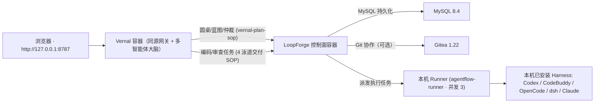

# Vernal

> **基于腾讯开源执行底座 [LoopForge](https://github.com/Tencent/LoopForge) 构建的多智能体架构驱动软件研发平台**

**Vernal** 将「宏观多智能体架构决策」与「微观自动化研发执行流水线」融为一体。你只需给出一句粗粒度想法或一份系统架构文档，平台即可自动组织产品经理、契约架构师、QA 总监与研发总监召开两轮评审圆桌、沉淀可审阅的 ADR 架构决策纪要、拆分低冲突研发组与任务流程图（DAG），并调度底层编码与审查智能体在隔离工作区完成实现、自测、独立评审与成品交付。

---

## 核心特性

- **统一工作台与同源网关（`8787`）**
  - 在 LoopForge 原生前端之上无侵入升级为 **Vernal 精密工程蓝图浅色风格**，完整保留原生 AI 工作台、需求列表、待我确认、运行统计、角色与流程管理等全部能力；
  - 同源反向代理自动复用浏览器登录态签发凭据与同步项目上下文，告别手动复制粘贴 Token。
- **两层多智能体协同架构**
  - **宏观大脑层（Vernal Brain）**：资料切片 → 2 轮架构评审圆桌（PM / 契约架构师 / QA 总监并行评审 → 研发总监 ADR 拍板 + 支持人类随时插话重裁）→ 研发组目录领地划分与滚动波次 DAG 排期 → 失败自动仲裁与断点续跑；
  - **微观车间层（LoopForge Asset-as-Code）**：自动向 LoopForge 注册编码规范、内置开源 `SKILL.md`、预置 MCP 插件、规划专用 SOP（`vernal-plan-sop`）与 4 泳道研发 SOP（后端 TDD / 前端 UI / 契约文档 / 缺陷修复）。
- **全链路走 LoopForge，宿主机免装 Python**
  - 圆桌规划、蓝图拆单、异常仲裁与代码实现、独立审查**全部**通过 LoopForge 派发至执行机（Runner）完成；
  - Vernal 本体运行在 Docker 容器中，部署主机需要 Docker。使用公用额度的成员可以直接在浏览器提交任务。
- **多 Harness 自动扫描与网页可视化编队**
  - 自动探测并支持 **Codex CLI**、**CodeBuddy**、**OpenCode**、**DeepSeek Harness (`dsh`)**、**Claude Code**；
  - 支持在网页「编队与模型」面板直接为总监、开发组、审查官分别选配不同执行器与模型，实现跨模型异构交叉审查。
- **双协作模式自由切换**
  - **文件交接模式（默认）**：免配置 Git 仓库，所有任务通过内容寻址快照流转，里程碑合入后一键下载 `.zip` 成品包；
  - **Git 分支模式**：与内置私有 Gitea（或外部 GitHub/GitLab）联动，支持人机协同分支开发与自动合入。

---

## 系统架构



---

## 快速开始

### 前置条件

1. **Docker**：
   - macOS：安装 Docker Desktop 或 Colima；
   - Linux / 麒麟（Kylin Linux）：安装 Docker 与 `docker compose` 插件。
2. 使用个人额度时，在自己的电脑上安装所选 CLI 并完成登录。使用公用额度时，个人电脑只需浏览器，管理员在部署端配置模型 Key。
3. 默认容器部署由镜像提供 Python。

### 启动平台

```bash
git clone <仓库地址>
cd <仓库目录>

# 首次启动：自动拉起 LoopForge + MySQL + Gitea + 容器版 Vernal
./vernal.sh
```

1. 打开浏览器访问统一入口：**http://127.0.0.1:8787**，注册或登录管理员账号；
2. 登录后顶栏会自动绑定当前账号并向项目注入标准规则、开源 Skill、角色与 SOP；
3. 本机启动脚本会在后台等待网页登录，登录后自动挂载 Runner。网页“编队与模型”显示 Runner 上报的工具和凭据状态。
4. 通过 `./vernal.sh --mount ~/Projects` 选择项目根目录，后续启动会沿用这个目录。启动台选择本机 Git 项目后，平台从所选分支已提交的版本建立独立副本。里程碑交付到原仓库的独立分支（如 `vernal/milestone-M1`），可用 Git 查看和合并。

### 选择项目来源和执行池

新项目可输入想法或上传文档。本机项目可选空目录、普通源码目录或已有 Git 分支。含有二进制素材或超过 4 MiB 的普通源码目录自动建立 Git 基线，在标准部署中通过私有 Gitea 镜像保存基线和交付分支。远端 Git 项目使用仓库 URL 和分支，私有 HTTPS 仓库可在启动台填写读写令牌。

打开「执行池、凭据与智能体编队」选择自动、本机 CLI 或公用 Docker。自动模式优先选择满足所需角色的一台本机 Runner。公用池使用专用 LoopForge 执行账号和管理员配置的 DeepSeek 或 OpenAI 兼容端点，支持 dsh 和 OpenCode。具体配置见 [使用指南](USAGE_GUIDE.md)。

### 跑通一个项目的标准五步法

1. **创建或切换项目**：在页面右上角项目下拉框选择或新建项目，系统自动建立独立工作区并装配资产；
2. **输入需求**：在「总控」点击 **「输入需求」** 填写粗粒度想法并切片，或将 `.md`/`.txt` 架构文档放入 `workspaces/<项目ID>/inputs/` 后点击 **「摄入资料」**；
3. **召开圆桌与生成蓝图**：点击 **「圆桌与立项」**，观看 PM / 架构师 / QA 总监与研发总监输出《ADR 架构决策纪要》与首轮任务图；对方案有调整时可在圆桌底部直接输入意见 **「插话并重新裁决」**；
4. **批准并自动调度**：在「总控」点击 **「批准蓝图」** → **「启动 Goal」**，实时观看任务流程图流转、工位实况席、步骤日志与代码 Diff；
5. **验收与获取成品**：里程碑合入后，在「总控 → 底座与收件箱」下载文件交付包、预览静态页面或推送文件快照。Git 模式可按里程碑记录查看目标仓库和交付分支。

---

## 多执行器与编队配置

在「总控」顶栏点击 **「编队与模型」**，即可直接查看本机自动扫描到的 Harness 状态，并在网页中可视化配置：

| 执行器 | 标识 | 说明 |
| :--- | :--- | :--- |
| **自动探测** | `auto`（默认） | 按 `codex → codebuddy → opencode → dsh → claude-code` 顺序自动选用本机已就绪工具 |
| **Codex CLI** | `codex` | 复用本机 Codex 登录态或 OpenAI Key |
| **CodeBuddy** | `codebuddy` | 腾讯 CodeBuddy CLI，适合国内网络与国产环境 |
| **OpenCode** | `opencode` | 开源多模型 CLI，支持 DeepSeek / 通义千问 / 本地 Ollama / vLLM |
| **DeepSeek Harness** | `dsh` | DeepSeek 官方无头 Harness CLI |
| **Claude Code** | `claude-code` | Anthropic Claude Code CLI |

支持为 **圆桌总监**、**开发组**、**审查官** 分别指定不同的执行器与模型（例如开发用 A 模型、独立审查用 B 模型交叉验收），保存后自动写入工作区配置并同步到底层 LoopForge 角色。

---

## 内置开源资产与四泳道 SOP

### 1. 内置 Skill 库（`autodev/assets/skills/`）
平台默认内置 5 套精选研发技能，并在绑定/切换项目时自动注入 LoopForge：
- `frontend-design`：现代前端排版、配色克制、响应式布局与触控/键盘交互规范
- `webapp-testing`：本地 HTTP 静态服务验证、ES Module 加载校验与无头冒烟测试
- `test-driven-development`：严格红绿灯 TDD 纪律，杜绝空壳假测试
- `systematic-debugging`：根因定位与最小外科手术修复规范，禁止盲猜乱改
- `security-review`：契约一致性、路径白名单、安全漏洞与测试真实性独立审查清单

> **扩展自定义 Skill**：只需将任意符合 `SKILL.md` 规范的开源技能文件夹放入 `autodev/assets/skills/<技能名>/`，下次绑定或切换项目时即会自动同步进底座。

### 2. 预置 MCP 目录与四泳道 SOP
- **预置 MCP 插件**：自动向 LoopForge MCP 目录注册 **Playwright 无头浏览器 MCP** 与 **Context7 实时文档 MCP**（默认仅注册不强绑角色，避免离线/内网环境启动报错；联网环境可在角色配置中一键勾选启用）。
- **四泳道任务自动分流**：派发开发任务时自动按角色、白名单文件类型与关键词路由至对应专项 SOP：
  - **后端逻辑泳道**（默认）：挂载 TDD + 根因排障技能
  - **前端界面泳道**：挂载 `frontend-design` + `webapp-testing` 技能
  - **契约文档泳道**：聚焦接口 Schema 稳定性与机器校验
  - **缺陷修复泳道**：强制先复现失败用例再做最小补丁回归

---

## 多人局域网协作与麒麟（Kylin Linux）部署

- **局域网共享使用**：主机执行 `./vernal.sh --host 0.0.0.0`，局域网内其他成员直接通过浏览器访问 `http://<主机IP>:8787` 即可共同参与圆桌评审、任务监控与产物下载；需要各自贡献算力时可在「设置 → 执行机器」接入本机 Runner。
- **麒麟（Kylin Linux）迁移**：内置多架构 [Dockerfile](Dockerfile)（同时支持 `linux/amd64` 与 `linux/arm64`），拷贝仓库至已安装 Docker 的麒麟主机后直接执行 `./vernal.sh` 即可启动，并可配合 `CodeBuddy`、`DeepSeek Harness (dsh)` 或 `OpenCode`（直连 DeepSeek / 内网 Ollama / vLLM）实现纯国产化闭环。

---

## 常用命令

| 命令 | 说明 |
| :--- | :--- |
| `./vernal.sh` | **默认纯容器模式**：一键拉起 LoopForge 底座、容器版 Vernal（`8787`）与本机 Runner |
| `./vernal.sh --pack` | 将当前平台的五个 Docker 镜像与启动脚本导出到 `dist/`，供同架构设备离线安装 |
| `./vernal.sh --build` | 修改源码后重新构建 Vernal 镜像并启动 |
| `./vernal.sh --host 0.0.0.0` | 开放局域网监听地址 |
| `./vernal.sh --stop` | 优雅停止全部容器与本机 Runner（所有数据完好保留） |
| `./vernal.sh --dev` | 开发者本机 `.venv` 调试模式 |
| `./deploy/loopforge/up.sh` | 单独启动或检查 LoopForge + MySQL + Gitea 容器栈 |
| `./deploy/loopforge/start-runner.sh` | 单独启动或重连本机 `agentflow-runner`（默认并发 3） |
| `.venv/bin/pytest -v` | 运行全量自动化单元测试（开发模式） |

---

## 项目目录结构与扩展文档

```text
├── vernal.sh                  # 一键启动与停止入口（默认容器模式 / --dev 开发模式）
├── Dockerfile                 # 多架构 Vernal 容器镜像（amd64 / arm64）
├── autodev/
│   ├── assets/skills/         # 内置与可扩展开源 SKILL.md 资产目录
│   ├── harnesses/             # LoopForgeHarness 及多 CLI 适配器
│   ├── loopforge/             # LoopForge REST 客户端、资产自动装配与桥接调度
│   ├── server/                # 同源反向代理网关、REST/SSE 接口与蓝图风格前端
│   ├── council.py             # 两轮多智能体架构评审圆桌与人类插话重裁
│   ├── engine.py              # 编排引擎、蓝图规划、滚动拆单与总监仲裁
│   └── scheduler.py           # 并行工位调度器、确定性验证门禁与交付打包
├── deploy/loopforge/          # LoopForge + MySQL + Gitea 编排与 Runner 脚本
├── tests/                     # 全量自动化单元测试与集成测试
├── USAGE_GUIDE.md             # 详细日常使用、协作与麒麟迁移手册
└── ROADMAP_AND_ASSETS.md      # 开源资产扩充清单与后续演进路线
```

- 详细操作与应急排查手册：[USAGE_GUIDE.md](USAGE_GUIDE.md)
- 标准化七阶段研发流水线任务书：[CODEX_PIPELINE_PLATFORM_SPEC.md](CODEX_PIPELINE_PLATFORM_SPEC.md)
- 演进路线与架构蓝图：[ROADMAP_V2.md](ROADMAP_V2.md) · [ROADMAP_AND_ASSETS.md](ROADMAP_AND_ASSETS.md)

## 标准化七阶段研发流水线（新增）

平台内置可配置的 **Process-as-Code** 工程流程引擎，覆盖 **需求分析 → 架构设计 → 详细设计 → AI 辅助编码 → 人工代码审查 → 自动化测试与质量门禁 → 持续集成与交付**：

1. **流程阶段门禁（`autodev/process/`）**：提供 `legacy`、`standard`、`feature`、`bugfix`、`doc_reverse` 五套模板，支持在「流水线总控」顶栏查看七阶段实时步进状态并在线签字放行或记录豁免。
2. **规范文档中心与详细设计（`autodev/docs_center/`）**：支持 `arc42/MADR/EARS` 与 `GB/T 8567` 双规范模板，自动校验详细设计中的 `P0` 需求双向覆盖与测试用例绑定，支持多版本对比及一键导出 `.docx` / `.zip` 归档包。
3. **人机协同 Code Review（`autodev/review/`）**：支持 `off / risk / milestone / all` 四档审查策略；高风险变更（触及契约、子进程/鉴权敏感代码、多轮返工）自动进入「审查与交付」工作台，支持逐行评论与一键打回编码智能体返工。
4. **多维代码质量门禁（`autodev/quality/`）**：内置 AST 假测试检测（拦截空壳测试、`assert True`、无断言、整文件跳过、吞异常）、硬编码密钥扫描、增量 Lint、变更行覆盖率与离线 Semgrep SAST。
5. **持续集成与版本交付（`autodev/ci/`）**：支持内置 Gitea Actions（`ci` profile）及外部 GitLab / Jenkins / Webhook 适配，CI 失败自动派发 `bugfix` 泳道任务进入闭环修复，合入时自动打标签并归档 Release Notes 与测试报告。
