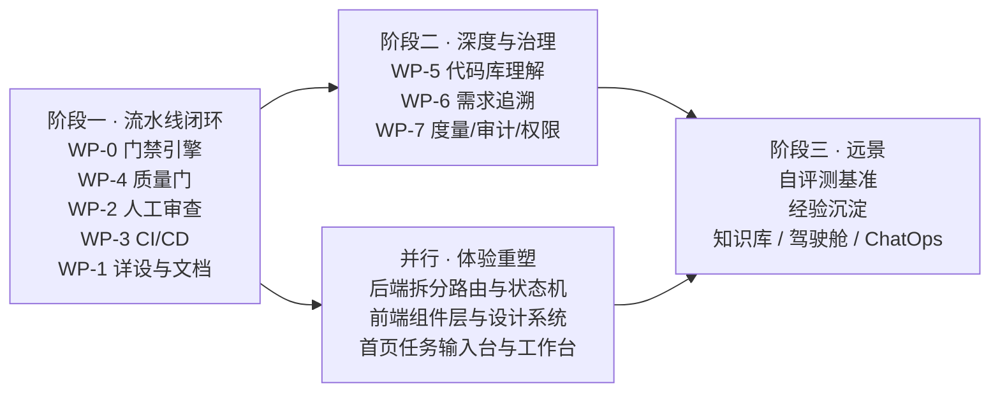

# Vernal 远景路线图 V2：产品形态、交互审美、工程架构与开源借鉴

> 本文档面向中长期演进，可分批交给 Codex 执行。
> - **第 0 阶段（现存缺陷清零、双壳收敛与体验整顿）**：见 [CODEX_AUDIT_AND_REFACTOR_SPEC.md](CODEX_AUDIT_AND_REFACTOR_SPEC.md)（Fix-1 ~ Fix-6）
> - **第 1~2 阶段（标准化七阶段流水线能力补齐）**：见 [CODEX_PIPELINE_PLATFORM_SPEC.md](CODEX_PIPELINE_PLATFORM_SPEC.md)（WP-0 ~ WP-7）
> 工程红线（CSP、离线、SQLite 幂等迁移、不改 LoopForge 源码）与任务书第 0 节一致。

---

## 一、产品形态：入口用「对话」还是「任务」？

### 结论：**任务为主、对话为辅**。入口像对话一样好上手，提交后生成结构化的任务单。

| 形态 | 优点 | 缺点 | 适合 |
|---|---|---|---|
| 纯对话（ChatGPT / Cursor 式） | 门槛低、探索性强 | 难追踪、难审计、难多人协作；长周期任务容易散 | 问答、澄清、临时小改动 |
| 纯任务表单（Jira 式） | 结构化、可追踪 | 填写门槛高、冷冰冰 | 管理视角 |
| **混合（Devin / Kiro / v0 式）** | 输入像对话，产出像工单；过程可追踪，也能随时插话 | 设计成本稍高 | **实验室的标准化流水线** |

实验室要的是「规范约束、质量可控、可审计」，平台的主干必须是**任务（研发任务单）**；对话用于需求澄清、过程插话和代码问答。

### 1.1 首页：醒目的「任务输入台」（Mission Composer）

```
┌──────────────────────────────────────────────────────────────┐
│  Vernal · 架构驱动的 AI 研发流水线                [待我处理 3]   │
│                                                              │
│   ┌──────────────────────────────────────────────────────┐   │
│   │ 描述你要做的事……（可粘贴需求、拖入文档、@选择代码仓库）  │   │
│   │                                                      │   │
│   └──────────────────────────────────────────────────────┘   │
│   [新建系统] [新增功能] [修复缺陷] [重构优化] [补全文档] [问代码库] │
│   来源：想法 ▾   流程模板：标准七阶段 ▾   执行池：自动 ▾   [开始 →] │
├──────────────────────────────────────────────────────────────┤
│  进行中的任务                                                  │
│  ▣ 订单中心  需求✓ 架构✓ 详设● 编码○ 审查○ 测试○ 交付○  等你评审详设 │
│  ▣ 轨道射击  ……                                                │
├──────────────────────────────────────────────────────────────┤
│  最近交付  ·  本周效能（一次通过率 / 人工介入 / Token）            │
└──────────────────────────────────────────────────────────────┘
```

- 输入台占首屏约 40% 高度，主色强调；全局快捷键 `N` 或 `⌘K → 新任务`，任意页面右下角都有悬浮按钮「＋ 新任务」。
- **任务类型芯片决定流程模板**：新建系统 → `standard`；新增功能 → `feature`；修复缺陷 → `bugfix`；补全文档 → `doc_reverse`；问代码库 → 只读问答（不建任务）。这样把「规范约束」做成用户无感的默认值。
- 提交后先进入**澄清对话**（借鉴 Kiro、Devin）：PM 智能体提出 3~5 个关键问题，选择题优先，可以跳过。回答后生成 SRS 草稿，进入「需求」阶段。
- 「进行中的任务」卡片内嵌迷你七阶段步进条，**需要人处理的阶段高亮并给出直达按钮**。

### 1.2 任务工作台（Mission Workspace）三栏布局

```
┌───────────┬─────────────────────────────────┬───────────────────┐
│ 阶段导航   │  当前阶段主内容                   │  对话 / 活动流      │
│ ● 需求 ✓   │  需求：SRS 文档 + 评审按钮          │  总监：已拆出 12 张卡 │
│ ● 架构 ✓   │  架构：圆桌 + ADR + C4 图           │  你：接口改成 REST   │
│ ● 详设 ◉   │  详设：各组设计文档 + 校验结果       │  总监：已重裁……      │
│ ○ 编码     │  编码：DAG + 工位实况               │  [输入插话……]        │
│ ○ 审查     │  审查：待审列表 → 代码审查页         │                    │
│ ○ 测试     │  测试：质量门 + 追溯矩阵             │                    │
│ ○ 交付     │  交付：CI + 版本 + 部署              │                    │
└───────────┴─────────────────────────────────┴───────────────────┘
          顶部：项目名 · 流水线进度条 · 上下文主按钮（如「批准详细设计」）
```

- 左栏是**流程骨架**，与领导提出的七个环节一一对应，汇报演示时直接对得上。
- 右栏对话**常驻**：可以和总监对话、插话重裁，也能看到所有智能体的动态。对话中产生的决定会被总监转成「变更单」，复用现有的 steering 机制，从而保证可追踪。
- 现有的「总控、圆桌、蓝图、底座与收件箱」各页拆分归入对应阶段；「底座 / 执行池 / 编队」移到「设置」。

### 1.3 「待我处理」（Needs You）统一收件箱

把 SRS 评审、架构评审、详设评审、代码审查、CI 失败、任务熔断接管、阶段转向审批全部归入一个列表，按紧急程度排序，顶栏显示红色徽标。可选推送到企业微信、钉钉或邮件（见 3.4）。

---

## 二、视觉与交互设计系统（审美升级）

### 2.1 设计原则

**克制、精密、信息密度高**。目标是「工程师愿意每天打开的工具」，而不是营销页。参照对象：Linear（密度与键盘操作）、Vercel Dashboard（留白与层级）、GitHub PR 审查（diff 交互）、Devin / OpenHands（智能体工作台分栏）、Plane（开源项目管理 UI）。

### 2.2 Design Tokens（`static/styles/tokens.css`，CSS 变量）

- **色彩**：中性色用 slate 色阶 12 级，再加 1 个品牌主色（建议保留现有「蓝图蓝」并降低饱和度）。语义色只用 success / warning / danger / info 四个。**七个阶段不各配一种颜色**（容易花哨），阶段只用状态色区分：未开始灰、进行中主色、等待人工琥珀色脉冲、通过绿、失败红。
- **字体**：中文用思源黑体，西文用 Inter，代码用 JetBrains Mono。**字体文件 vendored 到本地**，保证离线可用。字号阶梯 12 / 13 / 14 / 16 / 20 / 24 / 32。
- **间距与圆角**：4px 栅格；圆角 6 / 10 / 14；阴影只用 2 级。
- **动效**：150ms（hover）和 250ms（面板展开），统一 `cubic-bezier(.2,.8,.2,1)`；尊重 `prefers-reduced-motion`。
- **暗色模式**和**紧凑密度模式**两个开关，由 tokens 切换。
- 可以直接借用 shadcn/ui（MIT）开源的 token 数值体系与组件视觉规范，不必引入 React。

### 2.3 核心组件清单

流水线步进条 Stepper、门禁徽章 GateBadge、状态胶囊 StatusPill、文档阅读器（Markdown + Mermaid）、Diff 审查器、DAG 图（升级为分层自动布局，可以 vendored `dagre` 或 `elkjs`）、时间线、命令面板（`⌘K`：跳转项目、阶段、任务，执行操作）、Toast、空状态插画、骨架屏加载。

### 2.4 交互细节

- 每个页面只保留**一个主操作按钮**，位置固定在右上角或底部决策栏。
- 长任务给出**可感知的进度**：预计剩余时间、当前在做什么（复用工位实况数据）。
- 所有破坏性操作二次确认，并支持撤销（如撤回尚未生效的审批）。
- 无障碍：对比度达到 AA、可见的焦点环、完整的 `aria` 标签、全键盘可操作。

---

## 三、工程架构演进

### 3.1 前端架构（在「不引入 Node 构建链 + LoopForge CSP」约束下）

- **现状**：原生 JS 模块约 6000 行，以 overlay 方式挂载在 LoopForge 前端内，`main.js`、`runtime.js` 等文件职责偏重。
- **目标**：引入一个**无需构建的组件层**。推荐 vendored **Preact + htm + @preact/signals**（三者合计约 15KB，MIT / Apache-2.0），以 ESM 文件放进 `static/vendor/`。htm 在运行时解析模板字符串，不依赖 `eval`；落地前需要在 LoopForge 的 CSP 下实测确认。备选方案是 Lit（Web Components，同样免构建）。
- **目录**：
  ```
  static/app/
    core/   api.js（由 OpenAPI 自动生成、带 JSDoc 类型的客户端）、store.js（signals）、router.js（hash 路由）、sse.js
    components/  Stepper、GateBadge、DiffViewer、DocViewer、DagView、CommandPalette……
    views/  home、mission、docs、review、ci、trace、metrics、settings
    styles/ tokens.css、base.css、components.css
  ```
- **渐进迁移**：新页面（首页、审查、文档中心、追溯、度量）直接用新栈；旧页面保留，逐步替换，不搞一次性重写。
- **类型安全的 API 客户端**：新增 `scripts/gen_api_client.py`，读取 FastAPI 的 `openapi.json`，生成带 JSDoc 的 `api.js`，全程不需要 Node。
- **前端测试**：用 Python 版 Playwright 做关键流程 e2e（新建任务 → 评审 → 审查 → 交付），关键页面做截图对比（视觉回归）。

### 3.2 后端架构

- **现状问题**：`server/app.py` 有 2673 行，所有路由都定义在 `create_app()` 闭包中；`engine.py` 与 `scheduler.py` 各约 1000 行；任务和里程碑的状态迁移分散在多处直接 `update_task(status=...)`。之前 STEERING 任务书里修过的 8 个一致性问题，多半源于此。
- **目标分层**：
  ```
  autodev/
    api/        routers/*（每个领域一个 APIRouter）、deps.py（engine、当前用户、角色、审计）、schemas.py
    services/   ProjectService、PlanningService、ReviewService、CIService、DocService、MetricsService
    domain/     models、state_machines.py（显式状态迁移表）、events.py（类型化领域事件）
    process/    流程模板与门禁引擎（WP-0）
    infra/      db 仓储、loopforge 客户端、gitea 客户端、harnesses、quality 工具适配
  ```
- **显式状态机**：为 Task / Milestone / Checkpoint / Review / CIRun 定义合法迁移表，统一通过 `transition(entity, to, reason, actor)` 修改状态：非法迁移直接抛错，合法迁移自动写事件、审计与 SSE。这是降低并发一致性 bug 最有效的一步。
- **领域事件 + 订阅者**：事件落库（沿用现有 `events` 表），在进程内分发给订阅者（SSE 推送、度量、审计、通知）；对外 webhook 使用 **outbox 模式**，保证至少投递一次。
- **统一后台作业**：scheduler 主循环、LoopForge 轮询、CI 轮询合并为一个带租约（lease）的轻量作业运行器，避免多进程或重启后重复轮询。
- **配置分层**：平台默认 → 流程模板 → 项目 `config.toml` → 环境变量，用一份带 schema 的配置描述，设置页由 schema 自动生成表单。
- **API 规范化**：统一加 `/vernal-api/v1` 前缀；错误模型统一为 `{code, message, detail}`；OpenAPI 文档完整。
- **可观测性**：结构化 JSON 日志；用 OpenTelemetry 为每次任务执行建 span（属性包括模型、token、耗时、结果）；可选导出到自托管的 **Langfuse**（MIT），做 LLM 调用链分析与提示词效果对比。
- **插件机制**：门禁插件、CI Provider、文档模板、Harness 都通过目录约定或 entry points 注册，实验室可以自行扩展。

### 3.3 数据层

- 每个工作区继续使用 SQLite（轻量，便于随项目迁移）；平台级数据（用户、角色、审计、跨项目度量）放在 `.vernal-platform.db`。
- 数据访问统一经过仓储层，为以后切换到 PostgreSQL（或国产数据库）留出余地。

### 3.4 协作与集成

- **通知**：企业微信、钉钉、飞书机器人和邮件（SMTP）；在「待我处理」新增条目、CI 失败、任务熔断时推送，消息附带直达链接。
- **外部系统对接**：禅道 / Jira / GitLab Issues 双向同步（任务单 ↔ 外部工单）；外部 GitLab / GitHub 作为交付仓库。
- **IDE 插件（远景）**：VS Code 插件可以认领「人工接管」任务，在本地编辑后回传；也可以在 IDE 内完成代码审查。

---

## 四、开源借鉴清单（可以把哪些能力搬进 Vernal）

> 许可证一栏为个人了解，**引入代码前务必核实**。标为 AGPL / GPL 或非开源的项目**只借鉴思路，不复制代码**，或者作为独立服务部署。

| 开源项目 | 值得借鉴的能力 | 怎么搬到 Vernal | 对应 | 许可证（待核实） |
|---|---|---|---|---|
| **Aider** | repo-map（tree-sitter + PageRank 生成代码地图） | 复刻算法，生成 `codeintel/repomap.py` | WP-5 | Apache-2.0 |
| **DeepWiki-Open / OpenDeepWiki** | 从代码仓库自动生成 Wiki 与架构图 | 用于存量项目逆向补文档 | WP-5 | 多为 MIT |
| **Serena** | LSP 符号级检索的 MCP | 直接注册为 MCP | WP-5 | MIT |
| **github/spec-kit** | `constitution → specify → plan → tasks` 规范驱动流程 | 借鉴阶段划分与「项目宪章」（全局约束文档） | WP-0/1 | MIT |
| **Kiro（AWS）** | requirements（EARS）→ design → tasks 三件套、Steering 文件、Hooks | 借鉴 EARS 需求句式与三段式文档 | WP-1 | 商业产品，只借鉴思路 |
| **BMAD-METHOD** | 角色交接检查单、Story 文件 | 审查清单与任务卡模板 | WP-1/2 | MIT |
| **MetaGPT** | 以结构化产物交接的 SOP | 已有借鉴，继续强化 | — | MIT |
| **OpenHands** | 智能体工作台 UI（对话 + 终端 + 浏览器 + 编辑器分栏）、microagents | 工作台三栏布局与事件流展示 | 第一节 | MIT |
| **Cline / Roo Code** | Plan / Act 双模式、检查点回滚 | 「只读规划 → 执行」开关；任务级快照回滚 | 远景 | Apache-2.0 |
| **PR-Agent（Qodo）** | `/describe` `/review` `/improve` 结构化 PR 审查 | 借鉴审查摘要的结构与提示词组织 | WP-2 | AGPL-3.0，只借鉴思路 |
| **diff2html** | 浏览器端 diff 渲染 | vendored 进审查页 | WP-2 | MIT |
| **reviewdog** | 把各种工具的结果统一转成审查评论 | 借鉴 SARIF 到行内评论的映射 | WP-2/4 | MIT |
| **Gitea Actions + act_runner** | 兼容 GitHub Actions 的 CI | 栈内直接启用 | WP-3 | MIT |
| **Woodpecker CI** | 轻量 CI（Gitea Actions 的备选） | 作为第二个 CI Provider | WP-3 | Apache-2.0 |
| **gitleaks** | 密钥扫描 | 质量门插件 | WP-4 | MIT |
| **Semgrep CLI** | SAST 引擎 | 质量门插件，**规则自写** | WP-4 | 引擎 LGPL；官方规则有单独许可，不直接打包 |
| **diff-cover** | 变更行覆盖率 | 质量门插件 | WP-4 | Apache-2.0 |
| **mutmut / Stryker** | 变异测试，识别空壳测试 | 远景，可选的深度测试门 | WP-4+ | 待核实 |
| **sphinx-needs / OpenFastTrace** | 需求追溯 | 借鉴 ID 体系与追溯矩阵展示 | WP-6 | MIT / GPL（后者只借鉴思路） |
| **Apache DevLake** | 研发效能（DORA）指标口径 | 借鉴指标定义 | WP-7 | Apache-2.0 |
| **LiteLLM** | 统一模型网关、预算、日志 | 作为模型网关的备选 | WP-7 | MIT（企业版目录除外） |
| **Langfuse** | LLM 调用链观测、提示词评估 | 可选的自托管观测后端 | 3.2 | MIT（核心） |
| **Casbin** | RBAC / ABAC 权限引擎 | 权限变复杂时替换简单角色表 | WP-7 | Apache-2.0 |
| **shadcn/ui、Plane、Linear（设计）** | 设计 tokens、组件视觉 | 视觉体系参考 | 第二节 | MIT / AGPL / 商业，只借鉴视觉 |
| **SWE-bench** | 智能体能力评测基准 | 搭建平台自评测基准（见第五节） | 远景 | MIT |

---

## 五、更远期的能力（让平台更完善）

1. **平台自评测基准（推荐，与选型直接相关）**：维护一组实验室代表性任务（新建模块、修 bug、加接口、补测试），每晚用不同的「Harness × 模型」组合自动跑一遍，统计通过率、返工轮数、Token 成本、耗时，形成**客观的模型 / 工具选型数据**。调研报告中的数据可以直接取自这里。
2. **经验沉淀与自我进化**：自动聚类返工原因、审查打回意见和 CI 失败模式，由总监提出「规则 / Skill 升级建议」，经人工批准后写入全局规则（复用现有 decisions rule 机制）。
3. **实验室知识库**：把实验室的编码规范、领域知识、历史设计文档做成检索库，供圆桌和编码智能体使用。
4. **Skill / SOP 共享市场**：项目之间共享验证有效的 Skill、SOP 与流程模板，附带版本与评分。
5. **领导驾驶舱**：多项目组合视图，展示进度、风险、效能和成本，支持一键导出周报。
6. **ChatOps**：在企业微信或钉钉内直接完成审批（批准详设、通过审查）。
7. **信创适配深化**：国产 CPU（鲲鹏、飞腾、海光）镜像验证、国产模型（私有化 DeepSeek、通义千问）端到端回归、可选的国产数据库后端。

---

## 六、阶段规划建议



- **阶段一结束时的演示目标**：在真实或准真实项目上，从一句需求跑到「七个阶段全部通过、CI 全绿、文档可导出」，并展示一次「人工审查打回 → 智能体返工 → 通过」的人机协同过程。这正好对应领导要求中的「架构驱动、规范约束、人机协同、质量可控」。
- **体验重塑建议与阶段一并行**：先做后端路由拆分（WP-0 的新路由直接放进 routers），以及前端 tokens 与首页输入台；它们相对独立，可以交给另一个 Codex 会话处理。
