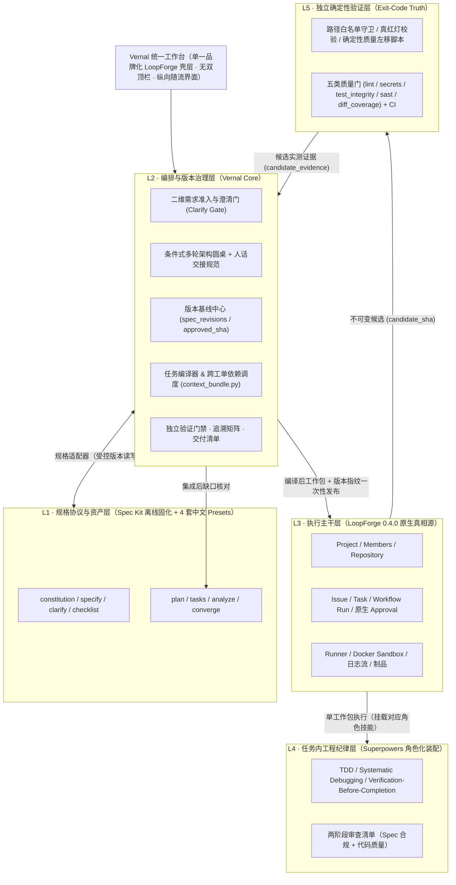
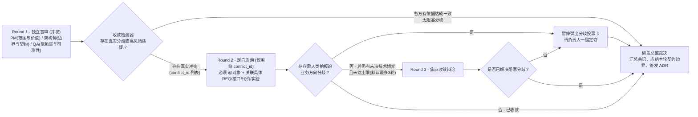

# Vernal 标准化 AI 软件交付体系架构与实施开发方案书

> **文档状态**：Formal Architecture & Implementation Spec v1.1（2026-11-26）  
> **适用代码库**：`vernal-loopforge`（基于上游 `LoopForge 0.4.0` 执行主干 + `Vernal` 编排治理延伸层 + `Spec Kit` 规格协议层 + `Superpowers` 任务纪律层）  
> **前置基线**：基于本次工作区代码快照开展增量实现。默认 `runtime_backend="loopforge"` 的本机 Runner、公用 Docker 沙箱及不同 Harness，必须按批提供对应的实测证据；不得由单元测试通过推断真实模型调用已跑通，也不得把工作区改动称为已合入主分支。  
> **修订说明**：v1.1 纳入审批并发、不可变快照、需求身份、运行基线、收敛补单与分期依赖审查。按批交付，开发者完成自审和测试后交由负责人验收，验收后推进下一批。P0 暂保留旧规格生产入口；Spec Kit 接管写源在 P1 完成迁移后启用。

> **核心目标**：以**“版本化单一事实源 + 三体合一防断裂约束”**为脊梁，把 `Spec Kit` 深度贯穿软件交付全流程，融合条件式多轮圆桌辩论、去机器味“人话”交接、6 套经典工程 SOP 模板、回归 LoopForge 原生精密美学的前端工作台，以及 `Superpowers` 角色化工程纪律，实现从“一句话想法/存量改造”到“可审计、可回滚、证据闭环”的标准化交付。

---

## 第 0 章 · 三体合一强制约束与防断裂工程红线（必读）

> [!CAUTION]
> **历史教训**：此前 Vernal 与 LoopForge 曾因并行建设第二套目录、第二套审批、第二套壳层，以及模块间隐式约定漂移（如 `adrs` 字段导致 SRS 静默丢失、详设写入子目录而追溯只扫顶层、需求字段名不统一、文档修改后旧批准仍有效），导致系统呈现“多段断开”的拼装形态。  
> 本次引入 **Spec Kit** 后，全平台形成 **Spec Kit × Vernal × LoopForge** 三方协作，**以下 8 条约束为不可妥协的最高工程红线，违背任意一条视为架构不合规，禁止合入。**

### 0.1 铁律一：全系统单一事实源（Zero Dual-Write / Zero Shadow State）

每个领域对象在整个平台中**只能存在唯一一个权威写源**，其余两方只能只读引用或经由单一投影函数单向同步：

| 领域对象 | 唯一权威写源（Authoritative Owner） | 其余两方职责（严禁独立改写） | 明确退役 / 严禁行为 |
|---|---|---|---|
| **项目宪章与工程规矩** | Spec Kit `.specify/memory/constitution.md` 的不可变修订；`docs/CONSTITUTION.md` 为展示投影，`project_decisions` 保存不得抵触宪章的版本化决策 | 单向编译并幂等同步为 LoopForge 全局 `Rule`（`decisions_rule_id`） | 严禁在 LoopForge 侧手工维护第二套不同步的全局规则 |
| **功能规格与澄清结论** | Spec Kit 文件为工作副本；发布后的权威正文为 `doc_versions` 不可变快照，`spec_revisions` 引用该快照，`clarifications` 记录问答来源 | `docs/SRS.md` 仅为跨功能只读聚合视图；LoopForge Issue 仅消费绑定版本的规格快照 | **彻底退役 `prd_spec.json` 与 `PRD_SPEC.md` 双写**（旧工作区仅保留只读兼容读取） |
| **架构方案、ADR 与详设** | `specs/<feature_id>/plan.md` + `docs/adr/ADR-*.md` + 统一详设产物 `.autodev/design/<milestone_id>/<squad_id>.json`（渲染至 `docs/design/`） | Vernal 统一路径解析器供文档中心与追溯矩阵共同消费；LoopForge 编码/审查只读消费版本化上下文包 | 严禁写入方与扫描方各自拼路径；严禁在详设中篡改需求定义 |
| **任务草案 vs 运行任务** | `specs/<feature_id>/tasks.md` **是版本化任务计划，发布后修改必须生成新修订并重新编译**；发布后唯一运行真源归 **LoopForge `Issue / Task / Run`** + Vernal `tasks` / `dispatch_records` 扩展锚点 | 任务经独立验证通过后，由 Vernal 单向回写 `tasks.md` 勾选状态与交付引用 | 严禁把 `tasks.md` 逐行裸建工单；严禁运行期手改 `tasks.md` 绕过编译器 |
| **候选产物与验证证据** | LoopForge Run 产出不可变候选（`candidate_commit_sha` / `artifact_digest`）→ Vernal 独立验证写入 `candidate_evidence` 与 `quality_results` | 追溯矩阵与交付清单只认绑定当前 `candidate_sha` 的实测证据 | 严禁仅凭任务状态 `APPROVED` 或目录静态 grep 标记判需求已验证 |
| **审批门禁与交付签收** | 执行节点审批归 LoopForge 原生 `approval` 节点；规格/详设/行级 Diff/里程碑签收归 Vernal `gate_records` / `code_reviews` | 全部强制绑定 `target_sha` 乐观锁，双向状态对账，汇聚至统一收件箱 | 严禁无内容哈希绑定的“永久批准”；严禁恢复第二套平行原生审批队列 |

### 0.2 铁律二：唯一执行主干（All AI Execution Runs Through LoopForge）
- Spec Kit 的所有 AI 步骤（`constitution`、`specify`、`clarify`、`checklist`、`plan`、`tasks`、`analyze`、`converge`）与编码、验证、审查步骤，**100% 经由 LoopForge 原生 SOP Run（本机 Runner 或公用 Docker 沙箱）派发执行**。
- **硬禁令**：
  1. 严禁 Spec Kit 另起旁路 CLI 直接请求外部模型 API，绕过 Vernal 模型安全网关（密级隔离、预算预留、真实模型审计）与 LoopForge 执行日志；
  2. 适配 Spec Kit 或其扩展时不得另建独立审批流/失败恢复调度器，与 LoopForge / Vernal 形成双控重试；若未来引入子流，必须受 Vernal 单一调度租约与 `dispatch_records` 管控。

### 0.3 铁律三：一根不可断链的版本指纹贯穿全周期（One Content-SHA Thread）
全链路所有持久化记录与远端上下文包，必须强制串联以下版本链条：
```text
constitution_sha
  → spec_rev_id (feature_id + rev_no + spec_sha)
    → clarification_rev_sha & decision_version
      → plan_sha & contract_sha (按本轮功能增量冻结)
        → compiled_task_hash (任务编译器输出指纹)
          → dispatch_record (exec_seq + lf_issue_id + lf_task_id + lf_run_id + preset_version + skill_version)
            → candidate_sha (commit_sha / artifact_digest)
              → evidence_sha & review_round_sha
                → approval_record (绑定 target_sha)
                  → delivery_manifest (不可变交付清单)
```
- **硬规则**：
  - 上游变化后计算需求、契约与依赖的影响集合；受影响批准对新基线标为 **`STALE`**，历史决定及其内容快照保留。无关任务依据冻结的工作包输入继续运行，纳入新交付基线前须记录兼容性判定或重新验证；无法证明无关时按受影响处理。
  - 迟到的旧 `exec_seq` / 旧 `spec_sha` / 旧 `compiled_task_hash` 执行结果**必须被硬拒收**，绝不覆盖新版状态。

### 0.4 铁律四：唯一领域契约模块 + 严禁静默吞错（Single Schema + Fail-Loud）
- 三方交换的所有结构化模型（`RequirementItem`、`ClarificationItem`、`CouncilRebuttal`、`DetailedDesign`、`CompiledWorkPackage`、`HandoffBrief`、`ReviewVerdict`）与所有产物路径解析函数（如 `detailed_design_json_path()`、`feature_spec_dir()`）统一收口在 `autodev/models.py`（或迁入 `autodev/domain/contracts.py`），**禁止跨模块手写字符串字段名或路径拼接**。
- **硬禁令**：跨模块解析、Schema 校验、文档同步、追溯扫描处**严禁编写 `except Exception: pass`** 静默吞错。任何契约不兼容必须显式抛出结构化错误、记录事件并阻断流转。

### 0.5 铁律五：唯一运行时主路径（No Local-Only Feature）
- 所有新增功能（澄清门、Spec Kit 适配、任务编译、条件式辩论、质量左移、集成后收敛）必须首先在默认主路径 `runtime_backend="loopforge"`（覆盖**本机 Runner** 与 **公用 Docker 沙箱**双执行池，含 `codex` / `opencode` / `dsh` 差异适配）端到端闭环验证。
- `local` / `mock` 仅作为离线单元测试替身，严禁出现“仅在 `local` 模式下生效、`loopforge` 模式绕过或失效”的功能分叉。

### 0.6 铁律六：唯一用户心智与无缝工作台（One Unified Vernal Experience）
- 用户视角下**只存在一个产品 Vernal**，严禁向用户暴露“Spec Kit 原始文件区 / Vernal 独立壳层 / LoopForge 原生区”三套割裂心智。
- 面向人类的规格书、圆桌辩论、任务标题、交接便签与主时间线默认摘要中，**不展示** `issue-179560...`、`FILE_DELIVERY_STAGES`、`.vernal-baseline.json`、`submit_gate_result` 等底层协议术语；授权用户的诊断展开区可保留可追溯标识与必要技术细节。

### 0.7 铁律七：Superpowers“只管门内、不越门外”
- Superpowers 技能（TDD、系统排障、完成前核验、两阶段审查）严格限定在**单个受控工作包内部**生效：
  - 规格已批准后，技能不得重新发起需求访谈；
  - 平台已准备隔离工作区后，技能不得嵌套创建新的 git worktree；
  - 平台已有跨任务调度器，技能不得擅自启动跨工单并行；
  - 技能不得绕过平台独立验证节点自行合并分支、清理现场或宣布交付完成。

### 0.8 铁律八：写入 CI 的「跨边界反断裂集成探针」（每批必过）
P0 起逐批启用与该批已实现能力对应的探针；P0 启用规格、文档、门禁与追溯探针，P1/P2 加入最小编译派发，P3 加入变更传播，P4 加入收敛。每批合并前，既有已启用探针持续必过。自动化跨边界探针套件 `tests/test_anti_fragmentation_probes.py`（无 Mock 绕过关键转换）：
1. **规格-追溯闭环探针**：真实产出圆桌/Spec 产物 → 真实调用文档同步与追溯构建 → 断言 `docs/SRS.md` 非空、需求条数 > 0、详设链接非空且字段完全吻合；
2. **版本失效探针**：批准源规格 `v1`（绑定快照）→ 修改源规格发布 `v2`（P0 过渡期使用版本化 SRS，P1 后 SRS 只读）→ 断言门禁与文档状态自动变 `STALE`，拦截下游派单；
3. **编译-派发-防回滚探针**：任务编译器真实编译 `tasks.md` → 验证生成的 LoopForge Issue 载荷携带 `spec_sha` / `contract_sha` / `preset_version` → 注入迟到旧 `exec_seq` / 旧 `spec_sha` 结果断言被拒收；
4. **收敛不改需求探针**：模拟集成后漏实现一条 `REQ-002` → 运行 `converge` → 断言追加补缺任务且 `spec.md` 原哈希保持零改动。

### 0.9 既有基础工程红线（持续生效）
1. **绝不修改上游 LoopForge `0.4.0` 源码与 MySQL 表结构**（仅通过公开 REST API、版本化资产配置与薄前端挂载层集成）；
2. **SQLite 迁移 100% 幂等向后兼容**（`CREATE TABLE IF NOT EXISTS` + `PRAGMA table_info` 条件 `ALTER TABLE`，旧工作区启动零报错）；
3. **前端严守 LoopForge CSP 与离线优先**（零内联事件、零 `eval`、零公网 CDN；离线库须 vendor 至 `static/vendor/` 并随 `./vernal.sh --pack` 打包；改样式必须运行 `scripts/build_vernal_stage_css.py` 并递增 `OVERLAY_VERSION`）。

---

## 第 1 章 · 总体架构与五层职责边界

### 1.1 五层协同架构图



### 1.2 核心定位一句话总结
- **Spec Kit**：负责“把软件意图写清楚、结构化、可演进”（方法论、目录协议、中文 Preset 与校验模板）；
- **Vernal**：负责“管版本、做决策、编任务、盯跨组依赖、守质量与交付底线”（单一控制平面）；
- **LoopForge**：负责“建工单、派算力、隔沙箱、管日志、走原生审批”（单一执行主干）；
- **Superpowers**：负责“约束每个工位内部怎么写代码、怎么排障、怎么自证完成、怎么两段式审查”（任务内工程纪律）；
- **OpenHands（借鉴层）**：当前阶段优先吸收其**执行端能力探测、登录态/模型聚合展示、会话与工作区解耦**思路来强化既有 Runner 与 Link，不贸然引入第二套执行后端。

---

## 第 2 章 · P0 地基：四处既有断链根治与增量版本绑定模型

> **优先级**：**最高（P0）**。必须在接入 Spec Kit 与改造任何智能体前完成并全量验收。

### 2.1 四处已复现代码断链的精确修复方案

| 编号 | 现状缺陷（已源码核实） | 根因位置 | 精确修复方案 |
|---|---|---|---|
| **BUG-1** | SRS v1 批准后修改为 v2，文档状态与门禁仍显示 `PASSED / APPROVED` | [docs_center/service.py](sandbox:/Users/zomeryang/Documents/春天/个人科研/lattice-mesh/workspaces/standard-delivery-p0/autodev/docs_center/service.py)、[process/runner.py](sandbox:/Users/zomeryang/Documents/春天/个人科研/lattice-mesh/workspaces/standard-delivery-p0/autodev/process/runner.py)、[db.py](sandbox:/Users/zomeryang/Documents/春天/个人科研/lattice-mesh/workspaces/standard-delivery-p0/autodev/db.py) | 为 `gate_records` 增量增加 `target_sha TEXT NOT NULL DEFAULT ''` 与 `target_version INTEGER NOT NULL DEFAULT 0`；创建审批请求时冻结 `target_sha` 与快照引用；`decide_gate` 在同一事务中核对请求轮次、冻结目标与当前内容，绝不在批准时把旧请求重新绑定到最新内容。前端回传 `expected_sha`，服务端独立校验；`save_doc_version` 产生新 `content_sha` 时，自动检测同文档已通过门禁，若 `gate.target_sha != latest.content_sha`，将文档状态判定为 **`STALE`（已变更待重审）**，并创建新一轮 `PENDING`。强制新轮次须覆盖旧记录仍为 PENDING 的情形；旧记录保留 `decision_status`、审批人和正文快照。 |
| **BUG-2** | 圆桌输出写入 `prd_spec.json` 含 `adrs` 字段，被 `ProductSpec(_Strict)` 拒绝且被 `except Exception: pass` 静默吞掉，导致 `docs/SRS.md` 根本未生成 | [council.py](sandbox:/Users/zomeryang/Documents/春天/个人科研/lattice-mesh/workspaces/standard-delivery-p0/autodev/council.py)、[models.py](sandbox:/Users/zomeryang/Documents/春天/个人科研/lattice-mesh/workspaces/standard-delivery-p0/autodev/models.py)、[docs_center/service.py](sandbox:/Users/zomeryang/Documents/春天/个人科研/lattice-mesh/workspaces/standard-delivery-p0/autodev/docs_center/service.py) | ① 统一圆桌共识与 `ProductSpec` 契约：`CouncilConsensus` 输出结构化 `requirements: list[RequirementItem]` 与 `nfrs: list[RequirementItem]`，ADR 单独存储于 `consensus.adrs` 与 `docs/adr/`，写入规格快照时严格通过 `ProductSpec.model_validate(...)` 校验；② **删除 `sync_standard_docs_from_artifacts` 中吞掉异常的 `except Exception: pass`**，改为显式抛错/记录 `doc.sync_failed` 事件并阻断进入下游阶段；③ 对旧工作区遗留 `prd_spec.json` 只读兼容：验证前在内存副本中剥离冗余 `adrs` 字段，保留原文件，不做破坏性迁移。 |
| **BUG-3** | 详设写入 `.autodev/design/<milestone_id>/<squad_id>.json`，但追溯扫描只用 `design_dir.glob("*.json")` 查顶层，详设追溯恒为空 | [docs_center/service.py](sandbox:/Users/zomeryang/Documents/春天/个人科研/lattice-mesh/workspaces/standard-delivery-p0/autodev/docs_center/service.py)、[trace/service.py](sandbox:/Users/zomeryang/Documents/春天/个人科研/lattice-mesh/workspaces/standard-delivery-p0/autodev/trace/service.py) | 抽取共享路径函数 `iter_detailed_design_json_paths(ws)`，使用 `design_dir.rglob("*.json")` 并同时支持按 `milestone_id` 过滤与去重最新修订；同时兼容解析 `squad_id` / `module` 与 `tc_id` / `id`。 |
| **BUG-4** | `ProductSpec` 使用 `requirements` / `nfrs`（字段 `acceptance`），追溯读取 `functional_requirements` / `non_functional_requirements`（字段 `acceptance_criteria`） | [models.py](sandbox:/Users/zomeryang/Documents/春天/个人科研/lattice-mesh/workspaces/standard-delivery-p0/autodev/models.py)、[trace/scan.py](sandbox:/Users/zomeryang/Documents/春天/个人科研/lattice-mesh/workspaces/standard-delivery-p0/autodev/trace/scan.py) | `extract_requirements_from_sources` 在 P0 **直接消费规范模型 `RequirementItem`（主字段 `requirements` / `nfrs` / `acceptance`）**；Spec Kit `specs/*/spec.md` 解析器在 P1 接入，仅对历史遗留 `functional_requirements` 保留只读回退解析，并补充双字段对照回归测试。 |

### 2.2 增量版本绑定数据模型（复用既有 SQLite 表，防过度建模）

复用现有正文快照及数据库。P0 实现审批目标绑定与需求生命周期，P1 才启用规格修订/澄清表，P3/P4 按实际消费方补齐任务和证据锚点。不得预先宣称尚未接通的表已形成闭环。在 [autodev/db.py](sandbox:/Users/zomeryang/Documents/春天/个人科研/lattice-mesh/workspaces/standard-delivery-p0/autodev/db.py) 中做**极简增量扩展**（2 张新表 + 5 张既有表补齐版本锚点）：

#### A. 新增 2 张核心表（幂等 `CREATE TABLE IF NOT EXISTS`）
```sql
-- 1. 功能级规格修订表（Spec Kit specs/<feature_id>/ 与 Vernal 版本真源的唯一桥梁）
CREATE TABLE IF NOT EXISTS spec_revisions (
    rev_id INTEGER PRIMARY KEY AUTOINCREMENT,
    feature_id TEXT NOT NULL,                  -- 如 "001-clarify-gate" 或 "core"
    rev_no INTEGER NOT NULL,                   -- 1, 2, 3...
    source_kind TEXT NOT NULL DEFAULT 'spec',  -- 'constitution' | 'spec' | 'plan' | 'tasks'
    rel_path TEXT NOT NULL,                    -- 如 "specs/001-clarify-gate/spec.md"
    content_sha TEXT NOT NULL,                 -- 规范化 UTF-8 内容 SHA-256
    content_version_id INTEGER NOT NULL REFERENCES doc_versions(id), -- 不可变正文，不得只保存可变路径
    parent_rev_id INTEGER,
    preset_id TEXT NOT NULL DEFAULT '',
    preset_version TEXT NOT NULL DEFAULT '',
    speckit_version TEXT NOT NULL DEFAULT '',
    status TEXT NOT NULL DEFAULT 'DRAFT',      -- DRAFT | APPROVED | STALE | ARCHIVED
    approved_gate_id INTEGER,
    author TEXT NOT NULL DEFAULT 'system',
    summary TEXT NOT NULL DEFAULT '',
    created_at TEXT NOT NULL,
    UNIQUE(feature_id, source_kind, rev_no)
);

-- 2. 需求澄清问答持久表（支持暂停等待用户回答、写回指定规格修订）
CREATE TABLE IF NOT EXISTS clarifications (
    clarify_id INTEGER PRIMARY KEY AUTOINCREMENT,
    feature_id TEXT NOT NULL,
    spec_rev_id INTEGER NOT NULL,              -- 提问所基于的规格修订
    question_key TEXT NOT NULL,                -- 如 "Q-01"
    category TEXT NOT NULL DEFAULT 'scope',    -- scope | interface | acceptance | constraint | non_goal
    severity TEXT NOT NULL DEFAULT 'BLOCKING', -- BLOCKING（影响交付承诺必答）| DEFAULTED（低风险带默认值可覆盖）
    question TEXT NOT NULL,
    options_json TEXT NOT NULL DEFAULT '[]',   -- 选择题选项列表
    default_option TEXT NOT NULL DEFAULT '',
    answer TEXT NOT NULL DEFAULT '',
    rationale TEXT NOT NULL DEFAULT '',
    status TEXT NOT NULL DEFAULT 'OPEN',       -- OPEN | ANSWERED | AUTO_DEFAULTED | SUPERSEDED
    answered_by TEXT NOT NULL DEFAULT '',
    applied_rev_id INTEGER,                    -- 回答合并后产生的新 spec_rev_id
    created_at TEXT NOT NULL,
    updated_at TEXT NOT NULL,
    UNIQUE(feature_id, spec_rev_id, question_key)
);
```

#### B. 既有 5 张表增量补齐版本锚点（`PRAGMA table_info` 幂等 `ALTER TABLE`）
1. **`gate_records`**：P0 新增 `target_path`、`target_sha`、`target_version`、`target_snapshot_json`、`decision_status`、`stale_reason`；快照集合引用 `doc_versions.id`。P1 按需增加功能修订关联，历史决定单独保留。
2. **`tasks`**：新增 `feature_id TEXT DEFAULT ''`、`spec_rev_id INTEGER DEFAULT 0`、`spec_sha TEXT DEFAULT ''`、`plan_sha TEXT DEFAULT ''`、`compiled_task_hash TEXT DEFAULT ''`、`resource_locks_json TEXT DEFAULT '[]'`、`handoff_brief_json TEXT DEFAULT '{}'`；
3. **`dispatch_records`**：新增 `spec_sha TEXT DEFAULT ''`、`contract_sha TEXT DEFAULT ''`、`compiled_task_hash TEXT DEFAULT ''`、`asset_versions_json TEXT DEFAULT '{}'`（记录 `speckit_version` / `preset_version` / `skill_versions`）；
4. **`candidate_evidence`**：新增 `spec_sha TEXT DEFAULT ''`、`contract_sha TEXT DEFAULT ''`、`evidence_sha TEXT DEFAULT ''`、`spec_review_verdict TEXT DEFAULT ''`、`quality_review_verdict TEXT DEFAULT ''`；
5. **`milestone_deliveries`**：新增 `manifest_json TEXT DEFAULT '{}'`（固化交付清单：关联 `constitution_sha`、`spec_revisions`、`decisions` 版本、所有任务 `dispatch_id/run_id/candidate_sha`、验证证据、审批记录与发布标签）。

### 2.3 运行中需求变更影响传播状态机

当项目运行中途发生需求修订（编辑 `spec.md`、回答新澄清或发起阶段 Steering 变更）产生新 `spec_rev_id (rev N+1)` 时，由 Vernal 统一计算**变更影响清单（Impact Set）**并执行确定性动作：

| 任务当前状态 | 是否受变更影响（命中变更的 `REQ-xxx` / 契约 / 依赖上游） | 系统确定性行为 |
|---|---|---|
| `BLOCKED` / `READY`（未派发） | 是 | 立即按新 `spec_sha` 重新运行任务编译器，更新 `compiled_task_hash` 与上下文包后再允许派发 |
| `IN_PROGRESS` / `VERIFYING` / `REVIEWING`（在途） | **否（无关）** | 按原工作包输入基线继续执行；归入新交付基线时记录兼容依据或追加重验 |
| `IN_PROGRESS` / `VERIFYING` / `REVIEWING`（在途） | **是（受影响）** | 标记当前 `dispatch_record` 为 `SUPERSEDING`，请求 LoopForge `pause_run`；**撤销旧尝试的写入租约并隔离旧工作区，仅在确认远端已暂停/终态且旧尝试不能再写入新版工作区后**递增 `exec_seq` 重编译派发新版 |
| `APPROVED` / `MERGED`（已完成） | **是（受影响）** | 保留已有代码实现不粗暴删除，仅对受影响的需求承诺发起增量返工或 `verify_only` 回归重验；其旧 `candidate_evidence` 对新 `spec_sha` 自动标为失效 |
| **迟到的旧 Run 回传结果** | 任意 | 调度器收割时强制比对 `dispatch.spec_sha == task.spec_sha` 且 `dispatch.exec_seq == task.exec_seq`，**不匹配时保留历史尝试、产物和费用记录，标记 `stale_result_rejected`，禁止更新当前任务或发布状态**，绝不污染新版状态 |

---

## 第 3 章 · Spec Kit 三层深度集成设计

### 3.1 Spec Kit 全生命周期映射与关键边界

Spec Kit 正式作为 Vernal 的**核心规格与设计协议引擎**贯穿交付全链路，但所有步骤的执行权、持久化与门禁判定归 Vernal + LoopForge：

| 平台交付环节 | Spec Kit 能力 | 在 Vernal 中的具体作用与产出 | 控制与验收边界 |
|---|---|---|---|
| **建项 / 存量接管** | `constitution` | 建立项目原则 `docs/CONSTITUTION.md`（技术栈红线、依赖策略、兼容性与测试底线），同步为 LoopForge 全局 Rule | 存量项目先跑 Repo Map，保留既有约束，不重写无关规则 |
| **整理需求** | `specify` | 生成功能独立目录 `specs/<feature_id>/spec.md`（纯 What/Why、用户场景、EARS `REQ-xxx`、`Non-Goals`、验收标准） | 自动投影更新聚合视图 `docs/SRS.md`；不混入实现细节 |
| **解决歧义** | `clarify` | 扫描 `spec.md` 歧义，写入 `clarifications` 表；`BLOCKING` 问题暂停交用户选择确认，回答后回写生成 `spec.md` 新修订 | 不强制低风险细节反复打断用户（给出可覆盖默认值） |
| **审阅规格** | `checklist` | 生成规格质量自检清单（需求完整性、无歧义、可测性检查） | **只检查规格表达质量，绝不替代后续自动化测试报告** |
| **架构与技术规划** | `plan` | 结合条件式圆桌决策，产出 `specs/<feature_id>/plan.md`、数据模型、增量契约方案与 `docs/adr/ADR-*.md` | 严格校验遵循 `CONSTITUTION.md` 与已批准的 `spec_sha` |
| **拆解工作草案** | `tasks` | 产出依赖有序的任务草案 `specs/<feature_id>/tasks.md` | **仅作为任务编译器输入草案，不直接逐行建 LoopForge Issue** |
| **编码前一致性体检** | `analyze` | **强制在 `tasks` 之后执行**：跨文件核验 `CONSTITUTION ↔ spec.md ↔ plan.md ↔ tasks.md` 是否漏 `P0 REQ`、存在矛盾或不可测项 | 存在 `CRITICAL` 矛盾直接阻断进入任务发布与编码阶段 |
| **受管任务实现** | `implement` 方法 + Superpowers | 在编译后的受控工作包内按 TDD/排障纪律实施代码与测试 | 生命周期、白名单与交付打包由 LoopForge SOP 与 Vernal 强制把关 |
| **集成后缺口核对** | `converge` | 里程碑集成验证后，对照批准版 `spec.md` + 真实候选代码 + 实测证据核查遗漏行为 | **只能追加补缺任务或退回返工；严禁反向修改 `spec.md` 去迁就已经写出的残缺代码** |

### 3.2 三层落地架构

#### 第一层：离线固化上游资产层（`autodev/assets/speckit/`）
- 在仓库内锁定经过验证的 Spec Kit 上游模板、规范 Schema 与版本清单 `autodev/assets/speckit/manifest.json`（含 `speckit_version`、文件 SHA-256 校验和）。
- 随 `./vernal.sh --pack` 一并离线打包，**规格资产运行期零公网依赖；模型、构建依赖与执行器联网策略另行声明并验收**。
- 每次项目初始化或步进执行时将 `speckit_version` 与 `preset_version` 写入 `spec_revisions` 和 `dispatch_records`：升级上游版本时先跑标准样板回归集，**正在进行中的历史项目继续锁定原资产版本**，防止升级导致解析失效。

#### 第二层：四套 Vernal 中文 Presets（`autodev/assets/speckit/presets/`）
遵循 Spec Kit 分层覆盖机制（项目本地覆盖 > 启用 Preset > 启用 Extension > 固化核心默认；逐模板明确 replace/append/prepend/wrap 与优先级，基础约束由平台校验器兜底），不修改上游核心模板文件，沉淀 4 套 Vernal 维护的中文交付 Preset：

| Preset ID | 服务对象 | 定制核心内容 |
|---|---|---|
| **`vernal-core`**（基础必选） | 所有项目 | 统一中文 EARS `REQ-xxx`/`NFR-xxx` 编号规范、强制 `Non-Goals` 章节、可自动化验证判据要求、人话表达规范（禁用平台内部黑话）、`TC-xxx` 与 `@pytest.mark.req` 映射规则 |
| **`vernal-lite`** | 极简原型、单体小工具、局部低风险修改 | 精简 1 页规格与 1 页技术方案模板，合并契约与实现步骤，关闭重型多组详设与冗余文档仪式 |
| **`vernal-standard`** | 多模块新系统与中大型功能交付 | 完整 `CONSTITUTION` + EARS 规格 + C4/时序图 + MADR + 增量契约冻结检查单 + `analyze` 跨产物核对规则 + GB/T 8567 导出映射 |
| **`vernal-existing`** | 存量代码目录/Git 仓库增量改造 | 强制前置 Repo Map 现状摘录、Delta Spec（`ADDED / MODIFIED / REMOVED`）模板、向下兼容红线清单、存量回归验证范围要求 |

#### 第三层：规格适配器（`autodev/speckit/adapter.py`）与任务编译器（`autodev/speckit/compiler.py`）
这是把三方焊为一体的核心工程层：

1. **规格适配器（Spec Adapter）**：
   - 统一封装 `run_step(engine, feature_id, step_name, preset_id)`；
   - **全部通过 LoopForge 规划 SOP 派发执行**，允许调用固定版本的 `specify-cli` 做确定性初始化与模板解析；禁止另建 AI 调度与审批主干；
   - **针对 `dsh` 等 CLI 的专门兜底**：由于 Spec Kit 原生 `dsh` 集成忽略 `model` 与结构化输出参数，Vernal 规格适配器统一由 `LoopForgeHarness` 注入显式模型配置与文件落地协议（写入指定 Markdown 产物 + 结构化摘要 JSON），并经 `validate` 确定性脚本节点做格式与 Schema 校验，不合法自动打回重写，统一输出契约并验证各执行器能力；无法验证模型选择或结构化产物时明确阻塞，不承诺各执行器原生能力相同。
   - 步骤完成后自动计算 `content_sha`、落库 `spec_revisions`、触发聚合视图 `docs/SRS.md` 同步与门禁状态刷新。

2. **任务编译器（Task Compiler，扩展自 [autodev/context_bundle.py](sandbox:/Users/zomeryang/Documents/春天/个人科研/lattice-mesh/workspaces/standard-delivery-p0/autodev/context_bundle.py)）**：
   - 将 `specs/<feature_id>/tasks.md` 中的微观步骤（2~5 分钟颗粒度）**按高内聚模块、同一验收边界和同一研发组领地合并编译为可独立验收的工作包（CompiledWorkPackage）**，绝不 1:1 裸建碎片工单。
   - **8 项强制编译校验（任一不通过即阻断发布并退回修订）**：
     1. **需求存在性**：任务引用的所有 `REQ-xxx` 必须存在于当前批准版 `spec_revisions`；
     2. **依赖无环且有序**：DAG 拓扑排序校验无环，跨里程碑依赖方向合法；
     3. **修改范围明确且无冲突**：`allowed_paths` 非空且明确，非 `contract` 任务不含受保护契约路径；
     4. **前置契约真实可访问**：依赖契约任务或已冻结 `contract_sha` 真实存在且可读；
     5. **验证命令可执行且自洽**：存在非空 `verify_cmds`，且当命令为测试发现类（`unittest discover` / `pytest` / `node --test`）时必须校验测试文件可读、测试被真实发现并执行；只有需要新增或修改测试时才要求写入白名单包含测试路径；
     6. **执行环境能力匹配**：对照当前生效执行池（本机 Runner / 公用 Docker）真实探测能力检查所需工具链是否存在，缺依赖直接给出可执行预检提示；
     7. **幂等防重发**：基于 `(feature_id, task_key, compiled_task_hash)` 核查既有已发布工单，禁止重复创建相同任务；
     8. **共享资源冲突检测（Resource Locks）**：显式标注可能争用的共享资源（如 `db:migrations`、`lockfile:uv.lock`、`port:8080`、`file:package.json`、`config:global`），即使任务在 `tasks.md` 中被标为 `[P]` 可并行，**凡同一实际资源作用域内存在互斥访问的任务，由编译器注入串行依赖或带租约的资源锁，禁止调度器并发派发导致互相踩踏**。

### 3.3 多轮迭代与持续演进机制（Spec Kit 不只跑一次）
- 第一版交付并归档后，用户提出第二轮需求（如“增加批量导出”）：
  - 新建功能目录 `specs/002-batch-export/`，**直接引用当前仓库已批准的 `.specify/memory/constitution.md` 修订 与 `docs/ARCHITECTURE.md` 基线**（无需推翻重写）；
  - 使用 `vernal-existing` Preset 生成 Delta Spec、澄清增量歧义、增量冻结受影响接口契约、编译增量工作包并执行；
  - 交付通过后自动将增量规格合入聚合 `docs/SRS.md` 与架构索引，保持全生命周期持续一致。

---

## 第 4 章 · 需求接入、交互式澄清、条件式圆桌辩论与“人话”交接体系

### 4.1 二维需求准入评估（淘汰“按字数分级”）

将**项目来源**与**需求清晰度**正交解耦，杜绝把“把按钮文字改成保存”（短但极清晰）和“做一个支持所有 LaTeX 的转换平台”（短但极模糊）混为一谈：

| 维度 1：项目来源 (`source_origin`) | 维度 2：需求清晰度 (`clarity_level`) | 自动推荐 Preset & 流程路径 |
|---|---|---|
| `greenfield`（全新构建） / `existing_local`（本机目录） / `existing_git`（Git 仓库） | **`READY_LITE`（目标、范围、验收明确且影响面局部）** | 直接选用 `vernal-lite` + `quick-prototype`（或 `bugfix-triage`），展示默认约束，免重型圆桌直达快速规格与编码 |
| 任意来源 | **`NEEDS_CLARIFICATION`（目标/边界/验收/约束存在影响交付承诺的缺口）** | **强制先进入 Clarify Gate**：PM 围绕“目标形态、首版范围/Non-Goals、接口边界、验收方式”只提出尚未解决且影响交付承诺的问题，允许 0 个；单轮原则上不超过 3 个，用户确认后自动重评估 |
| 任意来源 | **`READY_STANDARD`（复杂多模块需求或自带完整 PRD/架构文档）** | 选用 `vernal-standard`（存量叠 `vernal-existing`）+ 条件式圆桌 + `analyze` 体检 + 分波次契约冻结与多组并行开发 |

- **前置条件与人工体验项分流**：体检阶段识别出的物理真机体验、外部未授权账号/密钥、断网环境缺失系统二进制等事项，直接标为「前置条件阻塞」或写入 `spec.md` 的「交付后人工体验项」，自动化 DAG 可包含明确的人工作业等待节点和可自动安装的环境准备节点；核心验收条件不得自动降级为交付后体验项。

### 4.2 交互式澄清门（Clarify Gate）设计
- 仅对**影响交付承诺（架构选型、用户核心体验、接口边界、验收红线）**的歧义标为 `severity="BLOCKING"`，暂停流程交由用户作答；
- 对**低风险工程细节**（如默认端口、分页默认值、内部目录名）标为 `severity="DEFAULTED"`，直接展示“已按推荐默认值选定，展开可修改”，不打断用户；
- `BLOCKING` 问题优先提供选择题；只有存在有依据的安全默认值时提供推荐项与批量确认，否则等待负责人明确决定；回答后持久化至 `clarifications` 表，自动生成新 `spec_rev_id` 并进入下游。

### 4.3 条件式多轮架构圆桌（Debate-on-Conflict）

保留多视角碰撞价值，同时消除“每人只说一句”与“为了凑轮数硬造反对意见”两个极端：



- **铁律约束（防止空洞辩论）**：
  1. **不强制反对**：允许任何角色在给出具体依据的前提下表达 `AGREE`，严禁为了凑辩论而挑刺；
  2. **质疑必须带锚点**：任何 `CHALLENGE` / `AMEND` 发言必须明确绑定以下至少一项：关联的 `REQ-xxx`、具体接口签名、可验证实验/测试成本、或明确的工程取舍代价（Trade-off）；
  3. **增量契约冻结**：研发总监裁决后只冻结**本轮功能及下游依赖所需接口契约**（如 `contracts/<domain>/`），避免一期把整套未来系统契约一次性冻死。

### 4.4 彻底去“机器味”的 Prompt 重构与《工程师交接便签》

#### A. 物理隔离「业务思考层」与「平台搬运协议层」
- 从 [autodev/prompts.py](sandbox:/Users/zomeryang/Documents/春天/个人科研/lattice-mesh/workspaces/standard-delivery-p0/autodev/prompts.py) 的圆桌、澄清、规划、蓝图与审查主提示词中**彻底移除** `FILE_DELIVERY_STAGES`、`.vernal-baseline.json`、`vernal-files.json`、`submit_gate_result` 等底层搬运指令；
- 搬运协议仅作为 LoopForge 节点末尾的隔离系统脚手架注入，并在共享 Prompt 模块 `autodev/prompts_style.py` 中硬性规定：**“所有对外发言、规格书、ADR、任务描述与交接便签中，严禁出现 `issue-xxx`、工作项编号、文件交接模式、本工位独立完成、平台集成验证等平台内部黑话。”**

#### B. 全角色共享《沟通风格规范》与正反 Few-shot
- **倒金字塔表达**：首句 ≤ 40 字直接给结论与判断，禁用“综合分析上述材料，经过审慎评估，建议如下……”等废话铺垫；
- **角色鲜明口吻**：PM 直击范围取舍与用户价值，架构师讲清接口边界与演进代价，QA 直指漏洞与可测性红线，总监拍板干脆写清采纳/驳回理由；
- **正反例写进 Prompt**：直接附带真实反例（`建议工作项 issue-179560...`）与正例（`首版只做上传 .tex 转可编辑 .docx 下载，网页内编辑砍到二期，避免富文本编辑器拖垮交付`）。

#### C. 节点级《工程师交接便签（Handoff Brief）》
每个编码/审查节点产出结构化 `handoff_brief`（4 段白话，默认展示在界面首层，底层工具日志折叠在下方可随时展开）：
1. **我交付了什么**（1~2 句说清真实功能与变化）；
2. **下游怎么接**（入口文件、导出函数/接口与最小调用样例）；
3. **注意的边界与踩坑**（实现中锁定的假设与易错点）；
4. **验证方式与真实结果**（执行的命令 + 真实通过用例数与关键输出）。

---

## 第 5 章 · Superpowers 角色化装配、质量左移与 6 套经典 SOP 模板矩阵

### 5.1 Superpowers 角色化装配与防双控冲突表

将 `obra/superpowers`（及 `superpowers-devops`）能力以**版本化 Skill 资产**形式按角色精准挂载到 LoopForge Agent，同时写死平台控制边界：

| 平台环节 / 角色 | 装配的 Superpowers 方法 | 必须写入 Skill 的平台防冲突护栏 |
|---|---|---|
| **需求澄清（PM）** | `brainstorming` 结构化提问法 | 问题必须写入 Vernal `clarifications` 表；规格一旦 `APPROVED`，禁止再次触发需求访谈 |
| **工作包细化（Coder 启动前）** | `writing-plans` 微步骤拆解 | 仅在当前单个工作包内部拆解实施清单，严禁越权拆出新工单或修改 `allowed_paths` |
| **业务与缺陷编码（Coder）** | `test-driven-development` (TDD) | 仅适用于业务逻辑、契约与缺陷修复；纯配置/静态资源按校验脚本执行 |
| **失败返工与排障（Coder / Bugfix）** | `systematic-debugging` | 强制先区分「环境/依赖」「代码逻辑」「规格/契约缺陷」三类根因，严禁靠删断言或 `except: pass` 过关 |
| **编码结束汇报（Coder）** | `verification-before-completion` | 必须在当前回合真实执行完 `verify_cmds` 并附带真实输出与退出码，禁止凭记忆宣称通过 |
| **独立审查（Reviewer）** | **两阶段审查清单**（Stage 1 规格合规 → Stage 2 代码质量与安全） | 分别输出 `spec_compliance`（是否覆盖 `REQ-xxx`、未漏未跑偏）与 `code_quality`（安全/健壮性/测试真实性）；审查官禁止直接改业务代码 |
| **工作区管理** | Worktree 隔离思想 | **工作区创建、分支合并与清理 100% 归 Vernal / LoopForge 调度器控制，Skill 严禁嵌套建 worktree 或自行 merge/宣布交付** |

### 5.2 确定性质量左移与 Bugfix“真红灯”判据

1. **LoopForge 交付泳道质量左移**：
   - 将单任务标准泳道升级为：`implement（编码与自测） → package（产物打包 + Diff 影响面生成） → deterministic_gate（确定性质量脚本门） → review（两阶段独立审查）`；
   - `deterministic_gate` 脚本节点在**不消耗 Reviewer LLM Token** 的前提下，直接执行路径白名单守卫、密钥扫描（`secrets`）、空壳测试检测（`test_integrity`）与 Lint 检查；代码失败退回编码，环境或鉴权失败进入阻塞处理，配置重试次数、总预算及超时；
   - 仅当确定性硬门禁全绿时，才进入 Reviewer Agent 做“规格合规 + 代码深度质量”两阶段审查。
2. **Bugfix 泳道“真红灯”校验判据（修正假红灯漏洞）**：
   - 在 `bugfix` 泳道增加前置复现节点 `reproduce` + 脚本校验 `verify_reproduction`；
   - **严禁仅凭“命令退出码 != 0”判定复现成功**！脚本必须同时校验：
     1. 新增/指定的复现测试文件真实被测试框架发现并执行（executed tests ≥ 1，排除 pytest exit code 5 / unittest 0 tests）；
     2. 失败符合预先定义的目标缺陷签名；若目标本身是导入、启动或语法错误，则该错误可以构成有效复现。与目标无关的依赖缺失和运行器故障进入环境阻塞；
     3. 失败类型来自真实断言失败或目标缺陷异常（`AssertionError` / 目标异常栈命中被修模块）。

### 5.3 六套经典工程 SOP 模板矩阵

将顶层流程模板（`autodev/process/templates/*.yaml`）、Spec Kit Preset、LoopForge 泳道与 Superpowers 技能统一打通为 6 套开箱即用的经典模板：

| 模板 ID | 适用场景 | 绑定 Preset | 启用阶段与核心门禁 | 对应 LoopForge 泳道特征 |
|---|---|---|---|---|
| **`quick-prototype`**（新增，替换过重的默认轻量体验） | 单体小工具、算法模块、极简网页/原型、低风险小改 | `vernal-lite` | 可选澄清 → 1 页规格 → 直接编码与两段式审查 → 预览/交付（跳过多组圆桌与独立详设门） | 精简 1~2 组 2~4 卡，`implement → freeze_candidate → deterministic_gate → review → independent_verify` |
| **`greenfield-standard`**（升级 `standard`） | 多模块全新系统、正式产品研发 | `vernal-standard` | `CONSTITUTION` → 澄清 + EARS SRS（版本绑定批准）→ 条件式多轮圆桌 + ADR → `analyze` 体检 → M1 增量契约冻结 + 组级详设 → 并行 TDD + 风险人工 Diff 审查 → 五类质量门 + CI + `converge` 缺口核对 | 分泳道（backend/frontend/contract），全量质量左移 + 两段式审查 |
| **`brownfield-feature`**（升级 `feature`） | 存量本机目录 / Git 仓库新增特性 | `vernal-existing` | Repo Map 侦察 → Delta Spec（增/改/删 + 兼容红线）→ 增量设计与影响面确认 → `analyze` → 隔离分支开发 + 存量回归 + 人工 Diff 审查 → CI 合入并归档 Delta | 强制注入局部 Repo Map + 外部调用方影响面检查 |
| **`bugfix-triage`**（升级 `bugfix`） | 缺陷定位、集成报错与生产热修 | `vernal-existing` | 缺陷定界 → **真红灯复现门禁** → 最小外科手术补丁 → 复现转绿 + 回归 + 密钥/假测试门 → 人工补丁复核合入 | 专用 `bugfix` 泳道：`reproduce → verify_red → fix → freeze_candidate → verify_green → deterministic_gate → review` |
| **`refactor-hardening`**（新增） | 代码重构、解耦、性能与安全加固 | `vernal-existing` | **行为基线锁定（补齐特征测试）** → 重构计划（外部契约零破坏）→ 分步重构 + SAST/覆盖率/契约门禁 → 前后回归对比签收 | 强化静态安全扫描、变更行覆盖率与契约零破坏校验 |
| **`doc-reverse-onboarding`**（升级 `doc_reverse`） | 无文档遗留仓库首次接管建档 | `vernal-existing` | 静态符号拓扑 + Repo Map → 逆向还原 C4 架构、接口清单与核心 SRS → 人工基线签字 → 生成宪章与 `AGENTS.md` 修改建议，保留已有人工规则并经审核合入 | 只读分析 + 文档校验泳道，完成后平滑切换至 `brownfield-feature` |

> **向后兼容策略**：保留旧 `legacy` 模板 ID 映射到轻量兼容行为，确保既有工作区与 146+ 回归测试零破坏。

---

## 第 6 章 · 回归 LoopForge 审美的统一工作台前端重构规范

> **交付原则（采纳纵向协同调整）**：不把前端全部拖到最后统一返工。**在 P2 启动首个澄清界面前即锁定视觉基线与组件规范**，随 P2/P3/P4 纵向交付对应交互面，并在 P5 完成全局壳层减负、样式瘦身与离线渲染全面收敛。

### 6.1 视觉基线与架构减负（对齐 LoopForge 原生 Harness UI 精密克制美学）

1. **回归原生 Design Tokens，做减法不做加法**：
   - 清理 [vernal-overlay.css](sandbox:/Users/zomeryang/Documents/春天/个人科研/lattice-mesh/workspaces/standard-delivery-p0/autodev/server/static/vernal-overlay.css) 中与 LoopForge 原生 `--hui-*` 强行对抗的大段 `!important` 覆写；
   - **撤掉 `#vernalStage` 全屏点阵背景**（点阵仅保留在 DAG 拓扑画布中）、撤掉顶栏与进度条的高饱和蓝青渐变装饰；
   - 全站收敛为 **1 套中性灰阶（Slate/Zinc）+ 1 个克制品牌主色 + 3 个低饱和语义色（绿/琥珀/红）**；正文字号从 `13px` 提升至 `13.5~14px`（行高 `1.65`），彻底消灭密密麻麻的 `11px` 小字和 6 色打架。
2. **拆除“双重导航 + 四层套娃顶栏”**：
   - **彻底删除 Vernal 舞台顶部重复的 `.vernal-subtabs` 第二导航栏**，所有一级页面切换统一收口至左侧 `#platformRail`；
   - 顶部压缩为一条 **52px 单行上下文工具栏**：左侧仅展示 `项目名 + 当前来源/模式微标 + 规格修订版本号（如 rev 2）`；右侧严格遵守 **“每屏最多 1 个主色 CTA 按钮”**（随流程状态自动切换为「开始澄清 / 发起评审 / 批准启动 / 去签字」），其余低频按钮统一收入简洁菜单。
3. **严守“至多两层容器法则”消灭 6 层框套框**：
   - 主工作区采用宽敞留白（内边距 `24px`），列表项之间改用 **1px 柔和分隔线 + 悬停微浮底色**，彻底拆掉 `stage-card → task-card → nodes-stack → node-card → vst-feed → vst-item → pre` 的 6 层嵌套边框；
   - 单行任务只保留 **状态圆点 + 任务号 + 清晰人话标题 + 1 个核心状态胶囊**，其余耗时、执行池、快捷操作弱化呈现或悬停显示。
4. **CSS 架构瘦身**：
   - 将已膨胀至 2358 行的 [styles.css](sandbox:/Users/zomeryang/Documents/春天/个人科研/lattice-mesh/workspaces/standard-delivery-p0/autodev/server/static/styles.css) 拆分为清晰的模块化源码 `styles/tokens.css`、`styles/layout.css`、`styles/components.css`、`styles/views.css`（清理废弃的 `.goal-bar`、`.vmc-*` 等死代码），由 [scripts/build_vernal_stage_css.py](sandbox:/Users/zomeryang/Documents/春天/个人科研/lattice-mesh/workspaces/standard-delivery-p0/scripts/build_vernal_stage_css.py) 合并编译输出作用域安全的 `vernal-stage.css`，保持零 Node 构建链与离线可用。

### 6.2 五大核心交互面升级

1. **需求输入与建项台（Mission Composer 化）**：
   - 将需求描述框与规格文档拖拽区置于视觉 C 位（占核心高度）；
   - 顶部提供任务意图 Chip（全新系统 / 增量特性 / 缺陷修复 / 重构加固 / 逆向文档），自动匹配对应 SOP 模板与 Preset；
   - 将原本压在最顶部的 4 大块「执行路线与额度」和「协作方式」收敛为输入框底部一行精致的轻量胶囊选择器（默认带出智能推荐路线，点击才展开详细配置卡片）。
2. **纤细横向七阶段轨道（Horizontal Stepper Rail）**：
   - 取代目前在 1280px 屏幕必然挤压折行的 7 列大砖块 `.pipeline-steps-row`，改为高度约 `48px` 的纤细圆点连线轨道；
   - 当存在 `STALE` 失效门禁或待回答澄清时，在轨道下方展示**唯一一条紧凑行动提示条**直达处理。
3. **澄清向导与圆桌辩论室**：
   - **澄清面板**：聚焦展示 `BLOCKING` 选择题卡片（含推荐标签与自定义补充输入），低风险默认值折叠成一行摘要，提交后即时展示新生成的 `spec.md` Diff 与修订号；
   - **圆桌辩论室**：按 `Round 1 独立提案 → Round 2 定向质询（带 @引用 气泡与 AGREE/CHALLENGE 标记）→ 人类分歧裁决卡 → 总监 ADR 拍板` 分轮呈现，**彻底删除 [stage-drilldown.js](sandbox:/Users/zomeryang/Documents/春天/个人科研/lattice-mesh/workspaces/standard-delivery-p0/autodev/server/static/js/stage-drilldown.js) 中直接裸吐原始 JSON 的 `<pre>`**；
   - 将原 [index.html:486-544](sandbox:/Users/zomeryang/Documents/春天/个人科研/lattice-mesh/workspaces/standard-delivery-p0/autodev/server/static/index.html) 中长达数屏拼接的 `view-council` 拆分为顶部 3 个清晰分段视图（`圆桌与澄清` / `规范文档中心` / `蓝图与研发组`）。
4. **离线规范文档中心（告别 `<pre>` 裸源码）**：
   - 将轻量 MIT 开源渲染库 `marked` 与 `mermaid` 与 HTML 清理库一同离线 vendor 至 `autodev/server/static/vendor/`（固定版本，清理 HTML、限制链接与资源加载；实测 CSP、恶意文档和离线渲染）；
   - 取代 [docs-center.js](sandbox:/Users/zomeryang/Documents/春天/个人科研/lattice-mesh/workspaces/standard-delivery-p0/autodev/server/static/js/docs-center.js) 的纯 `<pre>` 展示，直接渲染带目录导航、EARS 需求高亮、版本批准徽章（`APPROVED v2` / `STALE 待重审`）与可缩放 C4/时序图的精装文档视图。
5. **单列执行流与统一原生扩展抽屉**：
   - 任务展开后默认置顶展示 4 段式《工程师交接便签》与关键验证结论，技术命令流与平台心跳作为可展开明细藏在下方；
   - 将 [vernal-overlay.js](sandbox:/Users/zomeryang/Documents/春天/个人科研/lattice-mesh/workspaces/standard-delivery-p0/autodev/server/static/vernal-overlay.js) 挂在 LoopForge 原生 Issue/Run 详情页的裸 `<dialog>` 替换为视觉风格与原生完全统一的侧滑抽屉，呈现详设约束、行级 Diff 审查与五类质量证据。

---

## 第 7 章 · 执行端演进（借鉴 OpenHands）与后置质量生态路线

### 7.1 近期优先落地：借鉴 OpenHands 改进现有 Runner 与 Link（融入 P3/P6）
不替换 LoopForge 执行主干，而是参考 OpenHands SDK / Agent Server 的职责拆分，在核验上游版本后落实以下 4 项执行端改进：
1. **执行端本地真实探测**：由实际运行任务的 Runner / Link 节点实时上报已安装 CLI、版本号与路径，不再由中心网关猜测 PATH；
2. **凭据、登录态与可用模型聚合呈现**：按当前选定执行池（本机 Runner / 公用 Docker）真实返回已鉴权 Provider 与动态可用模型列表，消除静态硬编码模型下拉框导致的误选；
3. **分离会话、工作区与控制视图**：清晰界定本机目录、容器沙箱与远端主机三类工作区的文件读写范围与凭据传递边界；
4. **结构化事件与恢复标识**：统一记录可恢复会话/Run 锚点，断线重连或网关重启后幂等续查而非重跑。

### 7.2 增强验证插件生态（Phase 2 · P6 之后按需插拔）
将高价值开源验证工具作为标准插件挂入现有 `autodev/quality/gates/` 与 CI 体系，**不阻塞首版 P0 至 P6 主干**：
- **契约破环门禁（`oasdiff`）**：对含 OpenAPI 契约的项目，自动检测 Breaking Changes 阻断向下不兼容提交；
- **API 边界探索测试（`Schemathesis`）**：基于 OpenAPI Schema 自动生成异常与边界请求探针；
- **固定浏览器行为回归（Playwright Test）**：对前端泳道任务提供可重复的关键交互冒烟断言（零 console/pageerror、核心操作闭环）；
- **链路性能可观测（OpenTelemetry）与交付 SBOM（`Syft`）**：关联跨节点耗时瓶颈，正式发布归档时生成依赖物料清单。

### 7.3 可选 P7：ACP 协议与 OpenHands 执行后端评估门禁
- 仅在 P0 至 P6 全链路稳定后，选取 1~2 个原生支持 ACP 的执行器做小范围受控 PoC；
- **准入标准**：只有当实测证明 ACP 或 OpenHands 执行后端在“多执行器维护成本、断网/凭据边界清晰度、运行稳定性”上的净收益明确高于新增维护复杂度时，才正式合入主干。

---

## 第 8 章 · 分期施工蓝图、首个黄金试点与验收矩阵

### 8.1 分期实施路线（增量纵向闭环）

原方案的 5 至 8 周仅为粗估。P0 验收后，依据真实执行器接入、前端改造、迁移与团队投入重新估算；每批以验收结果推进，不把粗估当成交付承诺。

| 批次 | 核心目标与交付物 | 涉及主要模块 | 本批硬验收门禁（Definition of Done） |
|---|---|---|---|
| **P0 · 地基止血与版本锚定** | 修复 4 处已复现衔接 Bug；复用 `doc_versions` 保存不可变正文；补审批快照、需求唯一身份及 ACTIVE/RETIRED 状态；建立跨边界反断裂探针测试骨架 | `autodev/db.py`、`models.py`、`council.py`、`docs_center/service.py`、`process/runner.py`、`trace/scan.py`、`trace/service.py` | ① 既有全量回归测试 100% 通过；② 改动 SRS 到 v2 后旧批准立刻变 `STALE`；③ 圆桌产出真实生成 `docs/SRS.md`；④ 追溯矩阵真实读到全部需求与子目录详设；⑤ 本批规格解析、文档同步、门禁及追溯路径无静默吞错 |
| **P1 · Spec Kit 固化、适配器与人话规范** | 离线固化 Spec Kit 资产清单；交付 `vernal-core` / `vernal-lite` 中文 Preset；落地规格适配器、规格修订/澄清表和最小任务编译器（含 `dsh` 能力预检与结构化输出兜底）；完成业务/协议 Prompt 剥离与《工程师交接便签》规范 | `autodev/assets/speckit/`、`autodev/speckit/adapter.py`、`prompts.py`、`prompts_style.py`、`loopforge/bootstrap.py`、`harnesses/loopforge_harness.py` | ① 离线断网可加载固化资产并记录版本；② 通过 LoopForge 规划 SOP 跑通 `constitution/specify/clarify/plan/tasks`；③ 真实输出中零 `issue-xxx` 与搬运黑话，均含 4 段式交接便签 |
| **P2 · 黄金试点闭环（含视觉基线落地）** | 来源、清晰度、变更类型与风险评估；Clarify Gate 全栈实现；`quick-prototype` 轻量交付流程；锁定 LoopForge 原生视觉基线、Mission Composer 与澄清/审批界面 | `autodev/speckit/triage.py`、`server/routers/planning.py`、`server/static/`（样式规范、输入台、澄清卡片） | **黄金试点 A：使用已完成能力交付最小「需求澄清功能」，P4 再完成增强自举验收**（澄清持久化 → 回答更新修订 → 未答阻塞开工 → 编译执行 → 同一候选验收交付） |
| **P3 · 任务编译器、条件式辩论与变更传播** | 扩展最小任务编译器（8 项硬校验 + 共享资源锁 + 扩展 `context_bundle.py`）；升级条件式多轮辩论圆桌；实现运行中需求变更影响传播与迟到旧结果拦截；按本轮功能增量冻结契约 | `autodev/speckit/compiler.py`、`context_bundle.py`、`council.py`、`scheduler.py`、`steering.py` | ① 共享资源冲突任务自动串行防踩踏；② 重复发布幂等不重单；③ 中途改需求后无关在途任务续跑、受影响任务确认暂停重派、迟到旧 Run 被拒收；④ 圆桌仅在真实争议时追加定向质询且支持人工投票 |
| **P4 · Superpowers 装配、质量左移与收敛** | 角色化装配 Superpowers 并写入防双控护栏；LoopForge 泳道前置 `deterministic_gate`；两阶段独立审查；Bugfix 真红灯校验；集成后 `converge` 缺口闭环及黄金试点 B | `autodev/assets/skills/`、`loopforge/bootstrap.py`、`quality/`、`speckit/converge.py` | ① 空壳测试/密钥错误在进入 Reviewer 前被脚本门拦下；② Bugfix 0 用例不算红灯；与目标缺陷无关的 ImportError 进入环境阻塞；③ 集成漏需求时 `converge` 真实追加补缺任务且 `spec.md` 哈希不变；④ 技能零越权建 worktree/自宣交付 |
| **P5 · 统一工作台全面审美收敛** | 彻底拆除 `.vernal-subtabs` 双顶栏与 6 层嵌套套框；上线纤细七阶段轨道、分轮辩论室、离线 vendored `marked+mermaid` 文档中心、单列交接时间轴与统一原生抽屉；重构瘦身 CSS | `autodev/server/static/`、`scripts/build_vernal_stage_css.py` | ① 1280px 视口无双顶栏、无 7 阶段横向挤压、无全屏点阵；② 零原始 JSON/Markdown `<pre>` 裸露；③ 严格通过 LoopForge CSP 无 `eval` 校验与前端契约烟测 |
| **P6 · 全模板矩阵、OpenHands 探测借鉴与离线总验** | 补齐全部 6 套经典 SOP 模板（含 `vernal-standard` / `vernal-existing`、`refactor-hardening`、`doc-reverse-onboarding`）；执行端真实能力探测与模型聚合展示；全环境/离线/升级兼容总回归 | `autodev/process/templates/`、`autodev/assets/speckit/presets/`、`server/project_launcher.py`、`vernal.sh` | 覆盖全新/存量/热修/重构/逆向 5 类样板任务 + 本机 Codex / 沙箱 dsh / OpenCode + 断网打包 + 进程重启恢复 + 老工作区无损启动 |
| **P7 · 扩展生态（可选）** | 接入 `oasdiff` / `Schemathesis` / Playwright 行为回归 / OTel / `Syft` 插件；开展 ACP / OpenHands 后端小范围对照 PoC | `autodev/quality/gates/`、`autodev/harnesses/` | 插件按需启停且离线可降级；PoC 形成量化收益评估报告后再决策合入 |

### 8.2 首个黄金试点设计：用 Vernal + Spec Kit 交付「需求澄清功能」本身

为避免纸上谈兵，P2 完成试点 A：步骤 1 至 4 使用最小编译器，执行基础冻结、独立验证并输出基本清单。P4 完成试点 B：补齐下述增强审查与收敛。不得用后期尚未实现的能力作为 P2 的前置验收条件。
1. **输入**：仅输入一句话需求：“为 Vernal 增加交互式需求澄清能力，遇到模糊需求时先向用户提选择题确认边界，再进入规划与编码”；
2. **检验闭环**：
   - `specify` 产出结构化 `specs/001-clarify-gate/spec.md`；
   - `clarify` 自动生成持久化 `BLOCKING` 澄清问题并阻塞下游；
   - 人类回答后生成该功能下一修订（例如 `rev_no=2`，数据库主键不固定为 2）（`spec_sha_v2`），确认旧修订自动变 `STALE`；
   - `plan` + `tasks` + `analyze` 核验一致后，任务编译器产出自包含工作包发布至 LoopForge；
   - `implement`（挂载 TDD）→ `deterministic_gate` → 两阶段 `review` → 独立验证绑定 `candidate_sha`；
   - 模拟漏掉“默认选项一键跳过”一条需求，跑 `converge` 确认自动补单并返工转绿；
   - 最终产出完整 `delivery_manifest`（可从交付版本一键反查到 `spec_sha_v2`、审批人、Run 日志、候选 Diff 与测试证据）。

### 8.3 跨边界与异常验收矩阵（总检清单）

| 验收维度 | 测试场景 | 预期硬结果 |
|---|---|---|
| **三体防断裂** | 完整执行 Spec → 圆桌 → 详设 → 编译 → LoopForge Run → 追溯 | 全链共享同一 `spec_sha`，`docs/SRS.md` 与追溯矩阵 100% 非空一致，零静默吞错 |
| **版本防漂移** | 批准 `v1` 后修改 `spec.md` 到 `v2` | 受影响批准对新基线标 `STALE`；调度器拒绝按过期工作包派单；历史决定保留，界面高亮需重审 |
| **并发与防回滚** | 需求变更重派后，旧 Run 延迟回传 `PASS` | 调度器校验 `exec_seq` 与 `spec_sha` 不匹配，硬拒收旧结果并记审计事件 |
| **共享资源防踩踏** | 两个 `[P]` 并行任务同时声明改 `uv.lock` / 迁移脚本 | 任务编译器自动插入串行/资源锁，调度器绝不同时派发 |
| **执行器差异兜底** | 在公用 Docker 沙箱下用 `dsh` 跑规格与规划步骤 | 正确命中指定模型，产物经 `validate` 节点校验通过，不因 `dsh` 原生限制丢结构化输出 |
| **真红灯防作弊** | Bugfix 复现用例写错路径或缺少依赖报 ImportError | `verify_reproduction` 判失败打回 `reproduce`，不误放行进入补丁节点 |
| **收敛守底线** | 集成测试漏过一条 P0 需求触发 `converge` | 追加针对性补缺任务并真正执行返工，原 `spec.md` SHA-256 零变化 |
| **重启与断网韧性** | 派单中杀掉网关进程重启；离线环境运行 `./vernal.sh --pack` 产物 | 重启按 `dispatch_records` 对账远端 Run 不重复建单；断网加载固化 Spec Kit Preset 与离线 Markdown/Mermaid 正常 |
| **老项目向后兼容** | 打开历史工作区（含旧 `prd_spec.json` 与 `legacy` 模板） | SQLite 幂等迁移零报错，历史记录可读，既有回归测试集保持全绿 |

---

> **后续推进建议**：本方案书定义目标约束；各批以对应实现、自审记录和负责人验收作为完成依据，不能把设计条目视为已实现能力。P0 完成自审后提交负责人验收；P1 才启动 Spec Kit 资产固化、适配器及最小编译器。后续批次各自提交实现与证据。


## v1.1 补充实施契约

1. 需求身份：采用项目范围内稳定键；跨功能使用 `feature_id:REQ-001`，显示编号与内部身份明确区分。重复定义显式报错；需求删除转为 RETIRED，重新引入恢复 ACTIVE；历史修订保留于正文快照。P0 兼容读取历史字段，P1 才接管 Spec Kit 文件解析。
2. 三层基线：项目交付基线选择功能修订；工作包冻结需求、契约、设计、代码基线与资产版本；验证证据绑定候选、环境与命令。旧批准对旧内容的历史事实不得被覆盖。
3. 收敛补单：缺口报告生成新的 tasks 修订，经过编译校验与幂等发布后执行；保存原任务条目与工作包映射。收敛不得修改规格降低验收标准，必须有次数、预算和停止条件。
4. 编译与派发：编译时允许引用 DAG 中尚待生成的契约任务；实际派发时必须取得已冻结契约。共享资源锁记录实际作用域、访问模式、租约与释放规则，添加依赖后重新检查环。
5. 失败处理：分别处理需求冲突、格式错误、代码失败、环境/鉴权错误、预算耗尽与取消。禁止把所有失败都交给编码 Agent 重试。暂停或重启只能恢复已确认的尝试，不能重复派发。
6. 权限与人工门：复用既有角色体系，逐动作定义澄清、规格修订、审批、豁免、重派和签收权限；服务端使用真实身份。人工验收若属于交付承诺，则必须是发布前门禁。
7. 需求准入：项目来源、清晰度、变更类型、风险分别记录，完整文档不自动代表无歧义。技术辩论达到上限仍未解决时转为实验或负责人决策，不自动宣称共识。
8. 离线验收：分开验证资产与界面离线、构建依赖离线及模型推理离线；允许外部模型的执行池不属于推理离线。P1 起具备最低能力/鉴权预检，P6 扩充执行器矩阵。
9. 前端与发布：P2 起提供关键交互行为回归。技术细节放在诊断展开区。交付清单包含最终集成候选及独立验证；部署回滚须补制品、配置和数据库迁移边界，不能用一个 SHA 声称全部可回滚。
10. P0 验收：旧页错批被拒、待审批期间修改产生新轮次、历史内容可恢复、外部文件变更阻断放行、主执行路径与发布路径均检查当前批准、圆桌到 SRS/需求/详设追溯通路正常、需求删除和重复编号行为正确、旧工作区迁移可重复执行。
