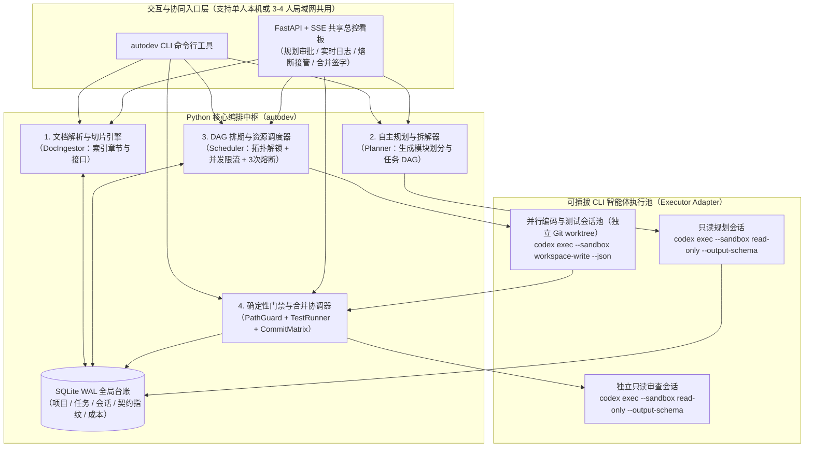

# 多智能体自主协同研发平台（AutoDev Hub）顶层设计与实施规范

> **文档用途**：本文档是直接交付给本地 [OpenAI Codex CLI](https://developers.openai.com/codex/non-interactive-mode)（已接入 [DeepSeek API](https://api-docs.deepseek.com/quick_start/agent_integrations/codex/)）执行的**系统顶层设计与工程实现规范**。请将本文件保存为新仓库根目录下的 `DESIGN_SPEC.md`，由 Codex 按文末里程碑顺序用 Python 从零构建出完整的“文档输入 → 自动规划 → 任务拆解与排期 → 多分支隔离迭代开发 → 独立审查与集成合并”平台。

## 1. 系统定位与核心设计边界

### 1.1 系统要解决的核心问题
构建一套基于 **Python 3.11+** 的轻量、成体系的多智能体软件研发编排平台（项目包名定为 `autodev`）。平台本身不包含任何特定业务代码；当研发团队（1 至 4 人）将目标系统的**架构文档、接口协议草案或技术参考资料**放入输入目录后，平台能够驱动底层的 CLI 编码智能体（默认使用本机已配置的 `codex`，架构上预留接口兼容 [OpenCode](https://github.com/anomalyco/opencode) 等同类 CLI 执行器）自动完成以下全生命周期闭环：

1. **资料解析与按需切片**：读取长篇架构说明、PDF/DOCX/Markdown 文档及已有接口文件，建立章节索引与摘要切片，避免将几十页资料一次性塞爆单次模型上下文。
2. **自主规划、拆解与 DAG 排期**：由只读规划会话识别系统模块边界、定义共享接口契约任务，并将研发工作拆解为带前置依赖关系的有向无环图（DAG）任务单与迭代批次。
3. **契约先行与目录隔离并行开发**：强制先执行并锁定公共接口契约任务（支持接入 [Buf](https://github.com/bufbuild/buf) 或自定义编译门禁），随后自动创建互不干扰的 `Git worktree` 分支，调度多个编码会话并行开展测试驱动开发（TDD）。
4. **确定性门禁、只读审查与自动迭代修复**：不依赖智能体口头宣称“已完成”，由 Python 调度器独立执行**修改路径白名单校验**、**自动化测试命令校验**与**独立只读会话代码审查**；未通过时利用会话恢复机制（`codex exec resume`）原路打回迭代修复，连续失败超限（默认 3 次）自动熔断并通知人工介入。
5. **跨模块集成合并与 3 至 4 人协同看板**：提供命令行入口（`autodev` CLI）与零前端构建依赖的 **FastAPI + SSE 实时共享看板**，既可在单台 **Mac M4（16 GB 内存）** 上单机轻量运行，也可一键容器化部署到内网**银河麒麟共享主机**（`x86_64` 或 `aarch64`）供 3 至 4 名开发人员通过浏览器协同审阅规划、接管熔断分支与审批合并。

### 1.2 全局技术栈约束（面向 Codex 实现者）
为保证系统在 macOS（Apple Silicon 16 GB）与银河麒麟 Linux 容器中均能极速启动、零运维负担，Codex 在编写本平台时必须严格遵守以下技术选型：

| 层次 | 选定技术栈 | 选型理由与硬约束 |
| :--- | :--- | :--- |
| 开发语言与运行环境 | Python 3.11+（标准 `pyproject.toml` 管理） | 开发效率高，异步子进程调度与文本/Schema 处理生态成熟 |
| Web 服务与多人看板 | `FastAPI` + `Uvicorn` + 原生 HTML/CSS/JS（SSE 推送） | 严禁引入重量级 Node/Webpack 前端编译链；单进程提供 REST API 与浏览器实时看板 |
| 状态存储与依赖台账 | `SQLite 3`（开启 `WAL` 并发读写模式） | 零外部数据库进程开销，单文件持久化全部项目、DAG 任务、会话 ID、重试计数与成本记录 |
| 结构化数据校验 | `Pydantic v2` + JSON Schema | 生成供 `codex exec --output-schema` 使用的严格 JSON Schema，杜绝模型输出格式漂移 |
| 文档解析层 | 原生 Markdown/Proto 解析 + 可选 `pypdf` / `python-docx` | 将长文档切分为带唯一 `slice_id` 的结构化知识块，按任务精准投喂 |
| 智能体进程驱动 | `asyncio.create_subprocess_exec` 封装 CLI 执行器 | 默认实现 `CodexCliAdapter`（调用本机 `codex exec`），预留 `OpenCodeCliAdapter` |
| 代码隔离与版本控制 | 原生 `git` 与 `git worktree` 子进程封装 | 每个开发任务独占一个分支与独立工作树目录，物理隔离并发读写冲突 |
| CLI 交互入口 | `Typer`（或 `argparse`）+ `Rich` 终端表格输出 | 方便本地快速操作与服务器端无头诊断 |

---

## 2. 总体架构与五阶段自治闭环



### 2.1 五阶段自治运行流转逻辑
1. **阶段一（资料摄入 `INGEST`）**：用户将目标项目的架构设计文档、Schema 说明或参考规范放入目标工程工作区的 `inputs/` 目录。`DocIngestor` 扫描所有文件，按标题层级或协议包切分为颗粒度适中的片段（单块控制在 3,000 至 6,000 字符），生成一份精简的全局目录索引 `doc_catalog.json`。
2. **阶段二（自主规划、拆解与排期 `PLAN & SCHEDULE`）**：`Planner` 将 `doc_catalog.json` 与核心架构摘要输入只读 `codex exec` 会话，分两步生成结构化蓝图：
   - 先确定**模块拓扑与目录规范**（例如 `contracts/`、`backend/`、`api/`、`sdk/`、`e2e/`）以及各模块的自动化验证命令模板；
   - 再拆解出完整的**里程碑（Milestones）与原子任务有向无环图（Task DAG）**，自动计算拓扑批次（Topological Batches / Waves），确保公共契约与基础数据结构排在第 0 批，业务后端、API 与 SDK 按真实依赖排在后续批次。
   - 若配置为人工确认模式（`require_plan_approval = true`），系统挂起等待团队负责人在看板或 CLI 一键批准排期（支持人工微调依赖或优先级）；若配置为全自动模式则直接进入开发。
3. **阶段三（单任务 TDD 迭代循环 `ITERATIVE_DEV`）**：`Scheduler` 轮询 SQLite 台账中所有前置依赖已 `MERGED`（或同里程碑前置已 `APPROVED`）且状态为 `READY` 的任务，按宿主机并发上限（如 Mac M4 16GB 默认 `max_concurrency = 2`，麒麟服务器可调至 `6~8`）创建独立 `git worktree` 并启动编码会话：
   - **投喂最小完备上下文**：组装任务专属 Prompt，仅包含任务目标、验收标准、授权修改目录白名单、锁定的上游契约文件内容以及关联的 1 至 3 个文档切片（而非整本百页文档）。
   - **独立门禁拦截（核心防幻觉机制）**：编码会话返回后，Python 调度器依次执行三道硬检查：① **目录越界检查**（对比 `git diff` 修改列表是否完全落在 `allowed_paths` 内，越界文件自动回滚并报错）；② **命令验证检查**（在 `worktree` 内执行任务绑定的编译、Lint 与单元测试命令，校验退出码是否为 `0`）；③ **独立只读审查**（拉起全新的只读会话审查 `git diff` 是否真正覆盖验收条件、有无并发/资源泄漏隐患）。
   - **同会话上下文恢复返工**：任一检查未通过时，若当前任务失败次数小于 `max_retries`（默认 3），调度器提取报错堆栈或审查缺陷，调用 `codex exec resume <session_id>` 在原工作区继续修复；若达到 3 次上限，状态置为 `FUSED`（熔断挂起），保留现场等待开发人员在看板点拨或手动修改后恢复。
4. **阶段四（契约变更升级处理 `CONTRACT_ESCALATION`）**：下游编码会话无权修改 `contracts/` 目录。当会话判断现有接口契约缺失必要字段时，按约定输出结构化阻塞信号 `NEED_CONTRACT_UPDATE`；调度器捕获后暂停受影响的下游分支，唤醒规划会话生成契约增量提案并交人工确认升版。
5. **阶段五（批次集成验证与指纹合并 `INTEGRATE & MERGE`）**：当一个里程碑批次内的任务全部变为 `APPROVED`，`MergeCoordinator` 创建临时集成工作树按拓扑顺序试合并各任务分支，运行跨模块集成命令，记录各分支精确 Commit SHA 指纹（`commit_matrix`），生成里程碑交付摘要报告，合并回主干分支并自动解锁下一里程碑批次。

---

## 3. 目标仓库目录结构（Codex 需创建的工程骨架）

Codex 需在当前仓库下构建如下清晰、模块化的 Python 工程结构（不得使用单文件巨石脚本）：

```text
autodev-hub/
├── pyproject.toml                     # 项目依赖、入口命令 `autodev = "autodev.cli:app"` 及 pytest 配置
├── README.md                          # 安装、DeepSeek/Codex 配置检查、Mac 单机与麒麟共享机启动指南
├── AGENTS.md                          # 平台自身的模块职责与编码规范说明
├── Dockerfile                         # 适配 linux/amd64 与 linux/arm64（银河麒麟容器化部署）
├── docker-compose.yml                 # 一键启动 autodev-hub 共享服务（挂载宿主 git 与 codex 配置）
├── configs/
│   └── default_settings.toml          # 默认并发数、重试熔断阈值、宿主机环境变量透传（如 CARGO_TARGET_DIR）
├── autodev/
│   ├── __init__.py
│   ├── config.py                      # 配置加载与运行环境自检（检查 git, codex 版本与 API 连通性）
│   ├── db.py                          # SQLite WAL 连接池、建表迁移与事务封装
│   ├── models.py                      # Pydantic 核心领域模型与枚举状态定义
│   ├── schemas/                       # 供 `codex exec --output-schema` 强制约束输出的 JSON Schema 文件
│   │   ├── project_plan.schema.json   # 规划拆解与 DAG 排期输出契约
│   │   ├── worker_report.schema.json  # 编码会话阶段性结构化汇报契约（含契约变更申请信号）
│   │   └── review_verdict.schema.json # 独立只读审查结论契约
│   ├── ingest/
│   │   ├── parser.py                  # 支持 .md / .txt / .proto / .yaml / .json / .pdf / .docx 解析
│   │   └── slicer.py                  # 按章节标题与语义块切分文档，生成 doc_catalog.json 与切片存储
│   ├── harnesses/
│   │   ├── base.py                    # 抽象执行器接口 `CodingHarness`（run_readonly, run_workspace, resume）
│   │   ├── codex_cli.py               # 基于官方 `codex exec` / `--json` / `--output-schema` / `resume` 的核心实现
│   │   └── opencode_cli.py            # 预留可插拔同类执行器适配器（OpenCode CLI 封装）
│   ├── gitops/
│   │   ├── repo_manager.py            # 目标研发仓库初始化、基准分支管理与AGENTS.md模板注入
│   │   ├── worktree.py                # 独立 `git worktree` 创建、清理、越界文件检测与回滚
│   │   └── merger.py                  # 按 DAG 拓扑序预合并测试、Commit SHA 矩阵校验与正式合入
│   ├── engine/
│   │   ├── planner.py                 # 驱动只读会话读取文档目录并生成分阶段 DAG 研发计划
│   │   ├── prompt_builder.py          # 为 Planner / Coder / Tester / Reviewer 组装精准上下文与 TDD 纪律
│   │   ├── verifier.py                # 独立运行白名单检查与测试命令（带超时控制与日志截断）
│   │   ├── reviewer.py                # 驱动独立只读会话对 diff 与验收条件逐条核验
│   │   └── scheduler.py               # 异步主事件循环：DAG 依赖解锁、并发槽位控制、重试恢复与熔断升级
│   ├── server/
│   │   ├── app.py                     # FastAPI 实例、REST 路由（项目/规划/任务/接管/合并）与 SSE 事件流
│   │   └── static/
│   │       ├── index.html             # 3-4 人共享总控单页看板（原生 HTML + CSS + Vanilla JS，零编译依赖）
│   │       ├── styles.css
│   │       └── app.js
│   └── cli.py                         # 命令行工具：`autodev init | ingest | plan | run | serve | status | takeover`
└── tests/                             # 平台自身完备单元测试与基于 Mock Harness 的端到端闭环测试
    ├── test_dag_scheduler.py
    ├── test_doc_slicer.py
    ├── test_codex_adapter.py
    ├── test_worktree_path_guard.py
    └── test_api_server.py
```

---

## 4. 核心数据模型与 SQLite 台账设计（`autodev/db.py` & `models.py`）

SQLite 数据库存放在工作区的 `.autodev/state.db`，初始化时必须执行 `PRAGMA journal_mode=WAL;` 与 `PRAGMA foreign_keys=ON;`。核心表结构定义如下：

### 4.1 数据表清单
1. **`projects`（研发项目表）**
   - `project_id` (`TEXT PRIMARY KEY`)、2 `name` (`TEXT`)、3 `target_repo_path` (`TEXT`)、4 `inputs_dir` (`TEXT`)、5 `base_branch` (`TEXT DEFAULT 'main'`)、6 `status` (`TEXT`: `CREATED | INGESTED | PLANNED | RUNNING | PAUSED | COMPLETED`)、7 `max_concurrency` (`INTEGER DEFAULT 2`)、8 `require_plan_approval` (`INTEGER DEFAULT 1`)、9 `require_merge_approval` (`INTEGER DEFAULT 1`)、10 `contract_hash` (`TEXT`)、11 `created_at` (`TEXT`)。
2. **`doc_slices`（输入文档切片索引表）**
   - `slice_id` (`TEXT PRIMARY KEY`，如 `DOC01-S03`)、2 `project_id` (`TEXT`)、3 `source_file` (`TEXT`)、4 `heading_path` (`TEXT`)、5 `summary` (`TEXT`)、6 `content` (`TEXT`)、7 `char_count` (`INTEGER`)。
3. **`milestones`（排期里程碑批次表）**
   - `milestone_id` (`TEXT PRIMARY KEY`，如 `M1-contracts-core`)、2 `project_id` (`TEXT`)、3 `seq_order` (`INTEGER`)、4 `title` (`TEXT`)、5 `goal` (`TEXT`)、6 `integration_cmd` (`TEXT`)、7 `status` (`TEXT`: `PENDING | ACTIVE | INTEGRATING | AWAITING_MERGE | MERGED`)、8 `verified_commit_matrix_json` (`TEXT`)。
4. **`tasks`（原子研发任务与 DAG 节点表）**
   - `task_id` (`TEXT PRIMARY KEY`，如 `T-001`)、2 `project_id` (`TEXT`)、3 `milestone_id` (`TEXT`)、4 `module_group` (`TEXT`，如 `contract | backend | api | sdk | qa`)、5 `role_type` (`TEXT`: `contract | coder | tester`)、6 `title` (`TEXT`)、7 `description` (`TEXT`)、8 `acceptance_criteria_json` (`TEXT`)、9 `depends_on_json` (`TEXT`，前置 `task_id` 数组)、10 `doc_slice_ids_json` (`TEXT`，关联文档切片 ID 数组)、11 `allowed_paths_json` (`TEXT`，允许写入的相对目录前缀数组)、12 `verify_cmds_json` (`TEXT`，必跑验证命令数组)、13 `priority` (`INTEGER DEFAULT 100`)、14 `status` (`TEXT`，见下节状态机)、15 `retry_count` (`INTEGER DEFAULT 0`)、16 `max_retries` (`INTEGER DEFAULT 3`)、17 `worktree_path` (`TEXT`)、18 `branch_name` (`TEXT`)、19 `last_session_id` (`TEXT`，保存 Codex `thread_id` 用于断点续跑)、20 `candidate_commit_sha` (`TEXT`)、21 `bound_contract_hash` (`TEXT`)、22 `failure_reason` (`TEXT`)、23 `owner_member` (`TEXT`，认领或接管的团队成员姓名)。
5. **`task_runs`（每轮智能体调用与审查审计表）**
   - `run_id` (`TEXT PRIMARY KEY`)、2 `task_id` (`TEXT`)、3 `attempt_no` (`INTEGER`)、4 `stage` (`TEXT`: `CODE | VERIFY | REVIEW`)、5 `harness_name` (`TEXT`)、6 `session_id` (`TEXT`)、7 `exit_code` (`INTEGER`)、8 `input_tokens` (`INTEGER DEFAULT 0`)、9 `cached_tokens` (`INTEGER DEFAULT 0`)、10 `output_tokens` (`INTEGER DEFAULT 0`)、11 `verdict` (`TEXT`)、12 `summary_log` (`TEXT`)、13 `started_at` (`TEXT`)、14 `finished_at` (`TEXT`)。
6. **`audit_events`（多人协同操作与系统事件流表，驱动 SSE 实时推送）**
   - `event_id` (`INTEGER PRIMARY KEY AUTOINCREMENT`)、2 `project_id` (`TEXT`)、3 `actor` (`TEXT`，如 `system` 或具体开发人员姓名)、4 `event_type` (`TEXT`)、5 `payload_json` (`TEXT`)、6 `created_at` (`TEXT`)。

### 4.2 任务状态机与严格流转条件
每个 `Task` 节点遵循如下确定性状态迁移：
- `BLOCKED`：初始态（存在未完成的前置依赖任务）。当 `depends_on_json` 中所有前置任务达到 `APPROVED`（同一里程碑内需要读取前置产物时自动合并前置分支基线）或 `MERGED` 时，自动转为 `READY`。
- `READY`：前置条件已满足，进入可调度队列，按 `priority` 与拓扑层级等待空闲执行槽位。
- `IN_PROGRESS`：已分配独立 `git worktree` 并正在执行编码会话。
- `VERIFYING`：编码会话结束，正在运行路径白名单检查与本地验证命令（`verify_cmds_json`）。
- `REVIEWING`：本地验证命令全部返回 `0`，正在由独立只读会话进行契约与代码质量复核。
- `APPROVED`：只读审查返回 `PASS`，已在任务分支生成干净的候选提交并记录 `candidate_commit_sha`。
- `FUSED`：连续返工达到 `max_retries`（默认 3 次），或编码会话主动发出 `NEED_CONTRACT_UPDATE` / `BLOCKED_BY_SPEC` 升级请求。此状态下自动释放并发槽位但完整保留 `worktree` 现场，等待人工在看板输入指导意见（`steer_note`）后重置回 `READY` 续跑。
- `MERGED`：随所属里程碑通过跨模块集成校验并正式合入目标基准分支。

---

## 5. Codex CLI 执行器封装规范（`autodev/harnesses/codex_cli.py`）

依据 [OpenAI Codex 非交互模式官方文档](https://developers.openai.com/codex/non-interactive-mode) 与 [DeepSeek Codex 集成规范](https://api-docs.deepseek.com/quick_start/agent_integrations/codex/)，平台默认复用宿主机 `~/.codex/config.toml` 中已配置好的模型供应商（如 `[model_providers.deepseek]`），同时支持通过配置文件按角色覆盖 `--profile` 或 `-m <model>`。**严禁使用已废弃的 `--full-auto` 参数**，必须使用显式 `--sandbox` 策略。

### 5.1 三类标准调用原语

1. **结构化只读调用（用于 `Planner` 拆解排期与 `Reviewer` 代码审查）**
   - 通过标准输入管道（`codex exec -`）传入完整提示词，启用内核级只读沙箱 `--sandbox read-only`，并通过 `--output-schema` 强制输出符合 JSON Schema 的结构化文件：
   ```bash
   codex exec - \
     --sandbox read-only \
     --output-schema <schema_file_path> \
     -o <output_json_path>
   ```
   - Python 端读取 `<output_json_path>` 并用对应 `Pydantic` 模型二次校验。注意：针对 DeepSeek API 部分模型对复杂嵌套 JSON Schema 的兼容差异，`schemas/*.schema.json` 必须保持扁平清晰（所有对象显式声明 `"additionalProperties": false` 与完整的 `"required"` 列表），并在解析器中保留一层从响应文本提取 JSON 块并自动纠错重试的容错兜底。

2. **隔离工作区首次读写调用（用于 `Coder` 与 `Tester` 新任务启动）**
   - 在目标任务专属的 `worktree_path` 目录下启动子进程，启用 `--sandbox workspace-write` 与 `--json` 事件流输出，同时注入防爆内存环境变量（例如针对 Mac M4 16GB 自动注入 `CARGO_TARGET_DIR`、`CARGO_BUILD_JOBS=4`、`PIP_CACHE_DIR`）：
   ```bash
   codex exec - \
     --sandbox workspace-write \
     --json \
     -o <last_message_file>
   ```
   - Python 异步逐行读取 `stdout` 的 JSONL 事件流：
     - 从 `{"type": "thread.started", "thread_id": "..."}` 提取 `thread_id` 存入任务的 `last_session_id` 字段；
     - 将 `item.started` / `item.completed` 中的命令执行与文件修改摘要实时写入日志并推送到前端 SSE 看板；
     - 从 `{"type": "turn.completed", "usage": {...}}` 提取 `input_tokens`、`cached_input_tokens` 与 `output_tokens` 记入 `task_runs` 台账。

3. **断点返工恢复调用（用于验证失败、审查打回或人工点拨后的迭代修复）**
   - 当第 1、2 轮验证或审查未通过，或开发人员在看板填写指导意见（`steer_note`）点击继续时，在原 `worktree_path` 下调用 `resume` 子命令接着原会话上下文修复（充分利用 DeepSeek 前缀缓存节省 Token 并保留上下文记忆）：
   ```bash
   codex exec resume <last_session_id> - \
     --sandbox workspace-write \
     --json \
     -o <last_message_file>
   ```
   - 若 `resume` 因会话过期失败，自动优雅降级为携带当前 `git status`、`git diff` 与失败日志的新一轮 `codex exec -` 调用。

### 5.2 可插拔执行器抽象接口（`autodev/harnesses/base.py`）
定义统一的异步抽象基类 `CodingHarness`（包含 `run_structured_readonly()`、`run_workspace_task()`、`resume_workspace_task()`、`health_check()` 四个方法）。默认注册 `CodexCliHarness`，并实现结构相同的 `OpenCodeCliHarness`（封装 `opencode run`），通过项目配置 `harness = "codex"` 或 `"opencode"` 即可无缝切换，后续接入新工具无需改动调度内核。

---

## 6. 核心业务引擎细化设计

### 6.1 文档摄入与智能规划拆解器（`ingest/` + `engine/planner.py`）
为了让你直接把架构文档、接口梳理文档丢进去就能自动跑起来，`Planner` 按**两阶段递进拆解**设计，防止一次性规划颗粒度过粗或遗漏接口细节：

1. **阶段 A（架构骨架与契约识别）**：读取全部 `doc_slices` 的标题路径与摘要，识别：
   - 目标系统由哪几个子工程/目录组成（如 `contracts/`、`backend/`、`api/`、`sdk/`、`tests-e2e/`），目标技术栈语言是什么，以及全局构建与测试环境约定（自动生成写入目标仓库根目录的 [AGENTS.md](https://developers.openai.com/codex/agent-configuration/agents-md)）；
   - 有哪些跨模块共享的数据模型与通信接口需要先在契约目录（如 `.proto`、OpenAPI YAML 或语言无关 Schema）中冻结。
2. **阶段 B（里程碑排期与 DAG 任务生成）**：按里程碑顺序生成完整任务图，并由 Python 代码在入库前执行 **DAG 静态合法性校验**：
   - 使用 Kahn 拓扑排序算法检测是否存在循环依赖（若存在环，自动把环路报错打回规划会话重排）；
   - 校验每个任务的 `allowed_paths` 非空，且非 `contract` 角色的任务其 `allowed_paths` 不包含契约保护目录；
   - 校验每个任务至少包含一条非空的自动化验证命令 `verify_cmds`（禁止出现无法验证的纯口头任务）。

### 6.2 确定性工程门禁（`engine/verifier.py` & `engine/reviewer.py`）
每当编码会话完成一轮修改，调度器自动串联以下四步确定性检查：

1. **空改动与未跟踪垃圾文件清理**：检查 `worktree` 是否有实质代码与测试变更；拦截把 `.env`、密钥或超大二进制编译产物提交进 Git 的行为。
2. **目录白名单硬门禁（`PathGuard`）**：运行 `git status --porcelain` 获取新增/修改/删除的全部文件路径，逐一匹配当前任务的 `allowed_paths`。一旦发现越界修改（例如后端任务擅自改了 `contracts/` 或 `sdk/` 下的文件），立即用 `git checkout -- <file>` 恢复越界文件，并将越界违规信息作为失败原因打回会话。
3. **测试与契约门禁执行（`TestRunner`）**：在子进程中按顺序执行任务的 `verify_cmds`（支持设置超时如 `300s`，自动截取末尾 150 行核心错误输出，防止数万行编译日志撑爆下一轮修复上下文）。
4. **独立只读审查（`IndependentReviewer`）**：启动一个全新的 `--sandbox read-only` 会话，输入该任务的原始规格切片、`acceptance_criteria`、`verify_cmds` 运行输出摘要及完整 `git diff`，强制按 `review_verdict.schema.json` 输出：
   - `verdict`: `"PASS" | "NEEDS_FIX" | "ESCALATE_CONTRACT"`
   - `blocking_issues`: 具体到文件与行号的必改缺陷列表（重点检查：是否先补了边界与异常单测、状态并发安全、错误码是否与契约一致、有无未实现的占位桩代码）。

### 6.3 上游依赖分支合成与跨模块集成（`gitops/merger.py`）
在多分支并行开发时，若任务 `T-003`（API 实现）依赖前置任务 `T-001`（契约定义）和 `T-002`（后端存储接口）：
- 当 `T-001` 与 `T-002` 状态变为 `APPROVED` 时，`WorktreeManager` 在为 `T-003` 创建工作树时，自动基于 `main` 分支按拓扑序合并 `T-001` 与 `T-002` 的候选提交作为 `T-003` 的起点基线，确保下游任务立刻能引用到上游刚写好的最新接口与代码！
- 当整个里程碑的所有任务均达到 `APPROVED` 时，自动在 `.autodev/integration/<milestone_id>` 工作树中合拢全部候选分支，运行里程碑级联调命令（`milestone.integration_cmd`），通过后计算 `commit_matrix` 指纹并生成 Markdown 交付报告。

---

## 7. 支持 3 至 4 人共用的轻量看板与双机部署设计

### 7.1 内置共享 Web 控制台（`autodev/server/`）
由 FastAPI 直接托管静态页面并通过 `Server-Sent Events (SSE)`（`/api/projects/{id}/events`）实时刷新界面，供团队 3 至 4 人在各自浏览器打开查看和操作，包含四个核心视图：
1. **资料导入与规划排期视图**：上传或查看 `inputs/` 文档切片，一键触发自动规划，以清晰的阶段卡片与依赖列表展示拆解出的里程碑与任务，提供“批准排期并启动”、“调整任务优先级/依赖”按钮。
2. **多组并行实时执行视图**：按模块组（如契约、后端、API、SDK、测试）分列展示各任务状态（`BLOCKED / READY / IN_PROGRESS / REVIEWING / APPROVED / FUSED`）、实时活动摘要与累计 Token 消耗。
3. **熔断接管与契约变更工作台**：高亮展示所有处于 `FUSED` 状态的任务，展示最近 3 轮失败日志与审查意见；团队成员填上自己的名字即可输入指导提示词（点击“点拨并继续运行”），或查看该任务在服务器上的 `worktree` 路径直接手工修好后点击“重新验证”。
4. **里程碑报告与按序合并审批台**：展示联调输出、各分支 Commit SHA 指纹核对状态，点击“批准合入主干”即可完成归档并自动开启下一里程碑。

### 7.2 单机（Mac M4 16GB）与银河麒麟共享主机（3-4 人）无缝切换
平台通过同一套代码支持两种部署形态：
- **形态 A（你在 Mac M4 16GB 本机单人运行）**：直接在终端执行 `autodev serve --port 8787`，配置默认 `max_concurrency = 2` 并透传共享编译缓存目录环境变量，系统本身内存占用低于 100 MB。
- **形态 B（部署到空闲银河麒麟主机供 3-4 人联机共用）**：只要麒麟主机 `uname -m` 为 `x86_64` 或 `aarch64`，通过仓库自带的 `docker-compose.yml`（基于 `python:3.12-bookworm` 官方多架构镜像，内置 `git`、Node/Codex CLI 及常用构建工具，彻底绕开麒麟宿主机旧版 `glibc 2.28` 限制，挂载卷默认带 `:Z` 兼容 SELinux）一键启动；团队 3 至 4 人在各自电脑浏览器访问 `http://<麒麟内网IP>:8787` 即可共享同一套任务台账、DeepSeek API 配额与联调环境。

---

## 8. 交付给 Codex 的分阶段自举实施路线（M1 → M5）

为了保证代码质量，Codex 在实现本平台时**严禁留下未实现的 `TODO`、`pass` 空函数或假数据桩**，必须按以下 5 个里程碑依序编码，且每完成一个里程碑必须运行 `pytest` 全部通过后再进入下一里程碑：

1. **M1 — 基础配置、Pydantic 领域模型、JSON Schemas 与 SQLite WAL 台账层**
   - 创建 `pyproject.toml`、`autodev/config.py`、`autodev/models.py`、`autodev/db.py` 以及 `autodev/schemas/*.schema.json`；
   - 实现完整的 DAG 拓扑排序、环路检测与前置依赖自动解锁状态机；
   - 编写并通过 `tests/test_dag_scheduler.py`（覆盖依赖阻塞、正常解锁、环路报错、3 次失败转 `FUSED` 状态流转）。
2. **M2 — 多格式文档摄入切片器与可插拔 CLI 执行器适配层**
   - 实现 `autodev/ingest/parser.py` 与 `slicer.py`（支持 Markdown 标题树切分、Proto/代码结构提取，以及可选 PDF/DOCX 读取，输出 `doc_catalog.json`）；
   - 实现 `autodev/harnesses/base.py`、`codex_cli.py`（完整支持 `codex exec -`、`--sandbox read-only|workspace-write`、`--output-schema`、`--json` 事件解析及 `codex exec resume`）与 `opencode_cli.py`；
   - 编写并通过 `tests/test_doc_slicer.py` 与 `tests/test_codex_adapter.py`（使用模拟子进程流验证 JSONL 解析、Token 统计与异常超时回收）。
3. **M3 — 自主规划器、Git Worktree 隔离管理与 TDD 自动迭代内核**
   - 实现 `autodev/gitops/`（仓库初始化、`worktree` 增删、上游 `APPROVED` 分支基线合成、`PathGuard` 越界修改拦截与自动回滚、`CommitMatrix` 指纹核验）；
   - 实现 `autodev/engine/planner.py`、`prompt_builder.py`、`verifier.py`、`reviewer.py` 与异步主调度循环 `scheduler.py`；
   - 编写并通过 `tests/test_worktree_path_guard.py`（在临时真实 Git 仓库中验证并发 `worktree` 创建、越界文件自动拦截还原、返工续跑与按序合并闭环）。
4. **M4 — 完整命令行工具（`autodev` CLI）与端到端模拟流水线测试**
   - 实现 `autodev/cli.py`，提供 `init`、`doctor`（检查本机 `git` 与 `codex` 可用性）、`ingest`、`plan`、`approve-plan`、`run`、`status`、`takeover`、`merge`、`serve` 子命令；
   - 使用 Mock Harness 跑通“输入一份双模块微型架构文档 → 自动拆解规划 → 并行开发 → 模拟一次单测失败后自动重试修复 → 只读审查通过 → 集成合并生成报告”的全自动集成测试。
5. **M5 — 3 至 4 人共享实时看板（FastAPI + SSE）与麒麟容器化配置**
   - 实现 `autodev/server/app.py` 与 `static/` 下的简洁工程风实时控制台（无外部前端构建依赖，支持查看文档切片、审批 DAG 排期、实时查看各组会话进度与 Token 用量、提交熔断接管指令、审批里程碑合并）；
   - 编写 `Dockerfile`、`docker-compose.yml` 与详尽的 `README.md`；运行全套 `pytest` 确保 100% 用例通过。
